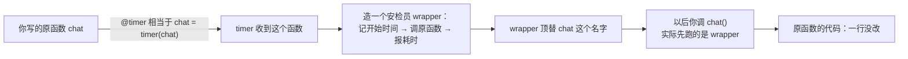
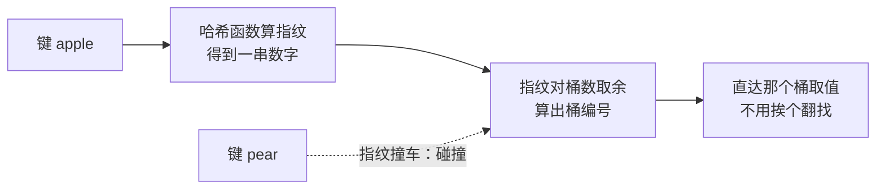

# 加餐课　AI 工程里的 Python

前面九课讲的都是原理，几乎没写过代码。这节加餐课补上另一头：动手做 AI 项目时，Python 工程师常用的几项技能。**装饰器**重点讲透；异步和生成器第 1 章练过，这里只重申结论；最后附一份"数据结构直觉"，不求会写，只求认得。

本课配了一个演示 `decorator_demo.py`（纯标准库），读到这里可以先把 `python decorator_demo.py` 跑一遍，对着输出看正文。

---

## 一、装饰器：不改动函数，在外面包一层新函数

### 解决什么问题

假设你写了个函数，负责向大模型发一次提问：

```python
def ask_llm(prompt):
    ...  # 真正干活的代码
```

用一段时间后会有新需求：每次调用都有成本，想记录耗时；同一个问题被反复提出，想自动缓存；网络偶尔不稳定，想失败后自动重试。这些需求有一个共同点：都与提问本身无关，都是附加在函数调用前后的额外动作。

最直接的办法是把这些逻辑写进函数体。函数少时还能接受；当这样的函数有十个，每个都要计时、缓存、重试，同样的代码就要重复十份，改动时也得改十处。

装饰器就是为这类场景设计的：把额外动作写在外层函数里，原函数一行不改。函数还是那个函数，只是调用前后多了一段固定流程。

### 前置知识：函数在 Python 里是对象

要包装函数，先接受一个设定：Python 里函数和数字、字符串一样，是对象。它能赋值给变量、能作为参数传给别的函数、也能被别的函数作为返回值送回来。第 1 章你把函数当作一段"技能"来用，现在把它当作一个"值"来看：既然是值，就能被另一个函数接收、处理后再交出去。

### 手写一个计时装饰器

```python
import time
import functools

def timer(func):                      # 收到要包装的函数
    @functools.wraps(func)
    def wrapper(*args, **kwargs):     # 门口新加的"安检员"
        start = time.perf_counter()   # 进门先记时间
        result = func(*args, **kwargs)  # 放行：原函数照常干活
        print(f"[timer] {func.__name__} 耗时 {time.perf_counter() - start:.3f}s")
        return result                 # 结果原样交还
    return wrapper                    # 把安检员送回去，顶替原岗位


@timer
def chat(prompt):
    time.sleep(0.2)                   # 假装等模型回话
    return "好的，收到：" + prompt
```

逐行说明：

- `timer(func)` 收到的 `func`，就是要包装的那个函数；
- `wrapper` 是新定义的内层函数：记开始时间、调用原函数、打印耗时，最后把结果原样返回；
- `*args, **kwargs` 表示接收任意数量与形式的参数，这样同一个 `timer` 才能套在任意函数上；
- 最后 `return wrapper`：把新函数交出去，顶替原函数的位置。

### @ 符号只是一句赋值的简写

`@timer` 没有任何特殊机制，它就是下面这句赋值的简写：

```python
chat = timer(chat)   # 把 chat 装进盒子，再把"chat"这个标签贴到盒子上
```

这行执行之后，调用 `chat()` 时实际先运行的是 wrapper。原函数代码一行没改，但每次调用前后都多了固定动作。整个过程如下：



### 名字和文档会丢失：functools.wraps

有一个细节需要注意：装饰之后，`chat` 这个名字指向的已经是 wrapper，`chat.__name__` 查出来是 `"wrapper"`，编辑器里的函数说明文档也没了。有些资料说装饰器"保持函数签名不变"，准确的说法是：调用方式不变，但名字和文档默认会丢失。加上一行 `@functools.wraps(func)`，可以把原函数的身份信息抄回 wrapper 身上。演示脚本的第二段专门对照了加与不加的差别，运行后看输出即可。

### 带参数的装饰器：三层嵌套

你会见到 `@retry(times=3)` 这种写法。它比普通装饰器再多一层：最外层先收配置（重试几次），收完配置才轮到收函数，真正干活的 wrapper 在最里层。从外往里数即可，本课不深入：

```python
def retry(times):                   # 第一层：先收配置
    def decorator(func):            # 第二层：再收函数
        def wrapper(*args, **kwargs):  # 第三层：真正干活
            ...  # 失败就重试，最多 times 次
        return wrapper
    return decorator
```

### AI 工程中的常见用途

- 计时：给每个模型调用套上本课的 `timer`，哪个接口慢，输出里一眼可见；
- 缓存：标准库自带 `@functools.cache`，同一个问题第二次调用时，不再花钱花时间等模型；
- 重试：网络抖动很常见，`@retry` 类装饰器把"失败了再来一次"与业务代码分开；
- 注册工具：第 3 章讲 Function Calling、第 6 章讲 Agent 挑工具时，你会看到框架用 `@tool` 这类装饰器把函数登记进一张工具表。模型提出要用某个工具时，程序按名字在表里查到对应函数。名字前一个 `@`，背后就是本节这套机制。

训练框架里的 `@torch.no_grad()` 你以后也会见到，它跟上面手写的没有本质区别。

---

## 二、异步复习：区分等待与计算

第 1 章已经练过 async/await，这里只重申结论：瓶颈在"等"，才用异步；瓶颈在"算"，不要指望它。

调大模型接口、下载网页、读写文件，时间都花在等待对方返回上，CPU 闲着。异步让程序在 A 等网的时候切去执行 B 的任务，一批等待型任务的总耗时从"排队累加"变成"只等最慢那个"。要同时处理几十个用户的对话机器人，基本就靠它。

反过来，矩阵运算、模型训练这类任务，CPU 一刻不停地满负荷运行，没有等待间隙可以利用，强行切换反而多付切换成本。判断标准只有一条：你的任务大部分时间在等（网络/IO），还是在算。

---

## 三、生成器复习：按需逐个产出

同样只重申结论：函数里出现 `yield`，它就成了**生成器**。每要一个值，执行到下一个 `yield` 就暂停，下次从暂停处继续，不必把所有结果先攒进内存。

两种基本用法：用 `next()` 一个个取，也可以直接放进 `for` 循环。逐行读大文件、把长文档切成小块交给模型，都适合用它。第 4 课讲训练时"数据一批一批喂进去"，背后做攒批的就是它。2026 年的今天它依然是标准做法，没有过时一说。

---

## 四、附录：数据结构直觉（知道什么场景背后在用谁）

先说明一条边界：做 AI 应用不需要手写这些结构，Python 早就备好了。这一节目标只有一个：看到某个功能运行得快，大致知道背后是哪种结构在工作。

评价快慢也不用背大 O 表，只看一点：数据量翻倍时，代价怎么变。代价不变、代价也翻倍、代价翻四倍，直觉上分这三档就够用。

### 三种结构，各一句话

- 链表：节点之间用指针按顺序相连。在已知位置插入、摘除节点，只需改动相邻节点的指针，代价很小；但想取第 100 个节点，只能从头逐个遍历。
- 二叉搜索树：每个节点最多两个分支，左边小、右边大。每比较一次就排除一半候选；一百万条数据，二十次左右比较即可锁定目标。
- 堆：不维护整体排序，只保证一件事：永远能最快取出最大（或最小）的那个。优先级队列、"从十万条候选里挑最相似的 5 条"（Top-K），背后是它。

### 哈希表：一步到位的查找（重点）

类比取快递：凭取件码，系统直接算出包裹在哪个柜格，走过去开门就取，不用逐格翻找。**哈希表**存取数据正是这个思路，分三步：

1. 算指纹：哈希函数把任意键（一段文字、一个数字）压成一个数，作为这个键的指纹；
2. 定位置：指纹对桶的数量取余，得到该放进哪个桶。桶就是一排编号固定的储物格；
3. 直达：下次再问"apple 在吗"，同一套算法直接算出桶位，不用挨个比对。



Python 的 `dict` 和 `set` 就架在哈希表上：`dict` 按键取值快、`set` 判断"这个元素见过没有"快，都是因为背后直接算位置，而不是逐个比对。你写 AI 代码时大量用 dict 存配置、用 set 去重，速度上的收益正来自这里。

两点补充：

- **碰撞**：不同键可能算出同一个桶位。工程上有成熟解法：链地址法在一个桶里用链表挂多个元素；开放寻址法则向后寻找下一个空位，CPython 的 dict 实际用这种。你只需记住：哈希的"快"是平均意义上的快，不是数学保证。
- 往远处看一句：第 7、8 章讲向量数据库，核心难题是"从几百万条向量里快速找到最相近的几条"，那里的解法（ANN，近似最近邻检索）跟这里的直觉同源：都不挨个比对，而是利用某种位置规律直接缩小范围。哈希表是这条思路里最简单的版本，后面会见到用树、用图实现的进阶版。

---

## 想一想

先自己回答，能讲给别人听最好。

1. 不看课文，用 `chat = timer(chat)` 这一句，向同学解释 `@timer` 到底做了什么。
2. 如果 wrapper 里忘了写 `return result`，被装饰的函数调用后会返回什么？原来的返回值去哪了？
3. "同时下载 50 个网页"和"把 1 亿个数从小到大排序"，哪个适合上异步？另一个为什么不适合？
4. （动手）照着 `decorator_demo.py` 里的 `timer`，自己写一个 `counter` 装饰器：每被调用一次就打印"第 N 次调用"。写完想想：N 是怎么在多次调用之间被记住的？

---

## 小结

五句话回顾本节：

- 装饰器：不改动原函数，在外面再包一层函数；`@` 只是 `my_func = decorator(my_func)` 的语法糖；自己写包装函数时，记得加 `@functools.wraps` 保住原函数的名字和文档。
- 异步记住一条判断：瓶颈在"等"（网络/IO）就用 async/await，瓶颈在"算"不要指望它。
- 生成器：`yield` 让函数按需逐个产出、省内存，可直接配合 `for` 循环。
- 数据结构不必手写：链表插入快、按序查找慢，二叉搜索树每比较一次排除一半，堆能最快取出最值，哈希表按指纹直接定位。`dict` 和 `set` 的地基就是哈希表，它也是第 7、8 章向量检索"快速找最近"的第一层直觉。
- 再看到 `@` 开头的行，你应该能说出它等价于哪句赋值、实际执行的是哪个函数。

至此本章全部完成：从第 1 课的四词地图出发，经过机器学习、神经网络、训练、Token 与注意力、Transformer，到大模型怎么说话、怎么微调，最后用这节课补上工程手感。下一章开始学 Prompt Engineering，让模型按你的要求完成具体任务。

---

2026 年 10 月
