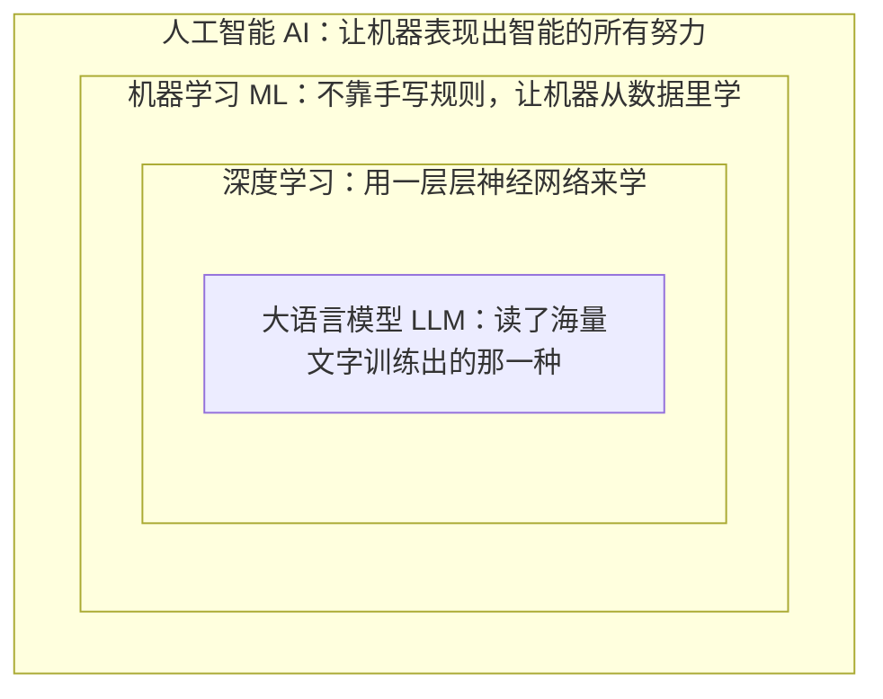
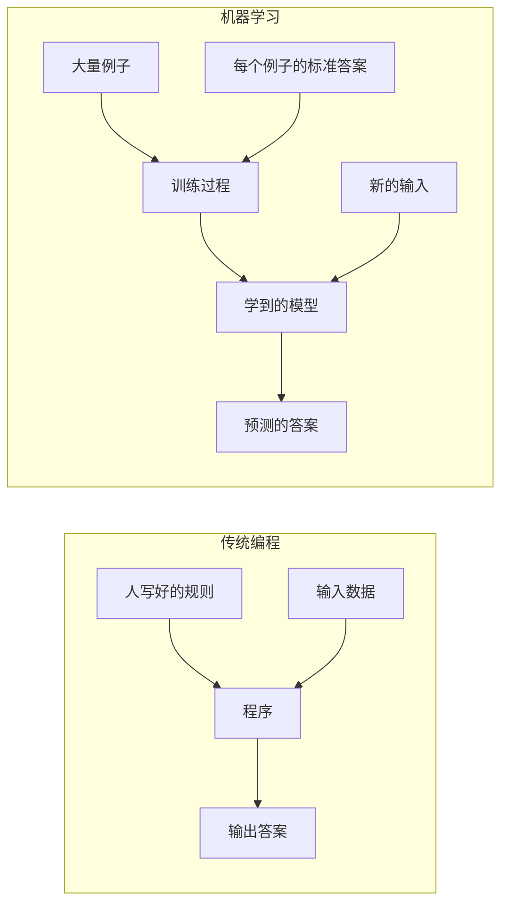

# 第 01 课　AI 到底是什么

这一章讲 AI 的底层基础，共九课。人工智能、机器学习、深度学习、大语言模型，这四个词在这一章会反复出现，第一课先分清谁是谁、谁包含谁，后面的课才不会混淆。

---

## 一、你已经在使用 AI 了

手机里的语音助手、软件推送的内容、拍照时自动框出的人脸、能帮你写邮件的聊天程序，背后都是人工智能。到 2026 年，能听、能看、能写、能对话的程序已经相当普遍：国外有 GPT、Claude、Gemini，国内也有一批大模型，它们能写代码、分析合同、解答问题。

不过，"AI"这个词用得太泛了。扫地机器人可以叫 AI，能和你讨论问题的聊天程序也叫 AI，但两者完全不是一个量级。要搞懂背后的原理，先把几个词分清楚。

> 大模型更新很快，你读到这里时，GPT、Claude 可能已经出了新一代。这不影响理解原理：这一章讲的是它们共同的底层逻辑，十年前的雏形和今天最强的模型，用的是同一套思路。

---

## 二、四个词，一层套一层

新闻里你会不停听到这四个词：人工智能、机器学习、深度学习、大语言模型。很多人把它们混着用，其实它们是层层包含的关系。

从外到内说：

最外面一圈是**人工智能（AI）**，它是最大的概念。凡是想办法让机器做那些原本需要人的智力的事，都算人工智能。这里面既包括今天的大模型，也包括几十年前的早期尝试：程序员把一条条规则手写进程序，让机器照着执行。它的目标很大，实现手段可以很原始。

往里一圈是**机器学习（ML）**，人工智能的一种实现思路，也是今天 AI 真正起飞的关键。注意它的对立面：传统做法是人把规则一条条写好；机器学习反过来，人不直接写规则，而是给机器大量数据，让它自己从数据里把规律学出来。这个转变是本章的核心，下一节专门展开。

再往里是**深度学习**，机器学习里的一种方法。它用一种叫"神经网络"的结构（灵感来自人脑，但并不是在模拟真的大脑），特点是一层叠一层，能自动从原始数据里提炼出越来越抽象的规律。图片识别、语音识别的突破，靠的都是它。

最里面是**大语言模型（LLM）**，深度学习的产物之一，也是你最熟悉的那种：它专门读了互联网上海量的文字，学会了人类语言的规律，于是能理解你输入的内容、接着你的话往下写。GPT、Claude、Gemini 都是大语言模型。

记住这个包含关系：大模型属于深度学习，深度学习属于机器学习，机器学习属于人工智能。以后再听到这些词，可以按位置对号入座。

---

## 三、最关键的一个转变：从"写规则"到"喂数据"

要理解机器学习新在哪，最好的办法是把它和传统编程摆在一起对比。

### 传统编程：你把规则一条条交代清楚

想让电脑判断一张图里是不是苹果。用传统的办法，你得自己想全所有规则，然后一条条写进程序：

- 如果颜色是红色或青色
- 而且形状接近圆形
- 而且直径在 6 到 12 厘米之间
- 那它就是苹果

听起来可行，但现实很快会出现例外：有的苹果是黄的，有的品种小得像枣，而有些别的果子偏偏又红又圆。你只能不停地补规则，规则越来越多，还互相冲突。问题的根源在于：现实世界太复杂、太模糊，靠人把规则一条条列全，是列不完的。识别一张照片里有没有猫、判断一封邮件是不是垃圾邮件，都是这种规则写不尽的事。

### 机器学习：你给例子和答案，规则让它自己找

换个思路。你不再描述"什么是苹果"，而是准备一大批水果，每个都附上正确答案：这张图是苹果，这张是橘子，这张是梨。然后把这批"例子 + 标准答案"交给机器，让它自己归纳：长成这些样子的，才被叫苹果。

归纳的过程叫**训练**，训练结束后总结出来的那套规律，叫模型。等你再给它一个没见过的水果，模型就能根据总结出的经验，判断这大概是什么。

你没有写任何一条"红的、圆的"规则，规则是机器从成百上千个例子里归纳出来的。下面这张图把两种思路并排画了出来：

看箭头方向的区别：传统编程里，规则是人从左边喂进去的；机器学习里，规则（模型）是训练这一步生产出来的产物，人喂进去的是数据和答案。

### 一个更贴切的对比

传统编程像给一个只会照手册办事的新人一本操作手册，手册上没写的情况他就无法处理；机器学习更像带一个会自己总结经验的学徒，你不必把每条道理讲透，只要让他看过足够多的例子和对错反馈，他慢慢就能举一反三，处理你没明确教过的新情况。

"模型"这个词，你就理解成这位学徒积累下来的那套经验：没法一条条写出来，但确实管用。

---

## 四、两个必须先说清的事实

机器学习很强，但它不是魔法，有两件事要从一开始就心里有数，否则以后用大模型会产生不切实际的期待。

第一，它学到的规律是从数据里归纳出的近似规律，不是被证明的真理。给它的数据有偏差、不够多，或者它遇到了一个训练时没怎么见过的情况，它就可能给出一个听起来很自信、其实完全错误的答案。大模型会一本正经地说出错误内容，根子就在这里。后面的课会看到它为什么会这样。

第二，它未必真正"理解"自己在说什么。大模型能把话说得流畅，很大程度上是因为它极其擅长"根据前面的话，预测接下来最可能出现什么词"。这种能力强大到能解决很多真实问题，但它和人的理解是不是一回事，至今没有定论。所以稳妥的用法是：把它当一个知识面很宽、偶尔会犯错的助手，重要的事自己核实，而不是把它的每句话都当权威。

---

## 五、这一章接下来怎么走

现在你手里有两样东西：四个词的包含关系，和"从写规则到喂数据"的核心转变。后面的课，就是把"机器学习到底怎么学"这件事一层层剥开：

- 第 02、03 课先看机器学习整体在干什么，以及神经网络这个最常用的工具
- 第 04 课看训练具体是怎么一步步让模型变好的
- 第 05～07 课进入语言模型的核心：文字怎么变成数字、注意力、Transformer
- 第 08、09 课回答大模型怎么生成回答、以及怎么让它更贴合你的需要

---

## 想一想

先自己回答，能讲给别人听最好。

1. 用"包含"的关系说一说：人工智能、机器学习、深度学习、大语言模型，谁是谁的一种？
2. 传统编程和机器学习，你喂给电脑的东西有什么不同？哪种思路更适合"判断一张照片里是不是猫"，为什么？
3. 有人说"我们给 AI 的数据越多，它就一定越正确"。结合这节课的内容，你觉得这句话哪里可能有问题？
4. （动手）随便打开一个你手边的 AI 助手，问它一个有确切答案的问题（比如两个城市之间的距离），再追问一个需要最新信息或者很冷门的问题。对比两次回答，想想它在哪种问题上更可靠。

---

## 小结

这节课没有公式，带走三句话就够了：

- 人工智能是最大的圈，机器学习是其中"让机器自己从数据里学"的那一类，深度学习用层层神经网络实现机器学习，大语言模型是深度学习里读文字训练成的一种。
- 机器学习和传统编程最根本的区别：传统编程是人写规则，机器学习是人给数据和答案、让机器自己把规律学出来。
- 模型的能力来自数据里的近似规律，它可能自信地出错，也未必真正"理解"，所以要用，更要核实。

下一课走进机器学习，看"从数据里学规律"这件事具体怎么发生。

---

2026 年 10 月
