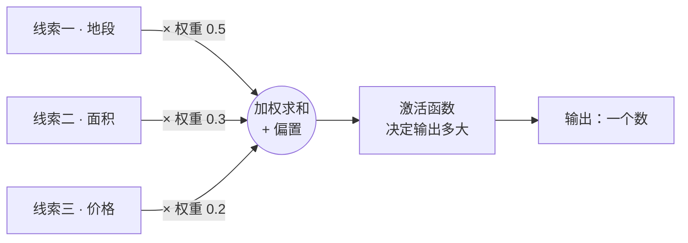
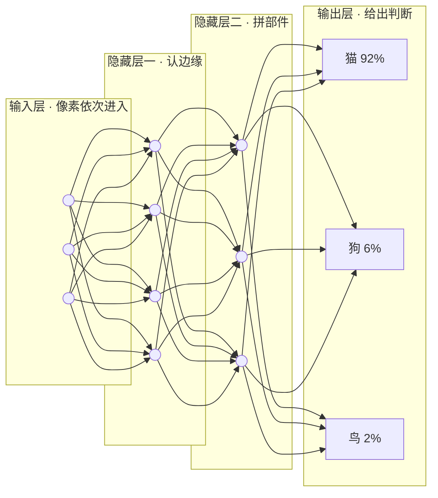

# 第 03 课　神经网络

上一课说，机器学习是"给例子和答案，让机器自己找规律"。这一课打开黑盒看一眼：机器用什么结构来"找"。答案是神经网络，几乎所有大模型的地基。这一课不需要任何数学推导，会"加权求和"就够了。

---

## 一、先把误会说清楚：它不是大脑的复制品

"神经网络"这名字容易让人以为，科学家在电脑里造了一个大脑。先拆掉这个误会：它只是借用了大脑的名字。上世纪的科学家受人脑中神经元互相连接的启发，把计算单元也叫"神经元"、把连接叫"网络"。但真的大脑有近千亿个神经元，连接方式复杂到今天都没完全弄清楚；而人工"神经元"本质上是一个小算式：收几个数，加权求和，输出一个数。它不会思考，也不打算复刻思考。

后面再看到"神经元""激活"这些词不必紧张，它们都是简单的数学零件。

---

## 二、一个"神经元"在算什么：一场加权打分

从一个日常决策说起：买不买一套房。你会看地段、面积、价格三条线索，心里有杆秤：地段最要紧（话语权大），面积其次，价格稍逊。综合下来打个分，分数过了心里那条线，就决定买。

一个人工神经元做的是同一件事：

1. 收进若干条输入（x₁、x₂、x₃，相当于三条线索各自的评分）
2. 每条线索各乘一个**权重**（w₁、w₂、w₃，表示这条线索有多重要）
3. 全部加起来，再补一个**偏置**（b，相当于门槛的松紧：同样的总分，心软的人容易过线，挑剔的人难得过线）
4. 把结果送进**激活函数**，决定这个神经元最终输出多少

写成一行就是：

> 输出 = f(w₁x₁ + w₂x₂ + w₃x₃ + b)

别被符号吓到，翻译成大白话：按重要性加权求和，加上门槛，再过一道开关。下一课会看到，所谓"训练"，练的就是这些权重和偏置，机器自己把那杆秤调准。

---

## 三、没有激活函数，叠再多层也没用

激活函数就是上面说的那道开关：拿到加权总分后，决定输出多少。为什么非要这一道？因为如果神经元只会"加权求和"，那么不管叠多少层、塞多少个神经元，整个网络从头到尾做的仍是放大版的加权求和。数学上，一百层等价于一层，参数花了，能力一点没涨。

激活函数打破这个限制：输出不再只是输入的线性放大，术语叫非线性。有了它，网络画出的分界线才能弯曲，才能贴合现实数据（现实中"会按时还贷的人"和"不会还贷的人"，通常不是一条直线能切开的）。

两个最常见的激活函数，看形状就行，不用推导：

- ReLU：规则简单，正数照抄，负数归零。正因为简单，它算得快，至今仍是各类网络的常客。
- Sigmoid：形状是个 S，把任意大的分数都压进 0 到 1 之间，越大越接近 1。适合回答"把握有多大"这类问题，0.9 就是十拿九稳。

补一句 2026 年的现状：你以后还会反复碰到 GELU 这一族激活函数，可以理解成"更顺滑的 ReLU"，这一代大语言模型里普遍使用它。用法和 ReLU 是一回事，先有个印象。

---

## 四、层：从"边缘"到"猫"，一层比一层抽象

单个神经元只会加权打分，能力有限。神经网络的真正威力在于把成千上万个神经元组织成层，一层层传递：

- 输入层：收原始数据，不做加工（一张图就是几百万个像素值，逐个进入）
- 隐藏层：一层叠一层。层数越多，网络越"深"，"深度学习"的"深度"就是从这里来的
- 输出层：给出最终答案

隐藏层里发生了什么？拿认猫举例（这是直觉说法，真实分工未必这么整齐，但大方向如此）：靠近输入的那层只能认出最简单的东西，横的竖的边缘、明暗交界；下一层把边缘拼起来，认出毛发纹理、圆弧；再下一层把纹理拼成耳朵、胡须、猫脸这些部件；最后输出层综合所有部件，给出判断：是猫。

从"边缘"到"部件"再到"猫"，一层比一层抽象。而且没有人教过中间任何一层"什么是耳朵"，这些都是训练时自己形成的。第 02 课说机器学习"自己找规律"，这里就是最具体的画面：特征是网络自己提炼的，不用人手把手教。

---

## 五、数据走一遍：前向传播与"可能性"的换算

数据从输入层出发，穿过一层层隐藏层，最后从输出层得到答案，这一整趟叫**前向传播**。名字听着复杂，其实就是按层走一遍：每个神经元收到上一层的产出，加权、加门槛、过开关，把结果交给下一层。

到了输出层还有最后一步。网络内部其实给每个候选答案都在打分，比如"猫 8.2 分、狗 3.1 分、鸟 0.4 分"。这种原始分数不好解读：没有上限，加起来也不等于任何好懂的数。所以最后用 **softmax** 把它们换算成"可能性"：分数高的占的份额大，所有可能性加起来恰好等于 1。8.2、3.1、0.4 经它一换，就成了"猫 92%、狗 6%、鸟 2%"。

从此你听到"模型输出了一个概率"，就知道背后是这么回事：网络先打分，softmax 把分数换算成加起来等于 1 的占比。

---

## 想一想

先自己回答，能讲给别人听最好。

1. 用"买房打分"的说法，向家人解释一遍权重和偏置各管什么。
2. 把一个网络里所有激活函数都撤掉，这个网络会发生什么？用"一百层等价一层"把它说明白。
3. 认猫的例子里，为什么是浅层认边缘、深层拼部件？"浅层认部件、深层认边缘"说得通吗？
4. 网络给三个类打分：8.2、3.1、0.4。为什么不能直接说"猫的可能性是 8.2"？softmax 换算出来的三个数必须满足什么条件？

---

## 小结

- 神经网络只是借了大脑的名字：人工神经元是个小算式，输入乘权重、加偏置、过激活函数。
- 权重表示每条线索有多重要，偏置是门槛的松紧；下一课讲的"训练"，练的就是这两样。
- 激活函数给网络非线性能力：没有它，一百层等价一层；ReLU 简单快速，这一代大模型里常见的是更顺滑的 GELU 一族。
- 一层层叠起来，网络自动从边缘、纹理拼出部件、再拼出整体，特征越提越抽象，且不用人教。
- 数据从左到右走一遍叫前向传播；输出层先打分，softmax 把分数换算成加起来等于 1 的可能性。

这些权重和偏置，在网络初始化时其实是随机设的。怎么把它们一步步调准？这就是下一课"训练"要讲的事。

---

2026 年 10 月
