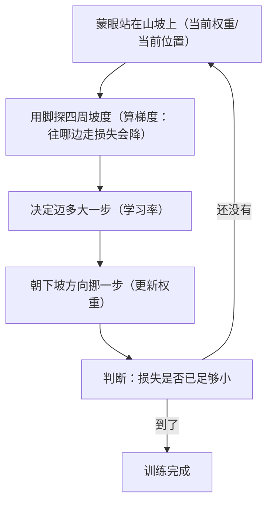

# 第 04 课　深度学习是怎么练出来的

上一课看了神经网络的结构：一层层神经元，靠权重把信号传下去。但有一个关键问题还没回答：这些权重是哪来的？答案是一开始全是随机设置的数字，网络的输出完全不可靠。这一课讲它怎么从随机状态，一步步训练到能给出正确的判断。

---

## 一、一开始，网络就是个"乱猜机器"

神经网络刚初始化的时候，里面几百万甚至上亿个权重全是随机数。给它一张猫的照片，它可能回答"这是一辆公交车"，这不奇怪，里面的权重本来就是随机的。

那怎么变好，你可能已经能从第 02 课的结论里找到方向：给它大量例子和标准答案，让它自己调。具体到神经网络，**训练**就是把权重一遍遍小幅调整、让错误越来越小的过程。接下来几节，把这个"自己调"拆开看。

---

## 二、先给"错得有多离谱"打个分：损失函数

要调，得先知道现在错得多离谱。神经网络的做法很直接：拿预测和标准答案一比，算出一个数字，专门衡量这一轮错得有多厉害。这个数字叫**损失**（loss），负责算它的规则叫损失函数。

损失和错误程度是同向的：预测和答案差得越远，损失越大；预测全对，损失接近零。

于是训练的全部目标变得非常清晰：让损失变小。之前说的"让错误越来越小"，落到实处就是盯着这一个数字往下压。

---

## 三、蒙着眼下山：梯度下降

现在的问题变成：损失这么高，该往哪个方向调权重，损失才会降？

想象你蒙着眼站在一片山坡上，目标是走到谷底。你看不见路，但脚还管用：用脚探一探四周，感觉哪边更陡地往下斜，就朝那边挪一步；站定，再探，再挪。重复足够多次，总能走到谷底附近。

神经网络做的正是这件事，这套办法有个正式名字：**梯度下降**（gradient descent）。"梯度"这个词听起来复杂，直觉上就是"当前位置四周的坡度"：它告诉你哪个方向上坡最陡。上坡的反方向就是下坡，所以每次朝梯度的反方向挪一点，损失就降一点。

顺带说一句：真实的"损失地形"往往是复杂的高维山谷，可能有好几个坑洼。但"探坡度、往下走"这个核心动作不变。

---

## 四、步子迈多大：学习率

下山还有个关键决定：一步迈多大。这就是**学习率**（learning rate），训练开始前需要人为设定的一个参数。

- 迈太大：一步直接跨过谷底，落到对面坡上，而且往往比刚才更高。接下来又在对面跨回来，来回震荡，越蹦越高，训练里叫"发散"，损失不降反升。
- 迈太小：方向没问题，但每次只挪一毫米，走一万步还在半山腰，训练太慢。

好的学习率是让损失稳步下降、步子又不太小的那个中间值。实际训练里它常是首先要调的参数，本课末尾的动手题会让你亲眼看到"迈太大"是什么景象。

---

## 五、错了怪谁：反向传播

前面始终藏着一块难点：网络有上亿个权重，预测错了之后，每个权重各该改多少、往哪边改。挨个试行不通：每试一个都要把整个网络重新跑一遍，上亿个权重试一轮，代价无法承受。

深度学习的答案是**反向传播**（backpropagation）。它的思路是复盘定责：从最终的损失往回倒推，逐层算出每个权重对这次错误的影响份额，一直分到最前面。分摊完，每个权重都知道自己该往哪个方向、改多少。

这个"从输出层往输入层、逐层把责任往回传"的过程，靠的是微积分里的链式法则。你暂时不需要会推它，只需要记住它的价值：不用挨个试，一遍从后往前，就能把全部上亿个权重的梯度同时算出来。没有它，训练上亿参数的网络无从谈起。

到此，训练的一个完整循环凑齐了：

这个循环转一圈，权重就整体变好一点；转上几十万圈，网络就慢慢训练成能用的模型。以后听到"模型训练了三周"，对应的就是这个循环反复在转。

---

## 六、优化器：更好的下坡走法

"朝梯度反方向挪一步"只是最基本的走法，学名叫 SGD（随机梯度下降）。它简单有效，但有个毛病：山谷如果是弯的，它容易在谷壁之间来回震荡，走得不够顺。

于是有了各种改良走法，统称优化器：

- 带动量：连续几步都朝同一个方向时积累惯性，步子更稳更快，不容易被小坑卡住。
- 自适应步长：每个权重按自己所处的地形自动配一个合适的步幅，陡的地方小心挪，平缓的地方大步走。

其中最出名的是 Adam，它的改进版 AdamW 在今天依然是大模型训练最常用的默认选择；近几年也有 Muon 等新优化器在部分大模型训练中得到采用。名字不必全记住，它们都是"探坡度、往下走"这一个母题的变体。

最后补两个你以后一定会遇到的词：

- batch（批）：一次拿几道题一起算，取平均损失再调一次权重。一道一道看太抖，全部一起看太慢，折中一次看一批（比如 32 道、256 道）。
- epoch（轮）：整套训练题从头到尾过完一遍，算一个 epoch。训练通常要过很多遍。

---

## 七、这就是"自动学特征"的实现机制

第 02 课说过，机器学习的核心是"自动从数据里学规律"。现在可以把它落到实处：损失函数指出错在哪，反向传播算清每个权重该怎么改，梯度下降带着上亿个权重一步步调整。这三个环节组成的循环，就是"自动学"的实现方式。

下一课回到语言模型：文字没法直接送进这台机器，得先变成数字。怎么变，是第 05 课的事。

---

## 想一想

先自己回答，能讲给别人听最好。

1. 一开始为什么不直接把权重设成"正确值"，而要从随机值开始慢慢调？（提示：想想上亿个权重，谁能一眼看出每个该是多少？）
2. 蒙眼下山的类比里，"山谷""你站的位置""脚探到的坡度"分别对应训练里的什么？
3. 损失如果越训越大，最该先怀疑哪个参数没设对？为什么？
4. （动手）打开本课目录的 `gradient_descent.py` 跑一遍，看 x 如何一步步逼近 3。然后把 `LEARNING_RATE` 改成 1.0 再跑，观察发生了什么；再改成 1.01，看看"越蹦越高"是什么样子。

---

## 小结

- 网络的权重一开始是随机设置的，训练就是反复微调这些权重、让损失越来越小的过程。
- 损失函数把"错得有多离谱"压成一个数字；梯度告诉你往哪个方向挪、损失会下降；每步挪多大由学习率决定，太大来回震荡，太小太慢。
- 反向传播从输出层往回逐层分摊责任，一遍算出全部权重的梯度，解决了"上亿权重高效调整"的难题。
- SGD 是朴素的往下走，AdamW 这类优化器加了惯性和自适应步长；batch 是一次看几道题，epoch 是整套题过几遍。
- 这套"前向算损失、反向传梯度、更新权重"的循环，就是深度学习自动从数据里学规律的实现方式。

---

2026 年 10 月
