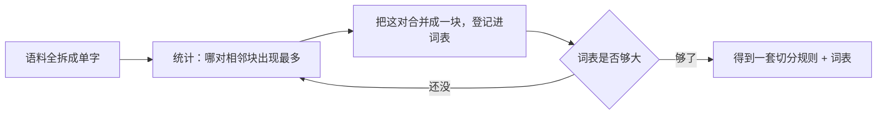

# 第 05 课　文字怎么变成数字：Tokenizer 与 Embedding

到上一课为止，模型怎么训练已经清楚了。但还有一个更基本的问题：文字在模型眼里长什么样。

答案很直接：它看不到字，只看到数字。你输入"今天天气真好"，模型没有读到这几个汉字，它读到的是一串数。这一课讲清这个翻译过程分几步、每一步在干什么。配套的 `token_demo.py` 可以亲手跑一遍，建议边读边跑。

---

## 一、第一道坎：电脑只认数字

先想清楚为什么非翻译不可。模型的本体是神经网络（第 03 课的主角），它的底层是成千上万次乘法和加法，而乘法加法只对数字有意义："猫"乘以 0.3 是没有定义的。

所以不管你输入的是文字、语音还是图片，进门之前都得先变成一串数。这一课讲的就是这套翻译规则是怎么设计的。

---

## 二、最朴素的译法：一词一个编号

最直观的译法比较笨，但值得先看一眼，它是理解后面一切的参照物。

假设词表里只有三个词：猫、狗、汽车。那就用三个格子表示它们，轮到谁，谁的格子是 1，其余全是 0：

- 猫 = [1, 0, 0]
- 狗 = [0, 1, 0]
- 汽车 = [0, 0, 1]

这叫 **One-hot 编码**（独热编码：一堆 0 里只有唯一一个 1）。想法很直接：一个词一个坑。但毛病马上就来了。

第一个毛病，太占地方。真实模型的词表动辄十万起步（这一代大模型普遍在十万上下甚至更多），按这个译法，每个词都得是一个十万格、其中九万九千九百九十九格是 0 的巨型列表，绝大部分空间浪费在 0 上。

第二个毛病更严重，词和词之间谁也不认识谁。猫的向量是 [1,0,0]，狗是 [0,1,0]，两串数字重合的位置全是 0——用数学的话说，它们互相"垂直"。于是猫和狗的差距，和猫跟汽车的差距，一模一样。编号本身不携带任何信息，猫不知道狗是自己的同类。可我们明明知道"猫和狗都是宠物，汽车不是"，这份常识在编码里一点都没留下来。

所以需要一种新译法：既要省地方，又要让"意思近的词"在数字上看得出来。

---

## 三、先切后编：Token 与词汇表

在换译法之前，还差一步：句子得先切开。

模型拿到"我爱人工智能"，第一步不是编码，而是切成小块，每一块叫一个 **token**（词元）：

我爱人工智能 → 我 / 爱 / 人工 / 智能

然后查一张对照表，"我"是 5 号，"爱"是 102 号，把文字换成编号。这张全模型通用的对照表叫词汇表。

那为什么不干脆按整词切，一步到位？试过就知道不省心：

- 词汇量爆炸：英语里 happy、happier、happiness、unhappiness 各算一个词形，几十万个词形，词表厚得查不动。
- 生词没见过：明天冒出来的网络热词、新品牌、人名，词表里肯定没有，整词切碰到生词就无法处理。
- 中文还有分词歧义这类老问题，整词切也躲不开。

于是主流做法走子词（subword）路线：常见的词整个存，生僻的词拆零件。汉语里"共享"天天出现，就整块存；哪天冒出个生僻的"共享员工"，把现成的"共享"和"员工"拼在一起就行。英文同理：un 和 ness 这类零件整存，unhappiness 来了就拆成 un + happi + ness。

拆到最细也不过是单个字符，而字符总量是有限的，所以任何新词都拼得出来，"不认识的词"从此不存在。这是子词思路最重要的优点。

---

## 四、BPE：把最常挨在一起的两块合并起来

子词词表的造法，用得最多的算法叫 **BPE**（Byte Pair Encoding）。算法过程如下：从把所有词拆成单字开始，看哪两块最常挨在一起，就把它们合并成一块、登记进词表；然后再看、再合并，反复到词表够用为止。

拿一小把词走两步（演示脚本里就是它）：

- 语料：人工智能、工人、人工费、智能锁、智力
- 第 1 轮数一数："人+工"出现 2 次、"智+能"也出现 2 次，最常见 → 把"人+工"合并成"人工"
- 第 2 轮再看："智+能"出现 2 次最多 → 合并成"智能"
- 现在词表里多了"人工"和"智能"两个块，再来一句"人工智能工程师"，就能切分成：人工 / 智能 / 工 / 程 / 师

token 不是谁凭空规定的，是从大量文本里统计出来的：越常挨在一起出现的字，越有资格合并成一个整块。

> 顺带一句：BPE 本来是上世纪九十年代数据压缩领域的老办法，2016 年被搬进机器翻译后成了分词的标配。今天各家大模型的 tokenizer 大多是它的变体，思想一脉相承：高频合并，宁拆勿猜。

---

## 五、Embedding：让意思近的词，数字也近

现在解决第二节留下的问题：编号只是一个序号，本身不携带语义，猫和狗还是互相不认识。真正让意思近的词在数字上靠近的，是 **Embedding**（嵌入）。

做法：给词汇表里每个 token 发一长串小数，比如：猫 = [0.9, 0.1, 0.3, 0.8]。真实模型里这个长度是几千，画不出来，但可以用地图找感觉：把一个词看成地图上的一个点，几万个词撒在同一张图上，意思近的词聚在同一片，"宠物区""交通工具区""水果区"自然成形。真实情况就是把这张地图升到几千维而已。

关键在两点。

第一，每一格是什么数字，不是人编的，是训练调出来的。模型读海量文本，用第 04 课讲的训练方法不断微调这串数，目标很朴素：让能互相替换的词，数字越调越近。猫和狗总出现在相似的句子里（会动、会叫、被人养），向量就越来越靠近；汽车出现的语境完全不同，就被调到了别处。教科书上管这叫"分布式表示"，它的含义是：一个词的意思，由它周围的词决定。

第二，数字真的能装下"关系"。最有名的例子是国王与王后：

国王 − 男人 + 女人 ≈ 王后

把"国王"的向量减去"男人"的向量，再加上"女人"的向量，落点几乎就是"王后"。这串数字里竟然编码出了"性别"这样的抽象概念，语义空间里藏着性别、大小、年龄段这些维度，只是模型自己学出来的维度，没人给它们起过名字。

至此，一整条流水线就通了：

出门前是文字，进门时已经是一排向量了。词表多大、向量多长，各家模型选择不同（这一代普遍词表十万上下、每词几千维），但流程从 2013 年 Word2Vec 到今天没变过，变的只是这张表做得更大、调得更准。

---

## 六、意思的远近：量一量两个向量的夹角

词有了向量，新问题来了：怎么用数字回答"猫和狗像不像"？

把每个向量想成一支从原点出发的箭头。两支箭头方向越接近（夹角越小），意思越近；互相垂直，就是毫无关系。One-hot 世界里所有词恰恰全都互相垂直，这正是它丢掉语义的几何解释。衡量这件事的常用工具叫余弦相似度，它还有一个更朴素的版本叫点积。你暂时只需要记住直觉：这两个操作都是在问"两支箭头方向有多一致"，公式等用到时再看。

演示脚本里那几个手工向量算出来的结果是：猫和狗的相似度最高，猫和汽车居中，猫和苹果最低，排序和你的直觉一致。

现在就要认识点积，因为下一课的注意力机制，Transformer 的核心组件，做的核心动作就是它：把一句话里每个词的向量，和句中其他词的向量两两做点积，谁和谁关系近，数字立刻见分晓。这个操作下一课马上就会用到。

---

## 七、最后一个现实问题：tokenizer 是和模型绑定的

还有一件使用中会遇到的事：tokenizer 不是通用的字典，它是随模型一起配套训练的。

每家模型开训之前，先拿自己的语料跑一遍 BPE，造一本自己的词表。所以同一句话喂给不同模型，切出来的 token 往往不一样，编号更是完全对不上。这也解释了两件日常小事：为什么换模型就得连 tokenizer 一起换（旧模型的向量表对新词表的编号毫无意义）；为什么调用 API 按 token 计费：同一段话在不同模型那里的"字符成本"本来就不一样。

想亲眼看真实模型的切法，可以运行演示脚本末尾附的注释代码，装好 `transformers` 后就能让大模型把你的名字切给你看，多半会被拆成两三块，因为生僻组合都得拆零件。

---

## 想一想

先自己回答，能讲给别人听最好。

1. One-hot 编码丢掉了什么信息？Embedding 是靠什么把这份信息找回来的？
2. 为什么子词比整词更能对付生词？拿一个你想到的新词（网络热词、新品牌都行），说说它会被怎么拆。
3. 两个词的向量夹角很小，可能说明什么？如果夹角接近 90 度呢？为什么说 One-hot 世界里所有词都"互相垂直"？
4. （动手）运行 `token_demo.py`。然后往 WORDS 语料里加两个"工"和"人"连排的词（比如"工人阶级""建筑工人"），再跑一遍，第二轮的合并对象变了吗？提示：出现次数并列时，脚本取先出现的那一对。

---

## 小结

- 模型只认数字：文字进门先切成 token、查词汇表换成编号，再按编号取出 Embedding 向量，这才进入神经网络。
- One-hot 一词一格，又费地方又让词与词互相垂直；Embedding 把词变成一串可训练的小数，意思近的词数字也近。
- token 的切法由 BPE 这类算法从语料里统计出来：常见词整存，生僻词拆零件，再新的词也拼得出来。
- 两个向量夹角越小意思越近，点积和余弦就是量夹角的，下一课注意力机制的核心动作正是它。

下节课走进模型内部：这么一排向量进去，模型怎么决定该"关注"哪个词？那就是注意力机制。

---

2026 年 10 月
