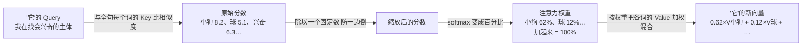
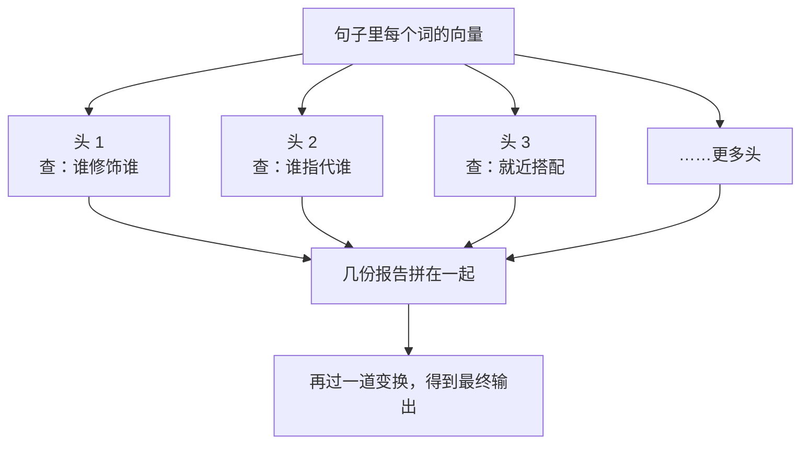

# 第 06 课　注意力机制：机器如何抓住重点

人在读"小狗追着球跑，因为它很兴奋"时，会不假思索地判断"它"指小狗；句子换成"因为它滚得飞快"，"它"就指球。这个判断依据的是词与词的关系。本课要讲的注意力机制（Attention），就是让机器完成同类判断的部件，也是理解大模型的关键一环。全程不涉及数学推导。

---

## 一、上一课留下的一个问题

上一课说过：机器不认识字，它把每个词变成一串数字（词向量），意思相近的词，向量也挨得近。这套做法好用，但有一个限制：每个词只有一个固定向量，无论出现在什么句子里都不变。

麻烦出在多义词上。英文 bank 既有"银行"的意思也有"河岸"的意思，在旧做法里，bank 无论出现在"我把钱存进银行"还是"我们坐在河岸钓鱼"里，得到的都是同一个向量，两种含义无法区分。中文的"它"也一样：它的向量只包含"这是个代词"这一层信息，不包含它在这句话里指谁。

一句话的意思，恰恰藏在词与词的关系里：理解"它"要回头看"小狗"，理解 bank 要看旁边是 money 还是 river。固定的向量装不下这种关系。

## 二、注意力的思路：按相关程度加权混合

注意力给出的解法很直接：

> 一个词的新表示，不要只靠自己，而是把全句所有词的向量按"跟我有多相关"的比例加权混合进来。

以"小狗追着球跑，因为它滚得飞快"为例：计算"它"的新表示时，球的向量占大头，小狗占小头；句子换成"因为它很兴奋"，比例就反过来。同一个词，语境不同，混合比例不同，最终表示就不同，bank 的两种含义也由此被区分开。

剩下的问题是：相关程度怎么算？机器需要一个具体流程。

## 三、Q、K、V：按图书馆查资料的流程走一遍

把每个词当成图书馆书架上的一本书。现在某个词带着问题来查资料：

- Query（查询）：你心里想找什么，比如"我在找一个会兴奋的、有生命的主体"；
- Key（键）：每本书书脊上的标签，写的是"我能提供什么"，比如"小狗"的标签是"一种动物、会跑会叫"，"球"的标签是"一种物体、会滚"；
- Value（值）：书的实际内容，标签匹配上之后真正拿走的部分。

查资料的流程正好就是注意力计算的流程：

1. 拿你的 Query，去和每一本书的 Key 对一遍，各得一个相似度分；
2. 把这些分数换算成一组百分比：小狗 62%、球 12%、跑 8%……加起来正好 100%。这一步的学名叫 **softmax**，作用是把打分变成分配比例：分高的多分，分低的少分，总和恒为 1；
3. 按百分比混合各本书的 Value：62% 拿小狗的内容，12% 拿球的……混出来的结果，就是"它"在这句话里的新向量。

有个细节值得停下来：为什么要 Key 和 Value 两套，标签和内容合一套不行吗？可以合并，但效果会差。标签是"用来匹配的侧面"，内容是"真正提供的东西"，两者分开、各自独立学习，模型才能学出更灵活的匹配方式。

还有一点容易误会：Q、K、V 不是三份现成的资料，它们都从同一个词向量经三套不同的变换得到。上一课说过训练就是让机器自己调参数，这里的三套变换参数正是训练学出来的。

## 四、自注意力：一句话内部互相建立联系

上面的流程里，Query、Key、Value 全部来自同一句话的各个词，所以这套操作叫**自注意力（Self-Attention）**：句子内部，词与词两两计算相关度。

以"小狗追着球跑，因为它很兴奋"为例，轮到处理"它"时，全句各词都要被看一遍。下面的权重是示意数字（真实权重由模型算出，这里只看形状）：

| "它"看向 | 小狗 | 追着 | 球 | 跑 | 因为 | 它 | 很 | 兴奋 |
|---------|------|------|----|----|------|----|----|------|
| 权重    | 0.62 | 0.05 | 0.12 | 0.08 | 0.01 | 0.04 | 0.02 | 0.06 |

"它"把六成多的权重给了"小狗"，于是"它"的新表示里装进了"小狗"的信息，指代关系就这样被编码进数字。每一行的权重加起来都是 1，也就是说每个词都会得到一份自己的全句混合表示。

把整个流程画成图：

这套机制还有另一个收益。注意力之前的主流做法 RNN（循环神经网络，把前文信息压缩进一个状态、逐词传递）处理第 50 个词时，第 1 个词的信息要经过 49 次转手，距离越远衰减越多。自注意力里，任何两个词直接计算相关度，一步直达，长句子里隔得再远的词也能直接建立联系。

## 五、一个小小的除法：防止权重过度集中

流程图里"除以一个固定数"那一步，值得单独说，它对应的正是大家最常见到的公式：

$$\text{Attention}(Q, K, V) = \text{softmax}\left(\frac{QK^\top}{\sqrt{d_k}}\right)V$$

逐项翻译：

- QKᵀ：每个词的 Query，去和所有词的 Key 两两比相似度，得到一大片分数；
- /√d_k：把每个分数除以一个固定数。向量维度一多（几百上千维），算出的分差容易很大，而 softmax 有个特性：分差越大，分配越极端，9 分和 8.9 分它几乎对半分，9 分和 0.1 分它就把前者判成 100%。权重一旦全压在一个词上，其余词的信息一点也进不来，模型也失去了细腻区分相关程度的能力。除一下，把分数拉回温和的区间，分配才有多样性；
- softmax：把分数变成加起来等于 1 的百分比；
- ×V：按百分比把所有词的内容加权混合。

所以这个公式说的就是四步：比相似度、控制分差、换成百分比、按比例混合内容。

## 六、多头注意力：多套参数各查一类关系

到目前为止，默认一句话里只有一种"相关"。但同一句话里同时存在多种关系：例句中"它"和"小狗"是指代关系，"追着"和"球"是动作与对象的关系，"很"和"兴奋"是修饰关系。

一组注意力参数只适合盯一类关系。实际的做法是**多头注意力（Multi-Head Attention）**：并行设置多组头，每个头有自己独立的一套 Q、K、V 变换，各查各的一类关系，比如这个头盯"谁修饰谁"，那个头盯"谁指代谁"，还有一个头盯"哪两个词就近搭配"。最后把各头的输出拼在一起，再过一道变换，得到最终结果。

今天的主流大模型，每一个注意力层里都并排装着几十上百个头。顺带一提，注意力也不只管文字：图像模型同样在用它，只是"词"换成了图像小块。另外，真实系统里注意力的计算量很大，工程上有专门提速的实现（比如 FlashAttention 这类工作），那属于工程优化的范畴，本课只讲原理。

## 七、掩码：训练时不许看后面的词

还剩最后一块。第 08 课会讲到，大模型写回答是一个词一个词往外生成的：写完"今天"，才根据"今天"决定下一个词，再往下续。训练模型这种能力时，就要模拟同样的处境：轮到看第 5 个词时，只许看前 5 个词，后面的词当作不存在。

这就是**注意力掩码（Mask）**：把"未来的位置"在打分环节直接封掉。做法是把那些位置的相似度分直接记成负无穷，softmax 一算，它们的权重就是 0。

为什么必须这样？如果训练时能看见未来的词，模型学到的会是"参考后文"的习惯；而真正使用时，后面的词还没有生成，训练和使用的处境就对不上了。掩码保证两个处境一致。记住这个设定，第 08 课讲生成过程时它会正面登场。

---

## 想一想

先自己回答，能讲给别人听最好。

1. "小明把书放进了书包，因为它快满了"和"小明把书放进了书包，因为它太好看了"，两句话里"它"分别指什么？用注意力的语言说说：这两句里"它"的 Query 会给谁的 Key 打高分？这说明注意力学到的匹配是写死的规则，还是随语境变化的？
2. 如果不要 Key，直接拿每个词的内容（Value）去和 Query 比相似度，也能算出权重。这样损失了什么？（提示：想想"标签"和"内容"的分工。）
3. 假如把"除以 √d_k"这一步去掉，分差变得悬殊，一句十几个词的话里会发生什么？描述一下每个词的新表示会变成什么样。
4. （动手感受）找一句带代词歧义的话发给 AI 助手，让它解释代词指谁；再把歧义词换掉重发一次，观察它的解释是否跟着变。结合本课内容，想想它内部多半发生了什么。

---

## 小结

- 理解一句话要抓住重点、连起相关词。注意力让每个词的新表示由全句所有词按相关程度加权混合而成，同一个词在不同语境里有了不同的表示。
- 流程记图书馆就够了：Query 是我在找什么，Key 是我能提供什么，Value 是真正给你的内容；比相似度、softmax 换成加和为 1 的百分比、按比例混合 Value。
- 自注意力让句子内部任意两个词一步直达；除以 √d_k 是为了防止 softmax 权重过度集中。
- 多头注意力用多套参数各查一类关系，指代、修饰、搭配各有头负责，最后拼成完整结果。
- 掩码挡住未来位置，保证模型训练与生成时不参考还没说出口的词，这是一词一词往外说话的前提。

注意力这部分拆完了，但只有它还组装不出完整模型：多个注意力怎么组织、怎么一层层叠加、前后还配了哪些零件？下一课的 Transformer 把这些组装成当今几乎所有大模型共用的完整骨架。

---

2026 年 10 月
