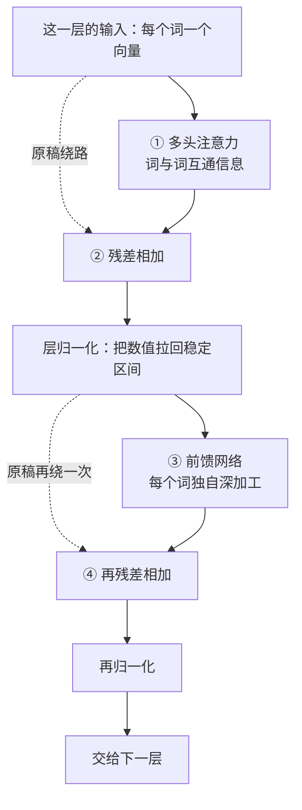
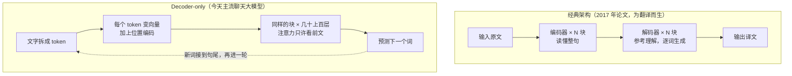

# 第 07 课　Transformer：大模型的骨架

前面几节课，零件已经备齐：第 05 课把文字变成一串向量，第 06 课的注意力让每个词学会按相关程度吸收别的词。本课做最后一步装配：把这些零件装成一台完整的机器。它的正式名字是 Transformer，今天几乎所有大模型共用的结构。GPT、Claude、Gemini 以及国内的一批大模型，核心结构都是这一套。

> 先说明一点：本课名词比较密。每个词都先看它解决什么问题，再记学名。某一节没看懂可以先做个记号往后走，回头再看通常会通。

---

## 一、旧结构的两个瓶颈

Transformer 之前，处理文字的主力叫 RNN（循环神经网络，后来升级成 LSTM）。它的思路是像人读句子一样，从左到右一个词一个词地读，每读到一个词，就把它的信息并进一个随读随记的状态，再把状态传给下一步。

问题就出在这个"传"上，一共两个。

第一，长句遗忘。状态每传一步就被改写一次，句子一长，开头的信息经过几十轮转手被稀释，模型常常"读了后头忘了前头"。

第二，无法并行。每个词的计算依赖上一个词的结果，第 100 个词必须等第 99 个算完才能开工。而 GPU 擅长的是同时算几百件事，让它们跟着 RNN 排队，算力就用不上。

2017 年，Google 的研究团队发表了一篇论文，标题是 Attention Is All You Need（注意力就是你所需要的一切）。思路是：注意力已经能让任意两个词直接建立联系，那就不需要逐词传递了，把循环整个去掉，只留注意力。这篇论文提出的结构，就叫 Transformer。

---

## 二、底座：让每个词直接看见每个词

第 06 课已经拆过注意力，这里把它接回来当底座。

- 自注意力：每个词用自己的 Query，去和句中所有词的 Key 比对相似度，再按比例把对方的 Value 混合进来。任意两个词之间一步直达，逐词传递造成的远距离衰减不复存在。
- 多头注意力：一组注意力只能盯一类关系，所以并行设置多组头同时工作：有的盯语法搭配，有的盯指代关系，有的盯相邻的词，最后把各头输出拼到一起。

还有一份额外收益：整句话所有词的两两关系可以摆成一张大表格、一次算完，这正好是 GPU 最擅长的矩阵运算。RNN 做不到的并行，Transformer 天然就有。

---

## 三、位置编码：给每个位置补一个先后信号

去掉循环之后，立刻出现一个缺口：注意力本身不知道词的先后顺序。

第 06 课见过，注意力算的是词与词之间的关系。它看"猫追狗"和"狗追猫"，看到的都是同一批词、同一批关系，一视同仁，分不出谁在前谁在后。

解决办法：给每个位置额外发一个"我在第几位"的信号，加到词向量上。位置信号就像座位号，谁先谁后由此确定，这个信号叫**位置编码**（positional encoding）。

原始论文用一串正弦、余弦函数给每个位置生成一条独一无二的编码，近处刻度密、远处刻度疏；早期的 BERT、GPT 则把每个位置当成一个词条，像词向量一样直接学出来。到今天这一代模型，主流开源大模型（Llama、Qwen 这些）大多换成了**旋转位置编码（RoPE）**：把"第几位"变成向量的一次旋转，位置越靠后转得越多，处理长文本更稳定。名字先记下，细节用到再学。

---

## 四、拆开一个块：四步流水线

零件齐了，现在看 Transformer 的标准件：块（Block）。每个块内部是一条四步流水线，先看图：

① 多头注意力：让词与词交换信息，前面刚说过。

② 残差 + 归一化。残差连接（residual connection）的要点是：本层的输入原样保留，本层算出的改动量直接加在输入上。这样哪怕这一层学得不好、改动量是错的，最坏也就是"加了个没用的东西"，原文信息不会丢；模型每层只需要学"在现有基础上再加一点什么"，学习负担轻得多。

吸收完信息，还要做层归一化收拾一下：把每个词向量的数值统一拉回稳定区间，防止有的数值越滚越大、有的越缩越小，下一层才能在稳定的数值范围上继续训练。

③ 前馈网络：**前馈网络（FFN）**是每层里参数最多的部分。注意力负责词与词之间交换信息，前馈网络则对每个词的向量单独做一次加工：独自穿过一个两层的迷你网络，先展开到很宽、再收回来，把刚吸收的信息再处理一遍。原始论文在这里用 ReLU 激活，今天这一代模型多换成更平滑的选择（GELU、SwiGLU 这类），名字见到能认即可。

④ 出口处再来一次残差相加和归一化，与第②步相同。之后这个块的输出交给下一个块，同样流程再来一轮。

> 备注：不同模型里流水线的顺序略有出入（不少现代模型把归一化放在每步之前，用的归一化方法也更轻量），但"注意力 → 残差 → 前馈 → 残差"这四样始终都在。记住这条主线，看哪一代模型都适用。

---

## 五、总装：从 2017 年的翻译模型到今天的聊天大模型

一个块只是标准件，Transformer 的本体是把块一层层往上叠。怎么叠，2017 年的论文和今天的聊天大模型给出了两个不同的答案。

原始论文做的是翻译，用的是**编码器-解码器**结构：编码器负责把原文整个读懂，产出一份"理解"；解码器一边参考这份理解，一边一个词一个词写出译文。一个管读懂，一个管生成，分工明确。后来这一族还分出几支：只用编码器的 BERT 擅长理解类任务（分类、检索），编码器加解码器的 T5 这类兼顾读和写。

而今天常用的聊天大模型，基本只保留解码器这部分，把它叠上几十层甚至上百层，这就是 **Decoder-only** 架构，GPT 一路就是这么走过来的。它做的事很单一：看着前面已有的词，预测下一个词。因为只许看前文（不能参考后面还没生成的词），里面的注意力加了掩码，就是第 06 课讲过的那个。

分清这两张图很重要：聊 Transformer 的来历，"编码器-解码器"是教科书答案；看今天的大模型，主流是 Decoder-only。两套都是同一块标准件搭出来的，只是搭法不同。

---

## 六、为什么是它撑起了大模型时代

回头看，这套设计赢在两件朴素的事上。

一是并行。整句话所有词同时过注意力、同时过前馈，GPU 的算力终于用得满，于是可以喂海量语料，训练快得多。二是长距离直达。第 1 个词和第 1 万个词之间也是一步连通，不存在转手衰减，长文章也咬得住。又快又稳，层数就敢往上叠，数据也敢往大喂。后来人们发现：参数越多、数据越多、算力越多，模型就越强，这条路线叫 Scaling，而它走得通的前提，正是 Transformer 这副结构扛得住。

骨架讲完了。但它只完成了一半：算出对下一个词的打分。怎么从打分里挑出那个词、为什么大模型的回答一个词一个词往外蹦、又为什么记不住太长的话，这些是下一课的主角。

---

## 想一想

先自己回答，能讲给别人听最好。

1. 如果不给位置编码，"猫追狗"和"狗追猫"喂进模型会遇到什么麻烦？说说为什么每个位置必须有独立的先后信号。
2. 残差连接帮了什么忙？试着用自己的话向朋友解释：为什么"每层只学一点点增补"比"每层从零重画"稳妥。
3. 2017 年论文是"编码器读懂 + 解码器生成"，今天的聊天大模型为什么只留解码器也够用？（提示：聊天时，"读懂你说了什么"和"生成回答"是在同一摞块里连续完成的。）
4. （动手感受）随便挑一个开源大模型（如 Llama、Qwen）的技术报告或模型主页，找一找它的层数、注意力头数。你会发现课里"块 × N"的那个 N，在真实模型里动辄几十层起步。

---

## 小结

- RNN 一词一拍传递状态，句子长了前面就淡，还用不上 GPU 并行；Transformer 把循环整个去掉，靠自注意力让任意两个词一步直达。
- 注意力不认先后，所以要给每个位置加位置编码；这一代主流模型多用旋转位置编码（RoPE）。
- 每个块是一条四步流水线：多头注意力交换信息，残差连接保留原输入，层归一化稳住数值，前馈网络单独深加工，再残差、再归一化。
- 经典架构是"编码器读懂 + 解码器生成"两段式；今天主流聊天大模型是 Decoder-only：把带掩码的解码器块叠几十上百层，只做"看前文、猜下一个词"这一件事。
- 又能并行、又咬得住长距离关联，这副结构撑得起堆数据堆参数的 Scaling 路线。

下一课看这台机器的最后一站：一个词一个词往外生成的背后，打分、挑选和温度是怎么工作的。

---

2026 年 10 月
