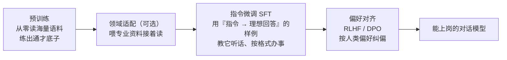
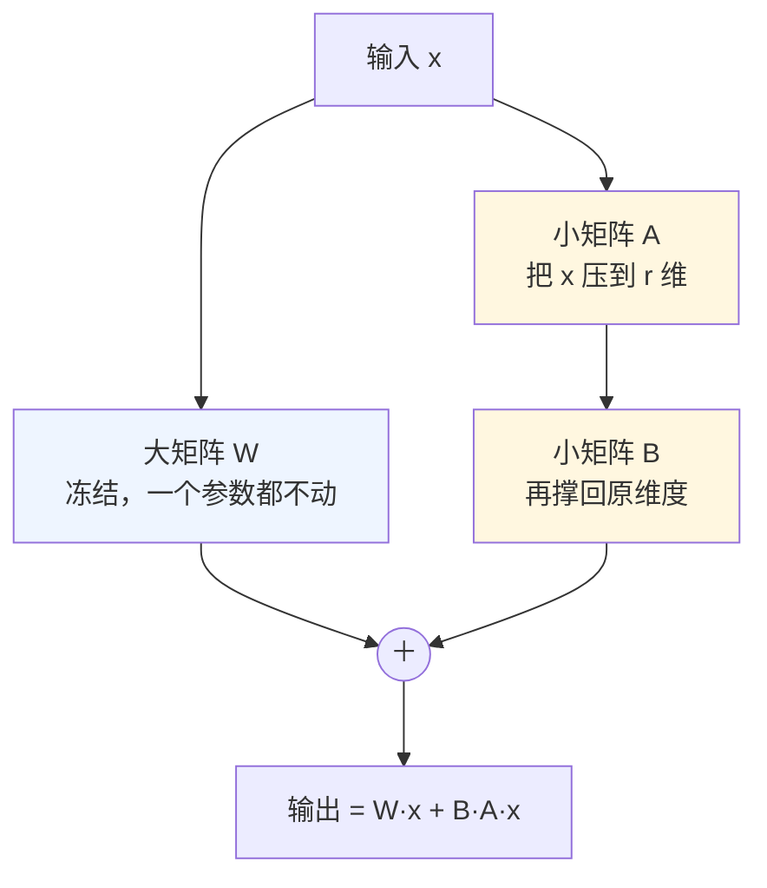

# 第 09 课　模型微调：让聪明模型专精一行

上一课看到大模型怎么逐词生成回答。它能力面确实广：写代码、改邮件、讲概念都可以。但直接拿它干活，很快会撞上另一件事：它未必按你的规矩来。你让它用公司的口吻回客服消息，它回答通顺，但不符合你们团队的规范；你让它按固定格式出报表，十次里有三次不按格式来。

本课讲解决这个问题的手段：**微调**（Fine-tuning）。它也是这一章的最后一课，学完它，原理篇就收尾了。

---

## 一、先看清微调在补什么

预训练模型的特点是通用能力强：什么话题都能聊两句，但它没接触过具体业务的规范，不知道团队的行话、格式、流程和说话分寸。预训练负责建立通用能力，上岗干活需要的样子，要靠另一步补齐。

微调，就是拿一批目标场景的真实例子，对模型做一次定向校准。

注意一个分寸：微调不是从零教一张白纸。底座模型早已具备通用能力，微调只做定向校准。这也是它便宜的根本原因：大头人家已经学完，你只补最后那一层。

---

## 二、先分清三件最容易混的事

新手常把三件不同的事都叫"微调"，这里摆开：

预训练（Pre-training）：从零开始，拿海量文本把模型的通用能力练出来。这是最贵的一步，百万美元级的花费、数月的算力，只有少数机构做得起。平时说的"开源底座模型"，指的就是这一步的产物。

继续预训练 / 领域适配：底座已经有了，再喂它大量某个领域的资料，医学文献、法律文书、内部技术文档，把行业知识和行业语言补进去。

指令微调（SFT）：注意，它补的不是知识，是按指令办事的能力。做法是准备一批"指令 → 理想回答"的样例，一条条教模型：用户这么问，你就该这么答、按这个格式答。今天所有对话模型能好好回答问题、按格式输出，主要归功于这一步。

在这之后通常还有一步对齐：拿人类的偏好当标准再纠一遍，同一个问题的几个回答，人标注哪个更好，模型就往更符合人类偏好的方向调。你可能听过 RLHF、DPO 这两个词，它们是做这件事的两代主流做法，机制到工程篇再展开，现在记住"按人类偏好纠偏"就够了。



本课的重点是中间两步：领域适配和指令微调。它们才是普通团队真正会动手的部分。

---

## 三、全量微调：所有参数都放开训

最直接的做法：把模型里所有参数统统解开，让训练过程每一处都可以动，这叫**全量微调**（Full Fine-tuning）。它效果上限确实最高，改动不受限制，代价也最大。

开销集中在显存。第 04 课讲过，训练就是反复调参数的过程，为此显存里要同时装三样东西：

- 权重：模型当前的参数，7B 模型光存一份就要十几 GB；
- 梯度：这一步每个参数该往哪边挪、挪多远，规模和权重一样大；
- 优化器状态：优化器（比如 Adam）给每个参数记的中间量（如动量），通常比权重本身还占好几倍。

三样加在一起，7B 模型的全量微调动辄几十 GB 起步、上百 GB 不稀奇，需要多张专业计算卡。

> 顺带修正一个网上流传很广的说法：不少资料写"7B 全量微调只需 28 GB 显存"。那是只算了权重加梯度的乐观账，把最占地方的优化器状态漏了。记住口径：训练显存 ≈ 权重 + 梯度 + 优化器状态，第三样往往是大头。

全量微调还有两个隐性问题。一是灾难性遗忘：所有参数都动了，模型原来会的本事可能被改掉一部分。二是每个任务都要保存一份改完的完整模型，十个任务就是十份十几 GB，存放成本很高。

---

## 四、LoRA：冻结原模型，只训练旁路小矩阵

更省的路是有的：冻结原模型，只新增并训练一小撮参数。这类做法统称**参数高效微调**（PEFT，Parameter-Efficient Fine-Tuning），到 2026 年已经是微调的默认选项，其中最出名的方法叫 **LoRA**（Low-Rank Adaptation，低秩适配，2021 年提出）。

LoRA 的想法可以浓缩成一句：原模型是一份画好的图纸，原稿不动，在旁边贴几张可撕的便利贴做批注；训练时只改便利贴，图纸一笔不碰。

它的具体形态如下。模型里到处是这样的运算：输出 = W·x（大矩阵 W 乘输入 x）。LoRA 不改 W，而是在旁边挂两个小矩阵 A 和 B：先用 A 把 x 压到很低维（比如 r 维），再用 B 撑回原维度，把这个窄通道的输出加回原输出：

> 输出 = W·x + B·(A·x)

训练时 W 全程冻结，只有 A、B 在学：



两条小通道能顶替对整个大矩阵的修改，背后有个实证依据，微调时权重的"变化量"结构出奇地简单，信息集中在很少的几个方向上。用一对瘦长矩阵的乘积去近似它，往往就够了。"低秩"这个名字由此而来，那个通道宽度 r 就叫秩（rank）。

r 是"省"和"容量"之间的旋钮：r 越小越省、通道越窄能装的东西越少；r 越大表达能力越强、要学要存的也越多。常用值在 8~64 之间，实际操作通常从小往大试，效果不再涨就停手。

LoRA 到底省在哪，对照第三节的账本就清楚了：

- 冻结的 W 不再需要梯度和优化器状态，三样里占地方的两样直接省掉。7B 模型的 LoRA 微调，一张 24GB 的消费级显卡（比如 RTX 4090）就能做。
- 存储：LoRA 适配器通常只有几十 MB。不用为每个任务存一份十几 GB 的完整模型，一个底座配 N 个适配器，哪个任务用哪个。
- 还能热插拔：2026 年的主流推理框架已经支持一个底座同时挂多个 LoRA，按请求切换。客服语气一个适配器、财报摘要一个适配器，同一个底座服务所有业务。

工具现状也交代一句：Hugging Face 的 PEFT 库至今仍是这套方法的标准工具，社区还有 LLaMA-Factory、Unsloth 这类开箱即用的封装。旧讲义里 LoraConfig、get_peft_model 那套示例代码今天依然能用，只是如今你多半会从这些更省心的工具起步。

---

## 五、QLoRA：先把底座量化，再做 LoRA

24GB 显卡够 7B 用了，8GB、12GB 的普通显卡就得再压一步：先把底座模型量化，用更少的比特存每个权重（比如从 16 位压到 4 位），让冻结的底座体积先缩小几倍；然后在这个压缩底座上照常做 LoRA，LoRA 部分训练时仍保持高精度。这就是 **QLoRA**（Q 是 Quantization，量化），2023 年提出后迅速成了消费级硬件上微调大模型的标准做法：7B 模型的显存需求能压到 10GB 上下，一张 12GB 的显卡就能上手。

量化是把双刃剑，压得太狠会伤质量，它自成一节课的内容，后面讲模型部署与优化的章节会专门展开。这里先建立连接：QLoRA = 量化 + LoRA。

---

## 六、给模型看的"教材"：指令数据长什么样

微调效果好不好，一半取决于数据。指令数据其实非常朴素：一条样例就是"问题 + 理想回答"。比如想教模型用某个客服团队的口吻说话，一条数据长这样：

```json
{
  "instruction": "你是某云服务的客服，用亲切但不啰嗦的口吻回答用户问题。",
  "input": "我的服务器半夜宕机了，怎么办？",
  "output": "您好，深夜遇到这种情况确实让人着急。请先在控制台查看实例状态，如果显示异常，我可以帮您提交紧急工单，工程师会尽快跟进。方便把实例 ID 发我吗？"
}
```

也有多轮对话版本（一问一答排成列表），格式不同，本质一样：告诉模型"遇到这种情况，理想中就该这么答"。

经验里最重要的一条：质量和多样性，比数量关键得多。几千条干净、覆盖各种问法的样例，往往胜过几十万条粗糙数据。数据里的口癖、错误格式、自相矛盾的答案，模型会原样学进去，这就是"脏数据教坏模型"。

---

## 七、微调、RAG、提示工程，到底选哪个

实际工作里"要不要微调"是个高频争论，而且经常有人选错方向。给你一个够用的判断框架，先说结论：很多看似需要微调的需求，其实不该微调。

| 你的需求 | 该用什么 | 处理方式 |
|---|---|---|
| 一句话能说清的要求（"回答别超过三句"） | 提示工程 | 写进提示词直接约束 |
| 引用你私有的、经常更新的资料来回答 | RAG（检索增强生成） | 资料放外部知识库，回答时检索引用 |
| 改变风格、口吻、固定套路、输出格式 | 微调 | 用样例训练，把行为写进模型参数 |

最容易踩的坑，是前两类需求被错送到微调手里：

- 想让模型"记住我们公司的产品文档"就去做微调，并不划算：知识装进参数里又贵又难更新，文档一改版就得重新训练，模型还可能把知识记混。这件事该交给 RAG：资料放外部知识库，回答时现查现引用，后面讲 RAG 的整章会专门展开。
- "回答简短点"这种一句话交代得清的要求，写进提示词就行，动用微调得不偿失。

反过来，如果目标是"让它按我们团队的口吻说话""永远按这个格式输出""学会我们这一行的固定套路"，这是行为和风格的改变，微调才是对应的手段。这个三岔路口的判断，是面试和架构设计里都常考的题。

---

## 八、练完了怎么用：挂着，还是合并

LoRA 训练完，你有两种用法：

- 挂着用：推理时现算 W·x + B·A·x，适配器独立于底座存在。好处是灵活：底座不动，随时换、随时叠加多个适配器，适合多任务共用一套服务。
- 合并：把 B·A 加进原权重，得到 W' = W + B·A，存成一个和原模型结构完全一样的模型。推理时零额外开销，但适配器融进了权重，不能再单独拆换。

两条路都通向后面的工程篇：挂着用牵扯多适配器的服务架构，合并则衔接模型部署与量化上线。到那些章节再遇到它们，你已有准备。

---

## 想一想

先自己回答，能讲给别人听最好。

1. 同事提议："把公司的全部产品文档拿去微调，让模型记住，回答客户问题就有依据了。"你会怎么建议他？什么情况才真的该微调，而不是"查资料"？
2. LoRA 为什么比全量微调便宜得多？从"训练时显存里要同时放哪三样东西"说起，说清它省掉的到底是哪几样。
3. 把 LoRA 的秩 r 从 16 调到 128，参数量和显存会怎么变？效果一定更好吗？什么信号说明 r 该往上加，什么信号说明不必再加？
4. （动手感受）找一个开源底座模型的"原版"和某个社区微调版（比如代码特调、角色扮演版本），各问同一个问题。对比回答的风格差异，体会一下"几十 MB 的适配器"能带来多大的行为改变。

---

## 小结

- 底座模型通用能力强但没有具体业务的规范，微调就是拿目标场景的真实例子做定向校准。分清三件事：预训练练底子，领域适配补知识，指令微调教按指令办事，最后再按人类偏好做对齐。
- 全量微调改动上限高但极贵：显存要同时装下权重、梯度、优化器状态三样东西，还可能灾难性遗忘。
- LoRA 冻结原权重 W，只训练旁边的小矩阵 A、B，省掉的正是梯度和优化器状态这两样大头；秩 r 是"省"与"容量"之间的旋钮。QLoRA 再把底座量化压缩，消费级显卡也能微调大模型。
- 数据质量比数量重要，脏数据会原样学进模型。选型口诀：一句话说得清的用提示词，查私有资料用 RAG，改风格和套路才微调。

这一章到这里就收尾了。从"AI 是什么"一路走到"怎么让大模型说你想听的话"，原理的地基打完。接下来的加餐课补上工程里顺手的 Python 工具；再往后的章节里，今天认识的这些词 SFT、LoRA、RAG 会反复出现，到时你已是熟面孔。

---

2026 年 10 月
