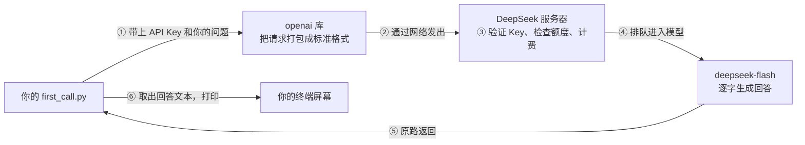

# 第 01 课　动手调用你的第一个大模型

前两章完成了 Python 基础和大模型原理。从这一课起进入工程部分：让程序通过网络调用大模型。

你可能从没碰过命令行，没关系。本课会先花十分钟讲清楚终端怎么用，再带你注册账号、装好环境、发出第一次请求。每一步都给足操作细节，照着点、照着敲就能走通。这一课是后续三课的地基。

---

## 一、网页聊天和 API 调用，是两回事

你大概率已经用过 ChatGPT、豆包、Kimi、DeepSeek 这类网页聊天产品。网页版是平台做好的成品：打开页面、输入问题、得到回答，用法固定。

API 是另一种方式：你的程序通过网络向大模型平台发起请求，把模型的回答当作原材料，接入自己的应用。两者像坐出租车和自驾的区别：坐车只需报目的地，路线由司机决定；自驾则由自己控制时间、路线和装载。用 API 时，什么时候调用、传什么内容、结果怎么加工，都由程序决定。

自动回复客服消息、批量给 1000 篇文章起标题、在自己的软件里加 AI 功能，都依靠 API 完成。

一个常见误区先说明：

> 网页版会员和 API 额度是两套独立的计费系统。网页产品里充的会员只能用于网页聊天；API 要在开放平台单独充值（有的平台送一点新人额度）。只充了会员就运行代码，第一次就会报"欠费"。

本课我们用国内的 DeepSeek 走完整流程：平台全中文、国内网络直连、价格便宜，还兼容最通用的 openai 库。等你学会了，将来换成 Kimi、阿里云百炼甚至 OpenAI，代码通常只改两处，这一点课后会点破。

---

## 二、先用十分钟认识命令行

前面十二课你也许一直在特定的练习环境里点"运行"。从这一课开始，要在自己电脑上真正装库、联网调模型，得先学会和电脑"打字对话"。这一节是纯操作地基，读完就不再怕那个黑窗口。

### 1. 命令行是什么

平时你用鼠标点图标、点菜单来操作电脑。命令行是另一种方式：在一个窗口里用键盘敲一句很短的英文，按回车，电脑就照做，并把结果打印出来。

这个让你打字的窗口，叫法略有不同：

- Windows 上叫 **PowerShell**（也有个老一点的叫"命令提示符 cmd"，本课用 PowerShell）；
- Mac 上叫 **终端**（Terminal）。

它们统称"终端"或"命令行"，下面这几个词指的是同一个东西。

### 2. 打开终端

- Windows：点屏幕最下面的任务栏搜索框（或按一下键盘上的 Win 键），直接敲 `powershell`，回车，弹出一个深色窗口。
- Mac：按 `Command + 空格` 调出搜索，敲 `终端` 或 `terminal`，回车。

窗口里有一行字和一个一闪一闪的光标，那就是等你输入的位置。你敲一条命令、按回车，它执行完会再空出一行等你下一条。

### 3. 在"放代码的文件夹"里打开终端（最省事的做法）

命令是在"某个文件夹里"执行的，位置不对就会找不到文件。我们不敲复杂的切换命令，用一个直观办法，让终端一打开就正好在你的代码文件夹里。

先在电脑上新建一个专门放本课代码的文件夹，比如桌面上建一个 `ai_study`（名字用英文，避免空格和中文，省去后面很多麻烦）。

- Windows：用文件资源管理器进入这个文件夹，用鼠标点一下窗口顶部显示路径的地址栏，把里面的内容清空，敲 `powershell` 后回车。弹出的窗口里，新一行开头已经指向这个文件夹，说明位置对了。
- Mac：打开"终端"，敲 `cd `（c、d 和一个空格，先别回车），然后用鼠标把 `ai_study` 文件夹从访达拖进终端窗口，它的完整路径会自动填上去，再按回车。

不确定自己在哪个文件夹时，可以让终端报一下当前位置：Windows 敲 `cd` 回车（也可以直接看窗口新一行里显示的路径），Mac 敲 `pwd` 回车。

### 4. 两条认门命令，不用背

刚打开时可以各试一次，看看反应：

- Windows：敲 `dir` 回车，列出当前文件夹里的文件；
- Mac / Linux：对应的是 `ls` 回车。

这一步只是让你建立信心：你敲字、回车、电脑照做，仅此而已。

### 5. 两个最容易混的概念

- 命令：在终端里敲完、按回车立刻执行的那句，比如稍后要用的 `pip install openai`、`python first_call.py`。
- 代码（脚本、程序）：你用编辑器写好、保存成后缀 `.py` 的一整段内容。它不会自己运行，要靠你在终端敲 `python 文件名.py` 来启动。

记住这个分工：写代码在编辑器里，运行代码在终端里。

### 6. 新建第一个 .py 文件，并避开新手坑

写代码需要一个编辑器。最推荐免费的 **VS Code**，它会自动处理编码和后缀；如果暂时没装，用系统自带的记事本也能完成本课。

用记事本要特别避开两个坑：

1. 别让文件偷偷变成 `.txt`。在记事本里选"文件 → 另存为"，底部"保存类型"一定要选"所有文件"，文件名亲手写成 `first_call.py`，否则它会变成 `first_call.py.txt`，终端里 `python first_call.py` 就找不到。
2. 让文件用 UTF-8 编码保存。同一个"另存为"窗口底部有个"编码"下拉，选 `UTF-8`，这样文件里的中文在别的电脑上不会变成乱码。

怎么确认后缀真的是 `.py`？Windows 文件资源管理器上方"查看"里，勾选"文件扩展名"，再回去看文件名，结尾确实是 `.py` 而不是 `.py.txt` 就对了。

文件要保存在刚才那个 `ai_study` 文件夹里，和终端所在位置保持一致。

### 7. 运行一个 Python 文件

在 `ai_study` 文件夹的终端里（先别急，下面装好环境后再正式跑），运行文件的命令永远是这个句式：

```powershell
python 文件名.py
```

比如 `python first_call.py`，回车。看到程序打印的内容就是成功；如果提示 `'python' 不是内部或外部命令`，说明 Python 还没装好、或安装时没勾选加入环境变量，回到《新手使用指南》的环境自检那一节处理。

命令行里看到红字或英文不要紧张，那不是电脑坏了，而是它在说"这句我没看懂"或"缺了某个东西"。本课第九节有一张报错对照表，照着查就行。

---

## 三、注册 DeepSeek，拿到 API Key

先去平台把账号和 Key 办好。先分清 DeepSeek 的两个入口，别走错（正对应第一节说的两套账）：

- 聊天网页 `chat.deepseek.com`：日常问答用，充的是网页会员，跟 API 无关；
- 开放平台 `platform.deepseek.com`：给程序调用用，充的是 API 额度。我们要去的是这一个。

然后按顺序操作：

1. 注册登录。浏览器打开 `https://platform.deepseek.com`，用手机号收验证码注册并登录，已有账号直接登录。
2. 完成实名认证。首次使用按量计费的 API 时，按页面提示做一次个人实名认证（身份证、刷脸）。这是国内调用大模型 API 的通行要求，只做一次。
3. 确认额度。进左侧的"费用"或"充值"页面，先看有没有赠送余额（有活动时新账号会送一点，扣费会优先用赠送额度）；没有就按需充一个最小金额。到 2026 年 10 月，最便宜的 `deepseek-flash` 模型缓存未命中时输入约 1～2 元/百万 token、输出约 4～8 元/百万 token，工作日 9:00-12:00、14:00-18:00 是高峰价，其余时段和周末全天半价。本课一次问答几百 token，不到一分钱。价格会调整，以官网"模型与价格"页为准。
4. 创建 API Key。打开 `https://platform.deepseek.com/api_keys`，点"创建 API key"，起个名字（比如 `study`），确认后页面显示一串 `sk-` 开头的 Key。

然后是本课最重要的一个动作：

> Key 只在创建那一刻完整显示一次，关掉弹窗就再也看不到，只能删掉重建。创建后立刻复制，存到你电脑的记事本里。Key 一旦泄露，拿到的人就能消耗你的额度，务必妥善保管。

先把这串 Key 存好。下面我们先把"厨房"搭好，到第六节再把它安全地交给电脑。

---

## 四、建虚拟环境

我们要用到一个第三方库 `openai`。先解决一个工程习惯问题：Python 的第三方库默认装进系统的同一个位置，项目 A 要求 2.0 版、项目 B 要求 1.5 版时，混装会互相覆盖。虚拟环境给每个项目一个独立的库目录，互不影响，不要了删掉整个文件夹即可。可以把它想成给这个项目单独搭的一间小厨房，里面的调料只给它用。

在第二节打开的、位于 `ai_study` 文件夹的终端里执行（确认终端就在这个文件夹）：

```powershell
# 生成一个 .venv 子文件夹，就是这台"独立厨房"
python -m venv .venv
```

激活它：

```powershell
# Windows PowerShell
.venv\Scripts\Activate.ps1
```

```bash
# Mac / Linux
source .venv/bin/activate
```

激活成功的标志：命令行新一行的最前面多出一个 `(.venv)` 前缀，像这样：

```powershell
(.venv) PS C:\Users\你\Desktop\ai_study>
```

看到 `(.venv)`，再敲的安装命令才是装进这间小厨房。两个高频提醒：

- 每新开一个终端窗口，都要重新激活一次，`(.venv)` 前缀没了就是没激活。
- 想离开虚拟环境时，敲 `deactivate` 回车即可（了解即可，平时不用）。

Windows 用户在这里可能遇到第一个报错："在此系统上禁止运行脚本"。这不是故障，是 PowerShell 默认不允许运行脚本文件，放行一次就好：

```powershell
Set-ExecutionPolicy -ExecutionPolicy RemoteSigned -Scope CurrentUser
# 出现提示输入 Y 回车，然后重新执行上面的激活命令
```

---

## 五、安装 openai 库

确认命令行前面有 `(.venv)`，然后安装：

```powershell
pip install openai
```

下一节还要用到一个管理 Key 的小工具，顺手一起装上：

```powershell
pip install python-dotenv
```

国内网络慢的话，用清华镜像源（在命令后面加一段地址即可）：

```powershell
pip install openai python-dotenv -i https://pypi.tuna.tsinghua.edu.cn/simple
```

装完验证一下：

```powershell
python -c "import openai; print(openai.__version__)"
```

能打印出版本号就安装好了。

这里有个看上去奇怪、但一定要想通的点：我们调的是 DeepSeek，为什么装的库叫 `openai`？因为 DeepSeek 沿用了 OpenAI 定下的那套请求格式，`openai` 这个库本来就允许你改一个"服务器地址"，把请求发到任何兼容的平台。这种安排常被称为"OpenAI 兼容"。库只负责按标准格式打包、收发，背后是哪家模型由地址决定。顺带认识一个词：SDK（软件开发工具包），`openai` 这样把网络请求、数据格式、错误处理都封装好的库，就是一个 SDK。

---

## 六、把 Key 安全地放进环境变量

先立三条规则：

- 不把 Key 写进代码里；
- 不把 Key 截图发到群里；
- 不把带 Key 的文件传上 GitHub。

原因：代码会分享、会上传，GitHub 上每天有程序专门搜索泄露的 Key，捡到就能消耗你的额度。Key 泄露等于把账户交给别人使用。

代码要用 Key、又不能把它写进文件，办法是靠**环境变量**：它是操作系统层面的一块配置，可以理解成系统帮你保管的一个"小记事本"，程序运行时按名字来查，但 Key 本身不出现在任何代码文件里。我们给这串 Key 起的名字是 `DEEPSEEK_API_KEY`。

### 方式一：临时设置（最适合第一次跑通）

它只对当前这个终端窗口有效，关窗就没了：

```powershell
# Windows PowerShell（把 sk-xxx 换成你在第三节复制的 Key）
$env:DEEPSEEK_API_KEY="sk-xxx"
```

```bash
# Mac / Linux
export DEEPSEEK_API_KEY="sk-xxx"
```

设置后这行没有任何回显，是正常的。要特别注意：它只在当前窗口有效。你要是关了窗口、或另开了一个新窗口，就得重新设置一次，否则程序会提示"没有找到 API Key"。这是新手最常踩的坑。

### 方式二：永久设置（不想每次重设）

- Windows：开始菜单搜"编辑账户的环境变量"，点"新建"，变量名填 `DEEPSEEK_API_KEY`，变量值粘贴你的 Key，一路确定。设置完要重开一个终端窗口才生效。
- Mac / Linux：把 `export DEEPSEEK_API_KEY="sk-xxx"` 这行加到 `~/.zshrc`（或 `~/.bashrc`）文件末尾，再执行 `source ~/.zshrc`。

### 方式三：.env 文件（项目多了以后最推荐）

在 `ai_study` 文件夹里新建一个名叫 `.env` 的纯文本文件（注意文件名就是 `.env`，前面有个点、没有其他名字），里面写一行：

```
DEEPSEEK_API_KEY=sk-xxx
```

我们装的 `python-dotenv` 会在程序开头通过 `load_dotenv()` 自动把这个文件读进环境变量，省得每次手动设置。

但 `.env` 绝对不能上传到 Git。在同一个文件夹建一个 `.gitignore` 文件（Git 上传时会自动跳过列在里面的文件），写入：

```
.venv/
.env
```

第一行把体积很大的虚拟环境文件夹也排除了，它本来就不需要上传。第一次练习，用方式一最快；等你熟悉了，再用方式三长期管理。

---

## 七、发出你的第一次请求

准备工作齐了：有 Key、虚拟环境里装好了库、Key 也放进了环境变量。先看这张图，弄清一次调用里发生了什么、Key 在哪一步出场：



Key 在第①步被程序带上，第③步被服务器验证；验证不过，后面都不会发生。所以报错时第一件事永远是查 Key。

把下面这段代码用第二节讲的方法保存成 `first_call.py`，放进 `ai_study` 文件夹：

```python
# first_call.py —— 第一次调用大模型：向 DeepSeek 发一句话，并把回答打印出来
# 前置：已激活虚拟环境、pip install openai python-dotenv、已设置环境变量 DEEPSEEK_API_KEY
import os
import sys

# 若文件夹里有 .env 文件，自动加载；没装 python-dotenv 也不影响
try:
    from dotenv import load_dotenv

    load_dotenv()
except ImportError:
    pass

try:
    from openai import OpenAI
except ImportError:
    print("还没安装 openai 库：请先激活虚拟环境（命令行前有 (.venv)），再运行 pip install openai")
    sys.exit(1)

# 调用失败时的几类常见错误，各自给一句中文提示，不让你直面英文报错
from openai import (
    APIConnectionError,
    AuthenticationError,
    NotFoundError,
    RateLimitError,
)


def main():
    # Key 一律从环境变量读，绝不写死在代码里
    api_key = os.environ.get("DEEPSEEK_API_KEY")
    if not api_key:
        print("没有找到 API Key。请先在当前终端设置环境变量 DEEPSEEK_API_KEY：")
        print('  Windows PowerShell:  $env:DEEPSEEK_API_KEY="sk-你的Key"')
        print("  Mac / Linux:         export DEEPSEEK_API_KEY=sk-你的Key")
        print("或在本文件夹建 .env，写入 DEEPSEEK_API_KEY=sk-你的Key（记得加进 .gitignore）。")
        sys.exit(1)

    # DeepSeek 兼容 openai 库：除了 Key，只需多给一个 base_url，指向它的服务器
    client = OpenAI(api_key=api_key, base_url="https://api.deepseek.com")

    question = "用一句话向完全没接触过编程的人解释：什么是程序？"
    try:
        # 2026 年的新写法 Responses API；model 用 DeepSeek 当前便宜够用的 deepseek-flash
        response = client.responses.create(model="deepseek-flash", input=question)
    except AuthenticationError:
        print("401 认证失败：Key 不对或没生效。检查是否复制完整、当前终端是否设置过环境变量。")
        sys.exit(1)
    except RateLimitError:
        print("429 请求被拒：多半是额度用完或欠费，去 platform.deepseek.com 看余额；也可能太频繁，稍等再试。")
        sys.exit(1)
    except NotFoundError:
        print("404 模型不存在：模型名写错了，去 DeepSeek 官网模型列表核对（deepseek-flash，全小写、中间是横杠）。")
        sys.exit(1)
    except APIConnectionError:
        print("网络连不上：确认能打开 platform.deepseek.com，检查网络后重试。")
        sys.exit(1)

    print("模型回答：")
    print(response.output_text)  # 回答文本就在这个字段
    usage = getattr(response, "usage", None)
    if usage is not None:
        print(f"本次用量：输入 {usage.input_tokens} token，输出 {usage.output_tokens} token")

    # 旧写法 chat.completions 在老教程里大量可见，DeepSeek 也支持，会读即可：
    # response = client.chat.completions.create(
    #     model="deepseek-flash",
    #     messages=[{"role": "user", "content": question}],
    # )
    # print(response.choices[0].message.content)


if __name__ == "__main__":
    main()
```

确认命令行前面有 `(.venv)`、环境变量也设好了，运行：

```powershell
python first_call.py
```

屏幕打印出一句话回答，就说明 Key、额度、网络、代码全部跑通了。第一次成功值得停下来确认一下，后面所有课程都是在这个基础上变化。

逐段看懂这段代码：

- 读 Key：`os.environ.get("DEEPSEEK_API_KEY")` 去环境变量里按名字取 Key，取不到就打印中文提示并用 `sys.exit(1)` 退出，而不是让程序崩出一屏英文。退出码 1 表示"这次没成功"，是脚本处理配置缺失的常见做法。
- 建客户端：`OpenAI(api_key=..., base_url=...)` 创建一个客户端对象，之后所有请求都从它发出。和调用 OpenAI 相比，DeepSeek 只多了 `base_url="https://api.deepseek.com"` 这一处。
- 发请求：`client.responses.create(model=..., input=...)`，`model` 指定用哪个模型，`input` 是你问的话。模型更新快，若哪天 `deepseek-flash` 这个名字失效，就去 DeepSeek 官网模型列表换一个当前便宜够用的名字。
- 取结果：回答在 `response.output_text`；`response.usage` 里是这次消耗的 token 数，代码用 `getattr` 做了个保护，万一某次返回没带用量信息，也不影响你看到回答本身。

这里也回答了开头埋下的问题：换平台要改什么？通常就两处，`base_url` 换成对方的地址、`model` 换成对方的模型名，再把环境变量里的 Key 换成那家的；请求、返回、报错处理的写法完全一样。

关于两种接口写法：2026 年的新代码推荐用 Responses API，也就是上面的 `client.responses.create`，回答直接取 `output_text`。旧项目、旧教程里大量使用老写法 `client.chat.completions.create`，参数是 `messages=[{"role": "user", "content": 问题}]`，取结果用 `choices[0].message.content`。两者背后是同一个服务，DeepSeek 也都支持，新代码照上面写，看到老写法认得即可。

---

## 八、读懂返回：回答藏在哪个字段

模型返回的不只是那句话，而是一个完整的 Python 对象，里面装着回答文本、用量、编号等信息。SDK 已经把回答放在最顺手的位置：

- Responses API：`response.output_text` 直接就是回答字符串；
- 老写法：`response.choices[0].message.content`，要一层层拆开取。

想看花了多少钱，找 `response.usage`，里面是这次消耗的 token 数。token 是大模型的计费单位，约等于半个到一个汉字（英文约 0.75 个单词），问答越长消耗越多。平台控制台都有"用量"页面，能看到每天花了多少钱、花在哪次调用上。

还有一个反直觉的事实：模型是无状态的，它不记得上一句你说过什么，每次请求都是独立的。平时用网页聊天觉得"它记得我"，是网页产品在背后自动把历史对话塞进了每次请求。以后做对话应用，"把历史拼进请求"要自己动手，这是后面课程的伏笔。

不想花钱、也不想联网，也能先熟悉返回结构：本课文件夹里有个 `parse_response_demo.py`，它只用标准库 `json` 解析一段写死的模拟返回，帮你离线看清"回答在哪个字段、用量在哪个字段"。运行 `python parse_response_demo.py` 看一遍，再把里面的文字改改试试。

---

## 九、第一次跑，常见报错对照

报错是常态，不是你笨。把报错里的关键字对号入座：

| 报错关键字 | 通常原因 | 怎么办 |
|---|---|---|
| 没有找到 API Key | 当前终端没设环境变量，或换了新窗口 | 重设 `$env:DEEPSEEK_API_KEY`（或 `export`）；用 .env 就确认文件名和内容 |
| 401 / AuthenticationError | Key 错、复制不完整、环境变量没生效 | 核对 Key 完整（`sk-` 开头、没多空格）；确认在当前窗口设过；仍不行就删 Key 重建 |
| 429 / RateLimitError | 赠送或充值额度用完、欠费，也可能太频繁 | 去 platform.deepseek.com 查余额和用量页；充值或稍等再试 |
| 404 / NotFoundError 提到 model | 模型名写错 | 去官网模型列表核对，`deepseek-flash` 全小写、中间是横杠 |
| 连接超时 / Connection error | 网络不通 | 先确认浏览器能打开 platform.deepseek.com，再重试 |
| ModuleNotFoundError: openai | 没装库，或没激活虚拟环境 | 确认命令行前有 `(.venv)`，再 `pip install openai` |
| `'python' 不是内部或外部命令` | Python 没装好或没加入系统路径 | 回《新手使用指南》做环境自检，重新安装时勾选加入 PATH |
| 找不到文件 / can't open file | 终端不在 `ai_study` 文件夹，或文件名成了 `.py.txt` | 按第二节在该文件夹重开终端；勾选"文件扩展名"核对文件名 |

---

## 十、花钱意识和 Key 兜底

- 先设用量上限：DeepSeek 控制台的限额相关页面可以设每月硬上限，比如 5 元，花完自动停，新手期建议设上。
- 练习开销极小：本课一次问答只花几百 token，不到一分钱。想完全零成本反复练，就跑 `parse_response_demo.py`，它不联网、不花钱。
- Key 泄露了怎么办：立刻去平台删除这个 Key，重建一个新的，再更新环境变量。删除即时生效，旧 Key 马上作废。
- 上传前扫一眼：养成习惯，代码上传 GitHub 前检查里面有没有写死的 Key，`.env` 是否已被 `.gitignore` 排除。

---

## 想一想

1. 你给 DeepSeek 网页版充了 100 元会员，跑 `first_call.py` 却报 429 欠费。钱去哪了？这说明了两套什么系统？
2. 为什么"环境变量"比"把 Key 写在代码里"安全？想象你明天要把项目上传 GitHub，两种放法各会发生什么？
3. 你和模型连续聊了好几轮，为什么说"模型是无状态的"？网页版又是怎么做到"它记得你"的？
4. （轻动手）打开 `parse_response_demo.py`，把模拟返回里的回答文本换成你自己的话、把 `total_tokens` 改成 99，再运行一次。如果打印出来的值跟着变了，说明你真的会读字段了。

---

## 小结

- 命令行就是用打字指挥电脑：写代码在编辑器、运行代码在终端；记住"在放代码的文件夹里打开终端"，能避开一大半找不到文件的问题。
- 网页版和 API 是两套独立的账：网页会员不能用于 API，API 要在 `platform.deepseek.com` 单独确认额度。
- 准备顺序：注册 DeepSeek 拿 Key（只显示一次，立刻保存）→ 建虚拟环境并激活（`(.venv)`）→ `pip install openai python-dotenv` → 把 `DEEPSEEK_API_KEY` 放进环境变量。
- 调用 DeepSeek 时，`openai` 库只需多设 `base_url="https://api.deepseek.com"`、模型名用 `deepseek-flash`；新写法 `client.responses.create` 取 `output_text`，老写法 `chat.completions` 认得即可。
- 排错口诀：没找到 Key 查环境变量，401 查 Key，429 查余额，404 查模型名，连不上查网络。

---

2026 年 10 月
