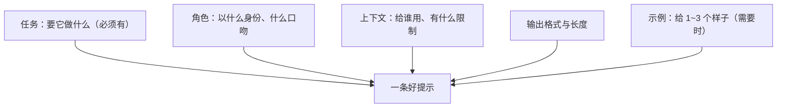
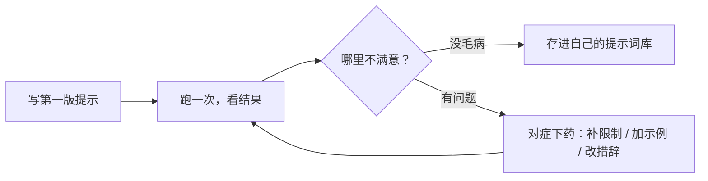

# 第 02 课　Prompt 工程：把话说清楚

上一课你已经能调用大模型了。实际使用中很快会注意到：同一个模型，有人得到的回答准确可用，有人得到的回答答非所问。差别通常不在模型，而在提示怎么写。本课讲提示词的写法。它不产生额外费用，只改变输入内容，是调用大模型收益最高的技能之一。

---

## 一、同一句话，两种交代

先看一个生活场景：给一位新同事派活。这位同事很聪明，读过海量资料，但不了解你的情况，也不会主动追问，你交代成什么样，他就做成什么样。

你说："帮我写个通知。"他只能凭感觉编一个，多半不是你要的。

你说得具体一点，结果立刻不同：

```
差提示：
帮我写个通知。

好提示：
我们小区下周三上午 9 点到 12 点停水检修。请以物业的名义写一张停水通知：
提醒业主提前储水，语气客气，不超过 100 字，结尾落款"阳光小区物业"。
```

第二版多了四样东西：做什么、给谁看、有什么背景、要什么样子。后面所有技巧，本质都是在解决同一个问题：怎么把话一次说清楚。

---

## 二、好提示的五个零件

一条好提示，常见的组成是下面这几样。不必每条都凑齐，但要知道每个零件的作用，缺了会出什么问题。



### 零件一：任务

最容易被写糊的就是任务。人说"帮我弄一下这个"，模型只能猜"弄"是什么。

```
反例：帮我处理一下这段文字。
正例：把这段产品介绍改写成适合发朋友圈的短文案，保留卖点，去掉专业术语。
```

动词要具体：改写、总结、翻译、列举、判断、抽取、解释。一个准确的动词胜过几句形容词。

### 零件二：角色

给角色不是玄学，就是提前定下"口吻和专业度"：

```
反例：解释一下什么是信用卡分期。
正例：你是一位耐心的银行柜台工作人员，用大白话给一位第一次办信用卡的
   客人解释"分期"是什么，多打比方，不说行话。
```

同一个问题，让"小学老师"和"法律顾问"来答，结果当然不同。需要哪种口吻，就在提示里指定。

### 零件三：上下文

模型不知道你是谁、读者是谁、有什么特殊要求，这些要写进提示：

```
反例：推荐几个旅游的地方。
正例：我们两个大人带一个 5 岁的孩子，十一假期从上海出发，不想去太远、
   人挤人的地方，预算一万以内。推荐 3 个目的地，各说明为什么适合带娃。
```

第二版把读者、预算、顾虑都交代了。写提示前先列一遍：这件事里我知道、但模型不知道的信息有哪些，全部补上。

### 零件四：输出格式与长度

```
反例：介绍一下 Python 的优点。
正例：用 Markdown 表格列出 Python 的 5 个优点，两列：优点、一句话说明。
   每条不超过 20 字。
```

不给格式，模型就自行发挥：这次是三大段，下次是十个要点。输出要贴进文档、交给程序处理时，格式必须明确。长度同理，"写详细点"没有约束力，"不超过 200 字"才有。

### 零件五：示例

有些要求用文字很难描述，直接给一两个例子更有效，下一节专门讲。

---

## 三、零样本和少样本：给不给例子

**零样本（Zero-shot）**：不给例子，直接下指令。简单任务直接说往往就行：

> 判断这句外卖评价是好评还是差评："送得挺快，但是汤洒了一半。"

**少样本（Few-shot）**：先给 1~3 个"输入 → 期望输出"的例子，再让它做。示例对统一风格和格式特别有效，比用文字反复描述要求更直接。

```
请把下面的客户留言分类为：售后 / 咨询 / 投诉。

留言：我买的杯子碎了，怎么退？
分类：售后

留言：你们这款保温杯能装开水吗？
分类：咨询

留言：物流太慢了，等了一个星期！
分类：投诉

留言：客服态度挺好了，但发货还是慢。
分类：
```

最后一条是故意放的。示例要覆盖边界：如果三个例子都干干净净，模型遇到"一半好一半坏"的留言就容易判断错；给过一个含糊的、混合的例子，它就知道这种情况该怎么办。挑例子时，专门挑最容易出错的类型放进去。

零样本够用就零样本；风格不稳、格式乱、边界判断差时，再加少样本。例子也不是越多越好，每个例子都占篇幅，两三个挑得准的胜过十个随手塞的。

---

## 四、让复杂问题更靠谱：把中间步骤写出来

简单的任务直接派。多步推理的问题，比如算一笔带折扣和运费的账、排查一段代码为什么报错，直接要答案就容易出错。

原因在模型的生成方式：它一个词一个词地往下写，写出的内容不会回头修改；开头一小步偏了，后面会顺着偏差继续写。对策是让模型把中间过程写出来，再给最终答案。可以这样要求：

- "把每一步的计算过程列出来，最后给出答案。"
- "先列出处理计划，等我确认后再执行。"
- "写完后自己检查一遍，确认没有明显错误再输出。"

这套做法的学名是**思维链（Chain-of-Thought）**，原理就是"把中间过程摊在纸面上"：步骤写出来了，错在哪一步看得见；模型顺着写下的步骤往下走，出错概率明显下降。

注意：这些说法是引导手段，不是固定口诀。起作用的不是某句固定措辞，而是"要求写出中间过程"这件事本身。任务确实需要分步时，就把"分步"写成明确要求；任务很简单时，加这句话反而多余。

更大的任务可以拆成几轮对话：第一轮收集资料列清单，第二轮基于清单出方案，第三轮润色。每轮目标单一，比一轮塞进所有要求更稳。

---

## 五、提示词是改出来的

不要指望第一版提示就完美。常见流程是：写一版、跑一次、看结果、按差距修改：



模型哪里不满意，就补哪条要求：回答啰嗦就限制条数；跑题就把限制放到最前面；格式乱就补一个例子。

修改时，几类常见问题值得先认识：

- 指令互相矛盾：前面说"详细展开"，结尾又说"一句话概括"，模型两边都做不到。写完通读一遍，检查要求是否冲突。
- 一次要求太多：又改写、又总结、又翻译、又起五个标题，模型容易顾此失彼。要么拆成几轮，要么明确主次："先做 A，再顺带 B"。
- 没说禁止项：不告诉它"不要编造数据来源"，它就可能编一个。重要的限制，反面也要写明。
- 重要要求埋在长文里：贴了 2000 字材料，关键指令藏在最后一行。重点要求放开头或结尾，不要埋在中间。

改到满意，就把这版提示存进自己的提示词库，一个文档也行，按用途分类。这是后面所有项目都会用到的个人积累。

---

## 六、拿走就能用的几句

几个高频场景的示范，可以直接改成你的版本：

改写：
> 把下面这段话改写成微信消息语气，礼貌但不要太客气，控制在 3 句以内：……

总结：
> 用 3 个要点总结下面的会议记录，每个要点一句话，保留涉及时间和负责人的信息：……

抽取信息：
> 从下面的简历文本里抽取：姓名、最高学历、工作年限、技能列表。按"字段：值"一行一个输出，原文没有的写"未提供"，不要猜。

写代码注释：
> 给下面的 Python 函数写注释：函数开头用一句话说明用途，参数和返回值各一行，重点解释"为什么这么做"。不要逐行翻译代码。

共同点：动词明确、背景给够、格式写明确、特殊情况有交代。前几节讲的零件，都在这些句子里。

---

## 想一想

1. 把你这周发给 AI 的一段提示翻出来，对照五个零件检查：缺了哪几个？补上后再跑一次，效果差多少？
2. 想一个你自己的任务，零样本效果不满意。设计两个少样本示例，其中一个故意选"最容易出错的边界情况"，看看模型的判断稳了多少。
3. "请一步一步思考"这句话什么时候有用、什么时候纯属多余？用你自己的话说说它背后的原理。
4. （动手）把本课的"停水通知"好提示再改一版：加上一条禁止项和一条格式要求，跑一次对比。

## 小结

把模型当成一位聪明、但对你的情况一无所知、还不会主动追问的新同事：任务、背景、输出样子，都要你主动交代。好提示的零件就几样：明确的任务、合适的角色、足够的上下文、明确的格式，必要时给例子；例子能统一风格，还要覆盖边界。复杂问题让模型把中间步骤写出来，大任务拆成几轮对话，记住这是引导手段、不是固定口诀。提示词很少一版到位，都是跑一次、改一次打磨出来的，把好用的提示攒进自己的库。下一课再往前一步：让模型不只是"说"，还能调用工具，Function Calling。

---

2026 年 10 月
