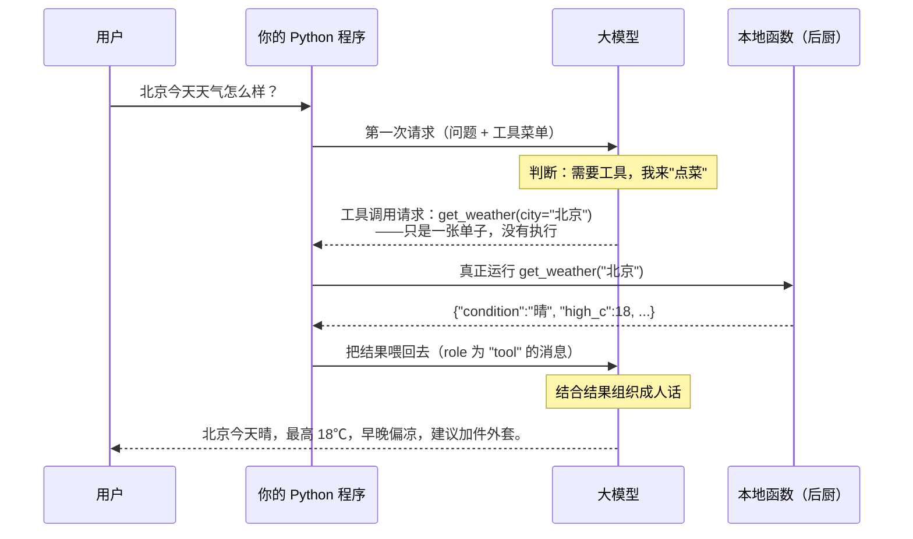

# 第 03 课　Function Calling：让模型会用工具

上一课解决了"怎么说清楚"。这一课解决另一个限制：模型只会生成文字。它查不了实时数据，访问不了你的数据库，也做不了精确计算。Function Calling 补上这一块：你提供一批函数，模型在需要时返回"调用哪个函数、参数是什么"的请求，由你的程序执行。

分工从一开始就要明确：函数由你编写、由你运行。模型只负责提出请求，不执行任何代码。

---

## 一、模型只生成文字，不执行代码

三件它做不到的事：

- 它不知道实时信息。知识来自训练数据，有截止日期；今天的天气、现在的汇率、你刚下的订单，它都不知道。
- 它看不到你的本地资源。你的数据库、内部文档、公司接口，对它完全不可见。
- 它算不精确。它不是在执行计算，而是在逐字生成最像答案的文字；8237 × 2931 这类乘法，它可能算对，也可能错。

但它有一项关键能力：准确理解意图，并按约定的结构提出请求。于是有了这样的设计：你提前准备好一批函数（查天气、做计算、查订单都行），用结构化描述告诉模型"这些事可以请求我做"；模型遇到需要这些能力的问题时，不编造答案，而是返回一条工具调用请求。

最容易误解的一点必须强调：**模型只递单，不执行。** 模型输出的只是"我想调用某函数、参数如下"这样的文本，它运行不了 Python、上不了网、碰不到你的文件。真正执行函数的，是你的程序。

用一个类比记住分工：模型像只看菜单点菜的顾客，不会自己进厨房；你提供菜单（工具列表），它下单（一次工具调用请求），后厨（你的程序）做好菜端回来（把结果喂回模型），它才能写出完整的点评（最终回答）。

---

## 二、工具是怎么告诉模型的

模型怎么知道有哪些工具可用？靠你提供的一份结构化描述，长这样（后面代码里会用到）：

```json
{
  "type": "function",
  "function": {
    "name": "get_weather",
    "description": "查询某城市当日模拟天气。仅当用户问到北京/上海/广州的天气时调用。",
    "parameters": {
      "type": "object",
      "properties": {
        "city": { "type": "string", "description": "中文城市名，例如：北京" }
      },
      "required": ["city"]
    }
  }
}
```

四个部分各管一件事：name 是工具名；description 说明它做什么，更要写清什么时候该用、什么时候不该用；parameters 逐个说明参数的名字、类型、是否必填、什么格式。

这份描述的质量直接决定模型选工具准不准：

- 模糊写法："查天气的"。模型不知道你只支持三个城市，用户问"成都天气"它也会请求这个工具，执行时只能失败。
- 清楚写法："查询北京/上海/广州的模拟天气，其他话题不要调用"。模型知道何时该用、何时不该用。

参数说明同理：写"中文城市名，例如：北京"，模型就很少传出"北京市朝阳区望京街道"这种你处理不了的值。描述越具体，执行端的返工越少。

---

## 三、完整闭环：一句话怎么变成一次执行，再变回一句话

整件事从头到尾走一遍：

1. 你把用户的问题和工具列表一起发给模型；
2. 模型判断这个问题需要工具，返回一条调用请求：工具名加参数，本质是一段 JSON；
3. 你的程序收到请求，检查参数，运行本地函数，拿到结果；
4. 你把结果作为一条新消息发回给模型；
5. 模型结合结果，生成最终的自然语言回答。

第 2 步和第 3 步之间有一条清晰的分界线：模型只递出请求，执行只发生在你的程序里。



整个流程里，模型只做两件事：决定调用哪个工具、参数填什么；拿到结果后把数据转述成自然语言。中间"真正执行"的部分全在你的程序里，所以你能控制它查什么、不能查什么。

一个回答可能需要多次工具调用。比如用户问"北京和上海哪个温差大，再算算（128×365+79）÷12 等于多少"，模型可能先请求两次 get_weather，再请求一次 calculate；你的程序逐一执行、逐一回填，模型最后汇总。所以"发请求、接请求、执行、回填"要写成循环，不能只走一遍。写这个循环有两个工程约束：一是给循环设轮数上限（比如 5 轮），防止模型反复调用不收敛；二是每一轮把对话发回模型时，tools 工具列表都要一并带上，漏了它下一轮就看不到工具了。

你在部分项目里还会看到另一种写法：Responses API 的工具协议，input 里传对话、用 function_call / function_call_output 两个条目回填结果。它与本课的 chat.completions + tools 是同一件事的另一种表达；DeepSeek 的工具调用按本课的 Tool Calls 范式写最稳，看到 Responses 的工具写法认得即可。

---

## 四、请求不能直接信：参数校验与错误回填

模型返回的参数是生成出来的文本，不是从你的数据库里查出来的，可能出现各种问题：

```text
{"city": "北京市朝阳区望京街道SOHO T1座"}   ← 你的函数只认"北京/上海/广州"
{"expression": "1 +"}                        ← 表达式残缺，没法算
{"city": "北京", "unit": "摄氏度"}           ← 多传了你没定义的参数
```

所以程序拿到请求后必须校验。校验不过时，不要让程序崩溃。正确做法是把错误信息也当成"执行结果"喂回给模型：`{"error": "没有成都的模拟数据，仅支持北京/上海/广州"}`。模型拿到这种说明，通常会改用其他方式回应，或建议用户调整问题，程序得以继续运行。

落到代码上，解析参数有两个固定动作。一是 arguments 是 JSON 文本，用 json.loads 解析时要 try/except 捕获异常，解析失败按上面的方式回填错误信息。二是取参数值用 .get 加默认值兜底，例如 `args.get("city", "")`，参数缺失时程序拿到空字符串，而不是直接抛 KeyError 中断。

还有一个安全点必须单独强调：**永远不要用 eval 执行模型传来的表达式**。如果计算器写成 `eval("1+1")`，有人诱导模型生成 `__import__('os').system(...)` 这类字符串，eval 会真的执行它，等于让外部输入在你的电脑上获得 shell 权限。本课示例代码用 ast 只放行加减乘除和括号，其他一律拒绝。原则记一条：模型的输出是数据，不是代码，除非你亲自验过。

---

## 五、什么时候该用工具，什么时候别用

工具不是万能开关，先对号入座：

| 场景 | 该不该上工具 |
|------|--------------|
| 实时信息（天气、汇率、股价、新闻） | 该，模型只掌握训练截止日期前的信息 |
| 内部数据（订单、库存、文档） | 该，模型根本看不到 |
| 需要精确的计算、统计、SQL | 该，算术交给函数，不依赖模型逐字生成 |
| 触发真实动作（发邮件、建工单） | 该，但要加确认机制（见下） |
| 闲聊、写作文、改语气 | 不该，又慢又增加成本 |

安全上记两条。一是权限最小化：给模型用的工具，能只读就不给写，能查订单就不要带删除功能。二是危险操作留人工确认：凡是花钱、删数据、对外发消息的动作，程序先交给人确认，再执行。

---

## 六、下一课预告

这一课里，工具的执行结果以 JSON 字符串喂回给模型，模型返回的调用请求也是 JSON。既然模型和程序之间用结构化数据交流这么有效，下一步就是让模型直接按规定的格式输出答案，比如"返回 JSON，包含 summary 和 tags 两个字段"。这是下一课的主题：结构化输出。

---

## 想一想

1. 为什么不让模型直接执行代码，而要设计成"模型决定、你的程序执行"？提示：想想那些函数跑在谁的电脑上、出了事谁负责。
2. 模型返回了 `{"city": "北京朝阳区望京街道"}`，而你的函数只支持地级市名。你的程序应该怎么接住？错误信息又该怎么喂回去才算"友好"？
3. "帮我算算 128 × 365 + 79"：让模型直接心算，和让它调用 calculate 工具，哪个更可靠？为什么？
4. （轻动手）给 function_calling.py 加一个 now 工具：用标准库 datetime 返回当前时间。不需要 API Key，把它加进离线演示的调用列表里跑一遍即可。

---

## 小结

Function Calling 解决的是"模型只会说、不会做"：你用结构化描述提供工具列表，模型在需要时返回"调用哪个工具、参数是什么"的请求。模型从头到尾不执行任何代码：递出请求的是它，执行的是你的程序，结果回填后它才给出最终回答。模型给的参数是生成的文本，可能缺失、可能格式不对，代码要校验、要兜底（json.loads 捕获异常、.get 给默认值），错误也要友好地回填给模型；调用循环每轮都要带上 tools，并设轮数上限。工具适合实时信息、内部数据和精确计算，闲聊不必调用；权限最小化、危险操作留人工确认，是安全底线。

---

2026 年 10 月
