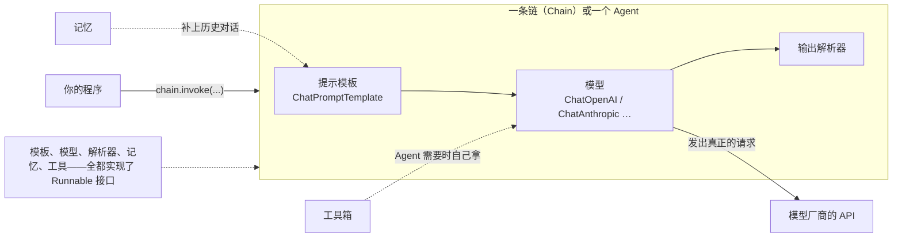

# 第 01 课　LangChain 是什么

第 3 章我们一直用裸 SDK 干活：发请求、拼提示词、挂工具、收结构化结果。功能越写越复杂，你会发现有一批活儿在反复手写。这一课来认识把这些重复劳动统一管起来的工具：LangChain。先说清它的定位：它不是新模型，也不比大模型更聪明，它是一个帮你少写样板、统一接口的框架。模型还是那些模型，它管的是你的程序和模型之间那部分重复代码。

---

## 一、先数数第 3 章你亲手写过的样板

回忆几个场景：

- 两步任务（先总结、再翻译）：手动取出第一步的返回值，塞进第二步的消息里。
- 对话记忆：自己维护一个 messages 列表，每轮把新消息 append 进去，太长了还得自己截断。
- 换模型厂商：函数名、参数、返回结构全不一样，调用代码几乎要重写一遍。
- 网络失败、额度用尽：重试要自己写循环。

每一条都不难，但每一条都要写、要测、要维护。项目里大部分代码在处理这些调用细节，属于业务本身的部分反而占少数。

LangChain 把这些反复出现的活儿做成标准零件：接模型、管提示、存记忆、调工具，都是现成的，而且接口统一。你的精力可以放回业务上。

---

## 二、几个核心概念

### 组件

LangChain 把大模型应用拆成一个个零件，官方叫它们**组件**（Component）：对话模型、提示模板、输出解析器、记忆、工具、检索器等。每个组件都能独立使用，像一套接口统一的积木：块与块能互相咬合，拆下一块换掉，旁边的积木不用动。最典型的就是换模型——今天用 OpenAI，明天想试别家，改的只有模型那一块，提示、解析、记忆统统不碰。

### 链

单个组件干不了完整的活。**链**（Chain）把组件按顺序串起来：提示模板先把问题填成完整提示词，交给模型回答，回答再交给解析器转成你要的对象。以后你会常见到这样的写法：

```python
chain = prompt | model | parser
```

那条竖线就是连接组件的接口。串好的整条链自己也是一个组件，还能再被接进更长的链里。

### Runnable

组件能互相替换，靠的是同一个接口约定：**Runnable**（可运行对象）。每个组件、每条链都实现这套接口，最核心的动作就是 `.invoke`：给一个输入，还你一个输出。

```python
model.invoke("用一句话介绍你自己")      # 模型会这个动作
chain.invoke({"question": "什么是Token"})  # 整条链也会这个动作
```

这正是"换模型只改一块"的基础：新旧组件动作完全一样，调用方不需要改动。除了 invoke，还有流式的 stream、批量的 batch、异步的 ainvoke，下一课展开。

### LCEL、Agent、Middleware

- **LCEL**：刚才 `prompt | model | parser` 用的搭链表达式语法，第 02 课专门讲。
- **Agent**：普通链是固定流程，一步一步按顺序走；Agent 是拿到工具后，由模型自己决定先查资料还是先算数、什么时候结束的执行方式。第 04 课展开。
- Middleware：给链或 Agent 统一附加的一层处理，比如"每次调模型前自动补历史""调用失败自动重试"。这层处理对所有调用生效，不用在每个调用点单独写。第 04 课写 Agent 时会再碰到它。

---

## 三、一张图看懂全貌



看图抓两层：方框内的模板、模型、解析器、记忆、工具是组件层，它们全部实现 Runnable 接口；把它们串起来的链和 Agent 是编排层，决定组件以什么顺序、什么规则执行。真正执行推理的只有模型这一格，其余组件都在为这一次调用做准备和收尾。普通链按图上箭头顺序走；换成 Agent，虚线那两个"什么时候用"的判断就交给模型自己决定。

### 为什么装个框架要装好几个包

安装时你会发现 LangChain 不是一整个包，而是一组分工明确的包：

| 包名 | 管什么 |
|------|--------|
| langchain-core | 地基：Runnable 接口、消息类型、LCEL 语法 |
| langchain | 主包：Agent、常用组件、通用逻辑 |
| langchain-openai | 借 OpenAI 兼容协议接模型（本课用它接 DeepSeek） |
| langchain-anthropic 等集成包 | 接对应厂商的模型 |
| langchain-community | 社区贡献的一大堆第三方集成 |

分包装是刻意的：用哪家模型就装哪个集成包，不必把所有厂商都拖进依赖里；地基和集成包各自独立升级，一个包更新不至于影响其他包。本课接 DeepSeek（借 langchain-openai 的 OpenAI 兼容协议），就 `pip install langchain langchain-openai`，就这么点事。

---

## 四、装上它，跑通你第一条链

虚拟环境怎么建、API Key 怎么申请，第 3 章首课都讲过，这里只强调一点：Key 别写进代码——从环境变量读，或用 python-dotenv 从项目里的 .env 文件读（.env 记得加进 .gitignore，别提交）。

安装：

```bash
pip install langchain langchain-openai python-dotenv
```

> 已知故障排查：如果运行时报 `TypeError: Client.__init__() got an unexpected keyword argument 'proxies'`，是 openai 旧版本（<1.55.3）搭配新版 httpx 的兼容问题，执行 `pip install -U openai httpx` 即可修复。

本课目录里的 hello_langchain.py 就是你的第一条链，核心就这几行：

```python
import os

from langchain_core.prompts import ChatPromptTemplate
from langchain_openai import ChatOpenAI

prompt = ChatPromptTemplate.from_messages([
    ("system", "你是一个说话简洁的编程老师。"),
    ("human", "用一句话解释什么是{thing}。"),
])
model = ChatOpenAI(
    model=os.environ.get("DEEPSEEK_MODEL", "deepseek-flash"),  # 示例名可能更新，以 DeepSeek 官网模型列表为准
    api_key=os.environ.get("DEEPSEEK_API_KEY"),
    base_url="https://api.deepseek.com",  # langchain-openai 借 OpenAI 兼容协议接 DeepSeek
)

chain = prompt | model
print(chain.invoke({"thing": "LangChain"}).content)
```

对照第 3 章的裸 SDK 写法，你手写过的活儿都有了对应的组件：

| 第 3 章你手写的 | 现在变成了 |
|----------------|-----------|
| 自己拼 messages 列表、手动塞变量 | ChatPromptTemplate 模板，{thing} 占位自动填 |
| client.chat.completions.create(...) 一大段 | model 一块组件，.invoke 一次调用 |
| prompt 和 model 之间的传参代码 | 一条竖线 `|` 接起来 |
| 换厂商要重写调用代码 | 换一个模型类，链的其他部分不动 |

跑出来的回答和第 3 章那次"第一次调用"没有本质区别。区别在于代码的形态：今天这几行，之后可以直接扩展成带记忆、带工具、带解析的完整应用，而不用推倒重来。

---

## 五、对框架，保持一点清醒

1. 框架会更新，接口会变。LangChain 演进很快，旧写法可能过时。跑不通时先怀疑版本，查官方迁移指南，再排查自己的代码。
2. 抽象有成本。为了"换模型不改代码"这类灵活性，你引入了一整套概念和依赖。如果需求只是发一次请求拿回结果，裸 SDK 十几行更直接。
3. 懂底层，框架才为你所用。第 3 章的功底这时候显出价值：链报错时，你能分清是提示的问题、模型的问题还是解析的问题，而不是对着黑盒排查。

第 07 课我们专门讨论"什么时候不该用框架"。先把工具学会，才谈得上什么时候放下它。

---

## 想一想

1. "换模型只改一块组件"靠的是哪个概念？如果没有统一接口，换一次模型你要动多少地方？
2. `prompt | model | parser` 串成的整条链，算不算一个组件？它有没有 `.invoke` 方法？
3. 举两个你会不用 LangChain、直接裸写 SDK 的具体场景，说说理由。
4. 如果让你在"每次调模型之前"这个位置统一加一件事（Middleware 的思路），你会加什么？为什么？

## 小结

- LangChain 是帮你少写样板、统一接口的框架，不是新模型；它管的是你的程序和模型之间的重复劳动。
- 组件是标准零件（模型、提示、解析器、记忆、工具），链是把组件按顺序串起来的执行结构，串好的链自己还能当组件。
- Runnable 是所有组件共同实现的统一接口，`.invoke` 是它的核心动作；组件可换、可串，全靠这个约定。
- 包是分开装的：langchain-core 打地基，langchain 是主包，langchain-openai 等集成包接各家模型。
- 框架不是用得越多越好。懂底层、按需使用，是这一章从头到尾的态度。

---

2026 年 10 月
