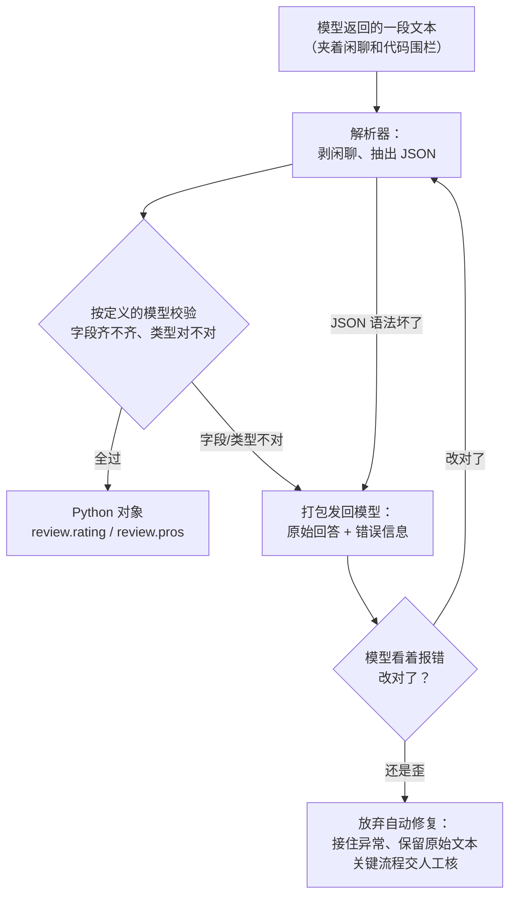

# 第 06 课　输出解析器：把回答变成对象

第 05 课我们让链条接上了外部资料，模型回答有依据了。但真跑过 `chain.invoke(...)` 你会发现：print 出来的是一段文本（AIMessage），不是程序能直接按字段取用的对象。这一课就解决最后一步怎么转换。第 3 章结构化输出那一课，这套流程你手写过一遍；今天看 LangChain 怎么把"格式说明 → 解析 → 校验 → 自动修复"做成链上的标准组件。

---

## 一、模型返回的是文本，程序要的是对象

先看问题的原型。你让模型"给《流浪地球2》写个简评"，它回你：

```
好的，这是我的简评：

```json
{"title": "流浪地球2", "rating": 8.5, "pros": ["特效震撼", "多线叙事有格局"]}
```

希望对你有帮助！
```

人读着没问题，但程序需要的是三个字段：电影名、评分、优点列表，之后要填进表格、写进数据库、发给前端。信息都在文本里，程序却不能直接按字段取用。

输出解析器（Output Parser）负责这个转换：**把模型返回的文本变成结构化对象**。它管两件事：

- 把模型返回的文本可靠地变成对象：找到 JSON、剥掉闲聊、解析、按定义的结构逐字段校验；
- 不合法时把错误报清楚：缺哪个字段、哪个类型不对，明确抛出来，而不是让人拿着半截字符串排查。

这个家族你其实早见过一位成员：第 02 课的 StrOutputParser，它只做"从消息对象里抽出字符串"。今天认识的是两个功能更强的。

## 二、PydanticOutputParser：先定义结构，再让模型填

思路是先把"数据长什么样"定义下来。用 Pydantic 写个类，字段、类型、含义一目了然：

```python
from pydantic import BaseModel, Field

class MovieReview(BaseModel):
    title: str = Field(description="电影名")
    rating: float = Field(description="0 到 10 的评分")
    pros: list[str] = Field(description="优点，2 到 3 条")
```

字段描述不是摆设，解析器会把它们写进给模型的格式说明里。接着创建解析器：

```python
from langchain.output_parsers import PydanticOutputParser
# 这个类在包之间挪过几次位置：报 ImportError 就换成 from langchain_core.output_parsers 试试

parser = PydanticOutputParser(pydantic_object=MovieReview)
print(parser.get_format_instructions())
```

`get_format_instructions()` 会生成一段文本：返回结果该是什么 JSON 结构、每个字段什么含义。把它塞进提示词，模型照着返回，格式出错率明显下降：

```python
prompt = ChatPromptTemplate.from_messages([
    ("system", "你是影评助手，简短直接。\n{format_instructions}"),
    ("human", "给电影《{movie}》写个简评"),
]).partial(format_instructions=parser.get_format_instructions())
```

`.partial(...)` 的意思是：这个变量现在就固定下来，之后 invoke 只填其他变量。

于是主线三步定型：定义 Pydantic 模型 → 提示里带格式说明 → 链末解析：

```python
model = ChatOpenAI(model="gpt-4o-mini")  # 示例名，可能已更新：按官网模型列表选
chain = prompt | model | parser
review = chain.invoke({"movie": "流浪地球2"})

review.rating     # 8.5，是 float，不是字符串
review.pros[0]    # 直接按列表用
```

链的末端换了组件：以前 StrOutputParser 输出字符串，现在 PydanticOutputParser 输出 MovieReview 实例。模型返回后，解析器自动做三件事：剥掉围栏和闲聊，解析 JSON，按定义的模型逐字段校验。评分返回"很高"这种值时，当场抛异常，错误信息写明哪个字段不合格，问题出在模型没按约定返回，而你的取值代码不用改。

## 三、JsonOutputParser：只要个字典，更轻量

如果字段结构经常变，或者你只想要个字典、不想建类，JsonOutputParser 更轻：

```python
from langchain_core.output_parsers import JsonOutputParser

chain = prompt | model | JsonOutputParser()
data = chain.invoke({"movie": "流浪地球2"})
data["rating"]    # 拿到的是 dict，用方括号取值
```

它保证"返回的东西是合法 JSON"，解析成 dict 就交给你，不做字段类型校验。格式说明它也能生成，只是没有 Pydantic 那套校验。

怎么选，一句话：

- 字段固定、要严格校验、下游想写 `review.rating` → PydanticOutputParser；
- 结构松散常变、拿到 dict 自己再加工 → JsonOutputParser。

另外提醒一句：LangChain 家族里还有 Xml、CSV 等各种解析器，不必都引入。绝大多数场景上面两个就够，真遇到再查文档。

## 四、解析失败：带错重试一次

格式说明给了，模型仍可能出错：JSON 里多个逗号、字段名拼错、类型不对。这不奇怪，大模型本质是在预测下一个字，不是在执行数据库写入，偏差是正常现象。

LangChain 的处理方式不是让你 try/except 一遍遍手动重跑，而是把"返工"做成组件：解析失败时，把原始回答连同错误信息一起发回给模型，让它修改后重新解析：

```python
from langchain.output_parsers import OutputFixingParser

fix_parser = OutputFixingParser.from_llm(parser=parser, llm=model)
review = fix_parser.invoke(raw_text)  # raw_text：刚才解析失败的那段原始回答
```

OutputFixingParser 包住原解析器：先按原路解析一遍，失败就把原始回答和错误信息一起发给模型，让它看着报错改一次，改完重新解析。RetryOutputParser 是同类组件，区别是它把提示词也带上（`parse_with_prompt`），模型能看到"当初让它做什么"，更适合内容跑偏而不只是格式小错的情况。

这能救回多少？格式小错救得回：围栏忘剥、逗号多了、字段名小错，模型看着报错修改这类问题成功率很高。但如果模型一开始就理解错了（字段全错、内容跑题），再让它改，顶多把 JSON 修合法，内容还是不对。所以**自动修复不是保险箱**：它自己也是一次模型调用，会失败、会花钱，第 02 课讲的 with_retry 和 fallbacks 在这里照旧适用，外面仍要 try/except 接住。



## 五、装回链条：检索 + 生成 + 结构化

解析器在 LCEL 里通常就是最后一段。和第 05 课的检索器拼起来，就是一条"查资料 → 生成 → 交结构化结果"的链：比如客服系统查完知识库，要输出"分类 / 严重程度 / 建议回复"三个字段交给工单系统：

```python
from langchain_core.runnables import RunnableParallel, RunnablePassthrough

chain = (
    RunnableParallel(context=retriever, question=RunnablePassthrough())  # retriever 是第 05 课的检索器
    | prompt      # 模板里吃 {question} 和 {context}，末尾带着格式说明
    | model
    | parser
)

ticket = chain.invoke("我的订单三天了还没发货")
ticket.category    # '物流' —— 直接进工单系统
```

输入先分两路：question 原样透传，context 去向量库取资料；汇合后填进模板，模型生成，解析器收尾。检索、生成、结构化三件事，竖线一串就齐了。

## 六、说点实话：解析器不是万能的

- 模型偏差大时，修复也救不回来。关键流程在解析之前保留一份原始文本，出了问题能对账，也能作为下一次修复的参考；
- 要不要人工复核，看场景：给内部报表填字段，错了重跑一次即可；给客户算退款金额，过了模型和解析器之后还要有人确认；
- 还有一条 2026 年的路线值得知道：新一代模型支持**原生结构化输出**，LangChain 里 `model.with_structured_output(MovieReview)` 一行，模型在接口层直接返回结构化数据，连格式说明都不用拼。它够用时优先用它；要兼容老模型，或要做超出类型校验的自定义检查时，今天讲的解析器路线仍然适用。

下一课是本章的综合实战：把 LCEL、记忆、工具、检索和今天的解析器串成一个完整小应用，解析器会以"链末收尾"的身份出场，这课的写法可以直接用上。

## 想一想

1. 格式说明为什么要提前塞进提示词，而不是等模型返回后用正则去"抠"？提前说和事后抠，各自赌的是什么？
2. 做"每日新闻摘要"，字段天天变；另一个项目做"退款审批"，字段固定且金额错一分都不行。两个各选哪个解析器，为什么？
3. OutputFixingParser 修复一次也是一次模型调用。如果修复后仍然失败，你的程序接下来该做哪几件事？
4. 模型把评分返回成汉字"很高"，Pydantic 校验会怎么报？你觉得修复解析器能把"很高"改成 8.5 吗——它凭什么能改对？

## 小结

- 模型吐的是文本，程序要的是对象。解析器负责把文本可靠地变成对象，不合法就把错误报清楚。
- PydanticOutputParser 的主线三步：定义模型 → get_format_instructions() 塞进提示 → 链末解析校验；这个类有双路径导入，报 ImportError 换 langchain_core 下的路径即可。
- 只要轻量字典用 JsonOutputParser；解析器不必堆砌，够用就好。
- 解析失败可以交给 OutputFixingParser / RetryOutputParser 带错重试一次，但它也是一次模型调用，外面仍要兜底、留原始文本。
- 解析器是链上最后一段，接上检索器就是"检索 + 生成 + 结构化"；新一代模型的原生结构化输出是优先考虑的路线。

---

2026 年 10 月
