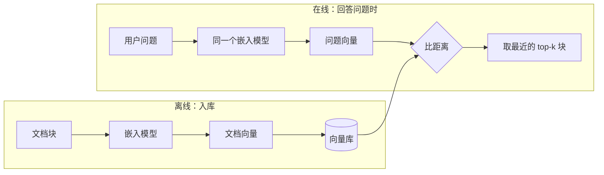

# 第 03 课　Embedding：给文字配上"语义坐标"

上一课把文档切成了块。但问题马上就来了：用户的问题和文档块长得完全不一样，电脑怎么知道哪一块和问题"说的是一回事"？答案就是本课的主角，嵌入模型。它给每段文字一组坐标，意思相近的文字，坐标就相近。

---

## 一、把第 02 章的向量请回来

在第 02 章学 Token 和 Embedding 时我们说过：嵌入模型把一段文字变成一串数字，这串数字叫**向量**。当时你可能觉得有点抽象。今天从"检索资料"这个具体用途重新看它，你会发现这串数字很有用。

先建立直观印象：嵌入模型把每段文字映射成高维空间里的一个点，安排位置的原则是按意思：意思相近的，位置就相近。

"小猫在沙发上睡觉"和"小狗趴在垫子上打盹"，用词几乎不重叠，但它们说的是同一类事（宠物 + 休息），所以坐标会挨得很近；而"今晚吃火锅还是烤肉"会落在另一个区域。这种表示还能穿透不同的说法："天气很好"和"今天阳光明媚"，一个字都不一样，也会被安排成邻居。

这就是检索的地基：只要"意思"变成了"位置"，找相似内容就变成了找邻居。

## 二、相似度怎么衡量：比方向，不比距离

两串数字摆在一起，怎么算"像不像"？最常用的尺子叫**余弦相似度**。

先说直觉：把两个向量看成从原点出发的箭头，余弦相似度量的是这两个箭头夹角的余弦。两个箭头指向几乎一致，说明它们说的是"同一方向的事"，分数接近 1；互相垂直（毫无关系）接近 0；指向相反接近 -1。就像判断两个人是否顺路，看他们前进的方向是否一致，而不是各自走了多远。

公式各部分的含义：

```text
cosine(A, B) = A·B / (|A| × |B|)
             = （对应分量相乘再求和）/（两个向量各自长度相乘）
```

分母把长度除掉了，所以余弦相似度只看方向、不看长短。嵌入模型输出的向量分量基本是正数，所以实际分数落在 0 到 1 之间，越接近 1 越像，这一条记住就够用了。

不过它是最常用的，不是唯一的。另外两把尺子也该认识：

- 点积：对应分量相乘再求和，是余弦公式里的分子。它算得快，而且有一个有用的事实：如果向量事先**归一化**（缩放成长度为 1），点积就直接等于余弦相似度。很多向量库正是靠这招省掉除法环节。
- L2 距离：两个点在空间里的直线距离，距离越小越像。归一化之后，它的排名和余弦一致。

三把尺子在"归一化"前提下排名一致，不必纠结：理解了余弦，其他两个都通了。

## 三、检索的本质：把问题也变成向量

现在可以回答开头的问题了。RAG 检索的完整动作是：

1. 文档切块后，每块都过一遍嵌入模型，变成一个向量，存进向量库；
2. 用户的问题来了，**同一个嵌入模型**把问题也变成一个向量；
3. 拿问题向量去库里逐一比相似度，取最近的 top-k 块，交给后面的步骤。



注意图里那句"同一个嵌入模型"，它是本课最重要的前提，第六节的坑一会展开。

## 四、这些坐标是哪来的

每段话的坐标由模型训练得出。嵌入模型的主体是一个编码器（第 02 章的 Transformer 在这里工作）：文字进去，经过编码和池化，出来一个固定长度的向量。

训练的方法符合直觉：给模型看海量文本对，意思相近的句子对（正样本）和不相干的句子对（负样本），要求它把前者的向量拉近、后者的推远。这类训练思路叫**对比学习**。

模型没有被明确教过任何一条规则，它是在几百万次"这两句该靠近、这两句该离远"的练习里，摸索出了语义空间的布局。这也是为什么"沙发睡觉"和"垫子打盹"被安排到隔壁：它们在训练语料里本来就常一起出现。

训练数学不展开，记住"靠近相似的、推远不相关的"这一句，就足够支撑后面的内容。

## 五、怎么选嵌入模型：先问四个实际问题

选型先把术语放一边，问四个实在问题：

1. 维度多高合适：维度就是坐标的个数。维度高，能表达的语义细节多，但每个向量占的存储更多、算相似度也更慢；维度低则又快又省，但细节可能损失。常见模型从几百维到几千维都有，按你的数据量和预算权衡。
2. 中文还是多语言：资料和用户提问都是中文，专门的中文模型往往更准；中英混杂就选多语言模型。错配的代价很实在：用只懂英文的模型嵌中文，出来的坐标基本是噪声。
3. 模型多大、跑多快：几十万份文档要嵌入时，模型大小直接决定这是几分钟还是一晚上的活。嵌入是一次性的入库成本，但重建索引时要再付一次。
4. 本地跑还是调 API：本地开源模型免费、数据不出本地，但要自己管机器和版本；API 省心、按量付费，数据要发给服务商。和第 03 章用大模型 API 的权衡是同一道题。

落到 2026 年的示例类型上：开源阵营有 BGE 系列这一类（如 BGE-M3，多语言、对中文友好），商业阵营通义千问、智谱等厂商提供嵌入 API。注意：本课程生成用的 DeepSeek 不提供 embedding 接口，做嵌入需另选 BGE/通义/智谱这类方案。注意这些名字只是示例，型号更新很快，选型时去 MTEB 这类公开榜单按你的场景（中文检索、多语言）筛，再回到官网确认当前版本：榜单名次会变，按场景选型的思路不变。

## 六、三个常见坑

### 坑一：问题和文档用了不同的嵌入模型

每个模型训练出来的语义空间都是独立的，问题用模型 A 嵌、文档用模型 B 嵌，两组向量不在同一个空间里，相似度算出来没有意义。问答两端必须用同一个模型，这条没有商量余地。换了模型怎么办：全部文档重新嵌一遍。

### 坑二：忘了归一化这回事

归一化把向量缩放成长度为 1。做了它，点积、余弦、L2 三把尺子排名一致，很多向量库还能借机提速；不做也不算错，但不同库的默认行为不同，返回结果对不上时，先检查双方有没有归一化，能省半天排查。

### 坑三：以为嵌入"什么都懂"

嵌入只负责"语义像"，它不懂事实的对错和数字的精确。"公司 2025 年营收 3.2 亿"和"公司 2024 年营收 2.9 亿"，语义上几乎是同一句话，向量会非常接近，但在财务问答里这是两条完全不同的数据。型号、编号、人名这类需要精确匹配的内容，语义检索会给你"长得像的"而不是"就是这个的"。

所以工程上的标配是：语义检索打底，必要时配上关键词检索兜底。两条腿怎么配合，第 05 课讲混合检索时展开。

## 七、它在 RAG 流水线里的位置

把全景课的地图调出来，嵌入模型站在"切块"和"向量库"中间：

- 离线入库：加载文档 → 切块（第 02 课）→ 逐块嵌入（本课）→ 向量连同原文存进向量库；
- 在线问答：问题嵌入 → 去库里取 top-k → 拼进提示词 → 模型生成回答。

下一课把这些零件串成一条能跑的完整流水线，到时候你会发现，最难的部分今天已经讲完了。

---

## 想一想

1. "天气很好"和"今天阳光明媚"没有共同关键词，为什么嵌入后向量会挨得很近？
2. 你的向量库用模型 A 建的，半年后想把文档换成模型 B，只把新问题用 B 嵌入库中查询，行不行？为什么？
3. 向量已经归一化时，点积和余弦相似度相等。为什么向量库偏爱用点积来做检索？
4. 要检索"订单号 ORD-88492 的物流状态"，纯语义检索可能出什么问题？你打算怎么办？

## 小结

嵌入模型把文字变成一串数字（向量），意思相近的文字在语义空间里位置相近，"找相似"由此变成了"找邻居"。衡量相似最常用余弦相似度：比方向不比长短，越接近 1 越像；归一化后点积与它等价。向量坐标是模型在海量"拉近相似、推远不相关"的对比训练里学出来的。选型先问维度、语种、大小速度、本地还是 API 这四个实际问题，再按榜单和官网确认型号。最后记住两条铁律：问题和文档必须用同一个嵌入模型，嵌入只懂语义相似、不懂事实精确。

---

2026 年 10 月
