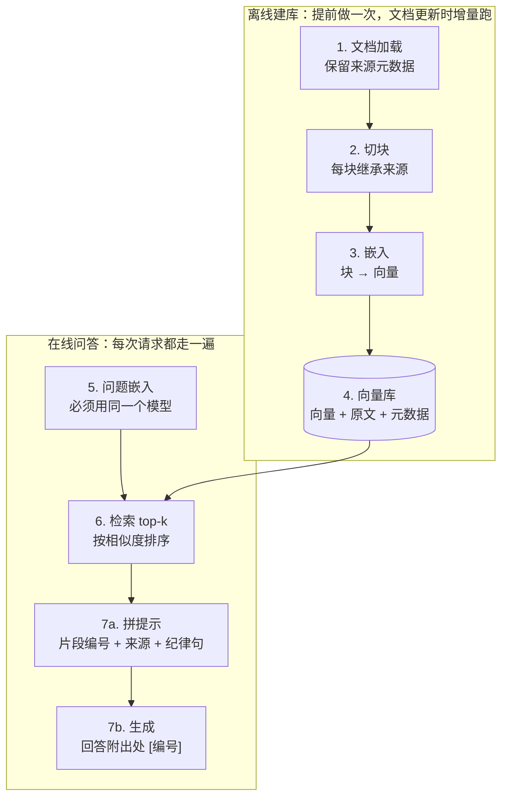

# 第 04 课　RAG Pipeline：搭一条完整流水线

前三课零件已经备齐：第 01 课画了全景，RAG 就是"先翻资料再回答"；第 02 课把长文档切成块；第 03 课弄懂嵌入，把文字变成可以比距离的向量。零件不等于机器，这节课动手把它们装配起来，跑通你的第一个 RAG 系统。

这台机器规模很小，但七个环节齐全，而且不需要任何第三方库就能跑通主干。

## 一张图看懂整条流水线

先看全景，一共七步。注意它分成两部分：上面四步是提前做好的（离线建库），下面是每次有人提问都要发生的（在线问答）。



离线与在线的划分依据是成本和频次：建库四步费时费力，但结果可以反复使用，做一次管千万次提问；在线四步轻快，每次请求都要走一遍。

还有一点值得现在就记住：整条流水线里，只有最后一步调用模型涉及"智能"，前面六步全是常规的工程处理。工程处理意味着可以调试、可以改进。

## 离线建库：提前做好的四步

第 1 步，加载。把文档读进来，通常是 PDF、网页、数据库记录。这一步最容易被轻视，却埋着一个大坑：加载时就要保住"这份资料是从哪来的"，也就是**元数据**（文件名、页码、网址）。原因是模型最后回答"报销期限是 10 天"时，用户得能追问这个说法的出处。没有元数据，回答就无法溯源。

第 2 步，切块。沿用第 02 课的思路，把长文档切成小块，而且每一块要继承来源元数据：块是检索的最小单位，来源跟着块走。本课为了看清流程，用最朴素的按句切块：在句末标点处切一刀。真实项目里换成第 02 课讲的递归分块，骨架不变。

第 3 步，嵌入。把每个块交给嵌入模型，变成一个向量。这步在第 03 课已经讲透，这里只强调一个贯穿全局的纪律：记录下你用的是哪个嵌入模型，后面马上要用到。

第 4 步，入库。把"向量 + 原文 + 元数据"三件套一起存进向量库。三样缺一不可：只存向量，检索到了也没法读；只存原文，就得每次提问现算全部向量，太慢；不存元数据，回答没法给出处。本课用一个 Python 列表当内存版向量库，概念上和 FAISS、Chroma 没有区别，只是规模不同。

这些活放在离线做，是因为它们贵、慢、但结果可以反复用：一次建库，千万次提问受益。文档有更新就增量处理新来的、删除失效的，不用全部重来。

## 在线问答：每次请求的四步

第 5 步，问题嵌入。用户的问题也要变成向量，才能去库里比相似度。这里有一条本课最重要的纪律：**问题必须用和建库时同一个嵌入模型**。

打个比方：两支探险队要在同一张地图上会合，必须用同一套坐标系；一支用经纬度、一支用街道门牌，永远碰不上头。嵌入模型就是坐标系：用 A 模型给文档建的库，用 B 模型给问题算向量，两组数不在一个空间里，算出来的相似度是一堆噪声。这是新手最容易踩、又最难察觉的坑。

第 6 步，检索 top-k。拿问题向量去库里算相似度（余弦相似度，第 03 课讲过），取分数最高的 k 块。k 取多大需要权衡：太小（比如 1）容易漏掉关键信息，太大（比如 20）会把不相关的块也拼进来，既稀释重点又增加成本。所以实践中常常再配一个**相似度阈值**：分数太低的块宁可不要，与其塞进干扰项，不如让模型直说"资料里没有"。

第 7a 步，拼提示。这是整条流水线里最考验细心的环节。把检索到的块拼成上下文时，做三件事：

- 编号：每条资料前标上 [1]、[2]，方便模型引用；
- 带来源：把元数据一起写进去；
- 立规矩：明确告诉模型"只依据下面的资料回答，资料不足就直说'资料里没有'，不要猜"。

最后这句纪律句不是客套。模型得不到约束时，会用训练时记住的泛泛内容补空，幻觉就是这么混进来的。把模型的发挥空间约束在"你给的这几条资料"里，是 RAG 治幻觉的核心手段。

第 7b 步，生成。拼好的提示发给大模型，要求回答末尾用 [编号] 标明用了哪条资料。用户看到答案，顺手就能核对出处。能自查的答案，才是可信的答案。

## 亲手跑通：mini_rag.py

课程目录里的 `mini_rag.py` 把七步全部实现了，离线主干纯标准库、零依赖，直接运行：

```bash
python mini_rag.py
```

它的思路很直白，对照代码读：

1. 写死 4 条中文小文档（报销、考勤、密码、团建各一条），每条带来源文件名当元数据；
2. 按句切块：正则切在句末标点上，和上面讲的第 2 步一一对应；
3. 手工向量代替嵌入模型：数一数每块里"报销、发票、请假、审批"这几个关键词各出现几次，凑成一个 6 维向量。这个做法与嵌入模型在本质上做同一件事，把文字变成一组有语义的数，只是嵌入模型用几千个维度、由神经网络学出语义，比数关键词精细得多；
4. cosine 检索 top-2 + 阈值 0.05：先按余弦相似度排序，分数太低的直接丢弃；
5. 拼出最终提示并打印：片段编号、来源、"只依据资料"的纪律句，一个不少；
6. 生成段：从环境变量读 `DEEPSEEK_API_KEY`，用 openai SDK 连 DeepSeek（base_url=https://api.deepseek.com）调模型。这一步需要 Key，本课未实跑；没配 Key 时脚本打印中文提示并跳过，不报错，也不伪造回答。

配置了 Key 的读者跑完整版：`pip install openai python-dotenv`，设好 `DEEPSEEK_API_KEY` 再运行。代码用 openai SDK 的 Responses API（`client.responses.create`）连 DeepSeek，模型默认 `deepseek-flash`，可用 `DEEPSEEK_MODEL` 覆盖；旧写法 `chat.completions.create` 在网上仍大量可见，两者会长期共存，会读旧代码就够。

跑起来后你会看到四段输出：建库切成了哪几块、问题向量长什么样、每块相似度多少分谁被丢弃、最终拼出的提示全文。重点看最后那段提示，那就是发给模型的原话，"资料不足就说没有"的纪律句写在开头。

## 调试 RAG：把中间结果打出来

RAG 出了问题，先分清是"没检索到"，还是"检索到了但没答好"。这是两类不同的问题，处理手段也不同。区分的办法是把流水线拆开，逐段看中间结果：

- 切块结果：文档被切成了几块，关键词所在句有没有被切散。
- 检索结果：命中了哪几块，相似度分别是多少，是被阈值拦了，还是排不进前 k。
- 最终提示：拼出来的上下文里，有没有包含答案的那一块。

逐段检查，堵在哪一段一目了然。上面 mini_rag.py 打印的四段输出，本身就是一份现成的检查报告。以后自己写 RAG，请养成每一步都留下中间结果的习惯。生产系统里，这套打印会升级成日志和追踪工具，思路一致。

## 检索不准时的进阶方向

跑完你可能会发现：检索这步容易失手，问题换个说法就搜不到，或者搜回来的块不贴题。这很正常，基础流水线本来就有天花板。后续两课专门处理：

- 第 05 课（高级主题）：查询重写（把口语化的问题改写成利于检索的样子）、混合检索（关键词检索 + 向量检索双路并行）、语义缓存等；
- 第 06 课（Rerank）：先粗筛再精排的两阶段检索，让"排进前 k"的块更靠谱。

先把手头这条最小流水线跑稳、跑懂，再按真实问题逐项加优化手段，顺序不要反。

## 想一想

1. 对照七步流水线，说说离线建库包含哪几步、在线问答包含哪几步。为什么"重活"要尽量放在离线做？
2. 建库用了 A 嵌入模型，提问时手滑用了 B 嵌入模型，检索会发生什么？用"坐标系"的类比解释一下。
3. 把 TOP_K 从 2 调到 5，可能出现什么新问题？提示：想想相似度很低的块被拼进提示后，模型会怎么表现。
4. （动手）把 `mini_rag.py` 里的 QUESTION 换成"团建要自己花钱吗？"，运行后观察各块相似度分数和命中结果，再看拼出的提示是否合理。

## 小结

七步流水线分两段：离线建库（加载→切块→嵌入→入库）提前做好、增量维护，在线问答（嵌入问题→检索→拼装→生成）每次请求都走一遍。加载保元数据、入库存"向量+原文+元数据"三件套、问题嵌入必须与建库同模型、拼提示要编号带来源并立下"只依据资料"的规矩、回答附出处。检索不准时先用"打印中间结果"分清是没检索到还是没答好，再对症处理：查询重写、混合检索、重排这些进阶手段，后面两课见。

2026 年 10 月
