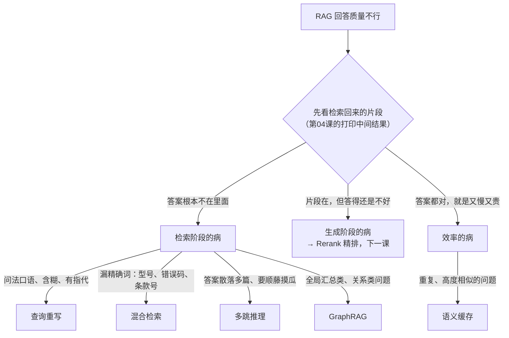

# 第 05 课　RAG 高级主题：先定位问题，再选手段

上一课结尾留了伏笔：基础流水线有天花板。实际用过 mini_rag.py 之后，多半遇到过这类情况：同一个问题换个说法就查不到；查回来的结果里，相关的那条被不相关的内容淹没；又或者同一个问题被反复提出，每次都重新检索、重新生成，成本重复支出。

本课介绍五种常见优化手段：查询重写、混合检索、语义缓存、多跳推理、GraphRAG。但在认识它们之前，先讲一件更重要的事：定位问题。RAG 效果不好就把所有优化手段全部加上，是新手常见的做法，结果是系统更大、更慢、更贵，指标却没有变化。正确的顺序永远是：先定位问题，再选手段。

## 先定位：问题出在哪一段

把根因分成三类，一个不满意的回答只可能落在其中一类：

- 检索阶段的问题：答案根本不在检索回来的片段里。又分两种情况：什么都没查到（问法太口语、指代不明，或精确词缺失）；答案散落多处，单次检索凑不齐。
- 生成阶段的问题：片段里有答案，模型没有用好，被噪声带偏、重点被稀释。这类问题的对应手段是下一课的 Rerank，本课只点名。
- 效率问题：答案正确，但响应慢、成本高，同类问题反复出现。

判断方法：用第 04 课的做法，打印中间结果。先看检索回来的片段：答案不在里面，是检索阶段的问题；在里面但答得不对，是生成阶段的问题；都对但慢和贵，是效率问题。

把这套判断逻辑画成图，出问题时先归类：

有了这张图，本课剩下的内容就是逐个认识每种手段，每一节回答同一个问题：它处理哪类根因。

## 查询重写：把口语化问题改写成利于检索的形式

设想同事递来一张纸条，上面只写"上次那个事怎么没批"。你得先问清楚是哪个事、哪一次。检索系统不会反问，只会拿原话去和文档逐字比对，比对不上就返回空结果。

查询重写（Query Rewrite）就是在检索之前，先把用户的问题重新组织一遍。它主要处理两种情况：

- 换个说法才查得到。用户问得口语、含糊，常用"它""那家公司""上一版"这类指代，而文档里没有上下文，代词无法对应。这时用 LLM 把问题改写成一句自含的、利于检索的话："上次那个事"改写为"Q4 市场预算审批流程"。多轮对话里把代词替换成上文实体，是查询重写最高频的用法。
- 一个问题包含多个意思。"对比方案 A 和方案 B"，一句话里装着两个问题。带着整句去检索，很可能两边都查不全。重写阶段可以把它拆成两个子问题，分别检索，最后合并。

还有一种方法叫 **HyDE**：不重写问题，而是让 LLM 先生成一段假想答案，再拿这段文字去检索。听起来绕，道理成立：答案的用词天然比问题更接近文档的用词。知道这招即可，实践中重写不奏效时可以试。

代价也要算：重写本身是一次 LLM 调用，延迟和成本都增加，改写偶尔会偏离原意。是否启用，靠评测数据决定（见本章最后一节的落地建议）。

## 混合检索：语义匹配与字面匹配并行

第 03 课学的向量检索有一个短板：它按语义相似匹配，对字面精确不敏感。问"笔记本坏了怎么办"，它能找到"笔记本电脑故障排查"；但问型号"XR-200"、错误码"0x80070005"时可能漏掉：在嵌入模型眼里，"XR-200"和"XR-300"两个向量的距离，未必比两个毫不相干的词远多少。专有名词、型号、条款号这类精确字符串，正是语义检索容易漏的部分。

关键词检索正好相反，代表算法是 **BM25**（基于词频与文档长度的打分，类似文档内查找的加强版）：搜"XR-200"，含这个词的文档一定排在前面；但搜"笔记本"，它不会把只写"膝上型电脑"的文档排上来，因为它不做同义匹配。

混合检索（Hybrid Search）就是让两路并行查询，再合并结果：一路按语义，一路按字面，互补盲区。它处理的是"向量检索漏掉精确词"这类问题。

合并环节的主流默认是 **RRF（倒数排名融合）**：不看两路的分数，只看名次，在两份榜单里都靠前的文档，合并后更靠前。主流向量库和搜索引擎现在基本内置了混合检索，多数情况下不用自己处理融合细节。旧资料里另一路做法（把两路分数归一化后加权求和）也能用，但权重需要调，两套分数的量纲还不同；看到旧代码认识即可。

## 语义缓存：重复问题的加速层

前两种手段提高检索准确性，这一种不求更准，求更快更省。

语义缓存（Semantic Cache）把问过的问题和答案存起来。新问题进来，先算它与缓存里已有问题的相似度，超过阈值（比如 0.95）就直接返回旧答案，检索和生成都跳过。它处理"重复、高频相似的问题响应慢、成本高"。客服、FAQ 这类场景问法集中，收益明显。

使用它有两个必须处理的风险：

- 答案过期。知识库更新后，报销政策从 10 天改成 15 天，缓存里还是"10 天"，用户拿到的全是旧答案。所以启用语义缓存必须配 **TTL**（缓存定期自动失效）或知识库更新时主动清缓存：前者是兜底，后者是更可靠的做法。
- 阈值太松。相似度门槛设太低，"请假政策是什么"和"加班政策是什么"可能命中同一条缓存。缓存怕的不是不命中，是命中错的。

给语义缓存定位：它提升的是效率，不是准确率。它不把答案变好，只把已经正确的答案变快、变便宜。等指标达标、流量上来，再考虑启用。

## 多跳推理：多次检索接力

最后一种检索问题最难处理。

问题："我们前项目负责人所在的公司，供应商在哪个城市？"一次检索得不到答案，因为没有一份文档同时写全这些信息。需要多轮：先查项目负责人是谁，结果说他待过 X 公司；再查 X 公司的供应商，结果说在苏州。每一跳的检索词，都来自上一跳的结果。

**多跳推理（Multi-hop）**就是把这套过程自动化：检索 → 从结果提炼中间结论 → 据此生成新的查询 → 再检索，循环，直到链条凑齐再作答。它处理"单次检索找不全链条"的问题：链条后半段的关键词，根本不在用户的原始问题里。

从机制上看，这已经是"让模型把检索当成多轮任务来跑"，和第 06 章 Agent 的循环是同一类结构。代价也明确：一个问题要 N 次检索、N 次生成，每一跳都可能出错，误差还会累积。所以多跳不是默认配置：评测里"链条型"问题占比高，再考虑启用。

## GraphRAG：资料之外，再建一张关系网

再想一个问题："这家公司现在一共有哪些在跑的项目，各由谁负责？"

每个项目都有文档，检索也总能捞回几条，但"全部列出来 + 和人对上号"是全局汇总问题，基础 RAG 经常遗漏。还有一类更明显："谁同时和 A、B 两个项目有关"这类关系问题，任何单块片段上都找不到答案。

GraphRAG 的思路：建库时用 LLM 从文档里抽取实体和关系，构建知识图谱——"张三—负责—项目X""项目X—采购—数据库Y"。知识库从"若干片段"升级成"片段 + 关系网"。前面两类问题，顺着关系走就能答；也可以把找到的关系路径连同原文一起提供给模型，答案更有依据。

边界：构建图谱本身需要大量 LLM 调用，建得贵、更新也贵。当关系本身就是答案（组织架构、供应链、审批流）时才划算；普通一问一答，基础 RAG 加前面的手段通常够用。GraphRAG 已有成熟开源实现（如微软的 GraphRAG），知道它适用什么、不适用什么即可，遇到再深挖。

## 落地建议：逐项加，用数据说话

把五种手段放回根因分类图：查询重写对应问法问题、混合检索对应精确词缺失、多跳对应链条长、GraphRAG 对应全局与关系问题、语义缓存对应慢和贵，生成阶段的"噪声淹没重点"留给下一课的 Rerank。

落地建议四条：

1. 先把第 04 课的基础流水线跑稳，用打印中间结果定位真瓶颈在哪一段；
2. 攒一个小评测集，几十道带标准答案的问题就够，完整方法论在第 11 章，先跑出一个基线分；
3. 加一种手段，重跑评测，分数确实提升才保留；同时核算它的代价（查询重写多一次 LLM 调用、语义缓存有陈旧风险、多跳成本成倍增加）；
4. 按性价比排序：混合检索收益最稳、风险最低，多数团队第一个启用；查询重写其次；多跳和 GraphRAG 看问题分布再定。

"定位 → 加一种手段 → 重跑评测"这个节奏，比"一次全上"的做法可靠得多。

## 想一想

1. 用户问"上次那个事怎么样了？"，基础 RAG 最可能出哪类问题？本课哪种手段对症？要把这个手段用对，除了改写，还需要把什么东西一并带给检索？（提示："上次那个"的指代藏在哪里？）
2. "请假政策是什么"和"加班政策是什么"被语义缓存返回了同一个答案。至少想出两个修法（提示：从阈值下手一个，从问题本身下手一个）。
3. "列出文档里提到的所有供应商及其合作项目"——用自己的话说说，为什么基础 RAG 答不好它？本课哪两种手段能帮上忙、分别帮在哪一步？
4. （动手）把 mini_rag.py 的问题换成 5 个自己编的，运行后逐条记录：检索到了吗？检索对了吗？然后对照根因分类图归类，看看你最该先加哪种手段。

## 小结

RAG 效果不好，先用打印中间结果把根因分成三类：没检索好、检索到了没用好、又慢又贵。查询重写把口语化问题改写成利于检索的形式，处理问法含糊和一问多意；混合检索让向量与 BM25 双路并行、RRF 融合，处理"向量检索漏掉精确词"；语义缓存复用历史问答，处理重复问题响应慢成本高，但必须防答案过期；多跳推理用多轮检索接力，处理链条型问题；GraphRAG 构建知识图谱，回答全局与关系问题。落地原则：先定位问题，再逐项加手段，每加一项都重跑评测用数据说话。生成阶段的问题和 Rerank，下一课见。

2026 年 10 月
