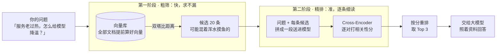

# 第 06 课　Rerank：给检索结果再排一次序

前面几课补齐了查询重写和混合检索，检索的"捞取"环节已经比较可靠。但跑起流水线，还会遇到一类问题：库里明明有正确答案，检索回来的 top 结果里它却排在第 8 名，第 1 名是一段词面相似、内容无关的片段。资料取回来了，答案还是不对，问题出在排序。本课介绍 Rerank（重排序）。

## 一、向量检索的短板：问题和文档从未直接对照

先回顾一直在用的向量检索：问题来了，先压缩成一个向量；库里每块文档提前压缩成一个向量；然后比较两个向量的相似度，分数高的排前面。

这个结构有个名字，叫 **Bi-Encoder（双编码器）**，俗称"双塔"：问题和文档各自独立编码，直到最后计算距离那一步才发生交互。

双塔的优点和缺点来自同一件事：两边从未直接对照。好处是文档向量可以提前算好存进库，查询时只编码一次问题，几十毫秒扫完全库，这是向量检索能支撑大规模数据的原因。坏处也在这里：比较只基于两个压缩向量的整体相似度，词与词之间的细粒度关系在压缩时丢失了。"服务过热怎么降温"和"把 temperature 参数调低"，在向量层面很相似，都带着"温度"的成分，但它们说的是两件事。

于是 top 结果里会混进"词面相似、实际答非所问"的片段。它们占了位置，真正有用的资料就被挤出去了。

## 二、两阶段检索：先粗筛，再精排

既要保住双塔的速度，又要把排序做准，成熟的做法是两阶段检索：

用招聘打比方：第一阶段像简历初筛，几千份简历用关键词快速选出 20 份，不求准，只求不漏，真正的候选人必须留在名单里；第二阶段像面试官逐份细读、对照要求打分排名，求准，但逐份处理很慢，所以只细读初筛留下的那一小撮。

对应到 RAG：第一阶段用双塔从全库快速取出二三十条候选（比如 top 20）；第二阶段用一个更准也更慢的模型，把"问题和每条候选"逐对细读打分、重新排序，最后只把最前面的几条交给大模型。快而粗的负责扫全库，慢而准的负责精读，分工明确。

## 三、Cross-Encoder 凭什么更准

第二阶段那个更准也更慢的模型，主流形态叫 **Cross-Encoder（交叉编码器）**。它与双塔的区别一句话能说清：双塔是问题和文档各自编码再比较；Cross-Encoder 是把问题和文档拼成一段输入，从头到尾一起读。

一起读意味着模型处理问题时，问题里的每个词都能与候选里的每个词直接交互（注意力是交叉的）。"降温"这个词会直接与候选里的"空调""散热"对上；同时它也会发现候选里的"温度"后面跟的是"参数"而不是"机房"，判断出这段在讲输出随机度，与问题无关。这种词与词的细粒度对照，正是压缩成摘要向量时丢失的信息。

代价也很直接：Cross-Encoder 无法预计算。每来一个问题，每条候选都要把"问题 + 文档"完整算一遍。候选 100 条就是 100 次完整计算；换成库里 100 万块文档就是 100 万次，完全不可行。所以它只用在第二阶段，服务粗筛留下的那一小批候选。

顺带认识一条中间路线：**ColBERT**。文档提前按词编码存好（保住双塔的快），查询来了再做词级别的细致对照（接近交叉编码的准），术语叫"延迟交互（Late Interaction）"。知道存在这条介于两者之间的路线即可，动手阶段先掌握两阶段的主流做法。

## 四、两个参数：候选捞多少、精排留几条

两阶段检索有两个需要自己定的参数，先建立取舍直觉：

- 粗筛捞多少条：捞太少（比如 5 条），真答案可能没进候选，精排再准也无法弥补，**精排救不回没进候选的文档**；捞太多（比如 300 条），精排的计算量成倍增长，延迟和费用跟着涨。常见取几十到一百，按能接受的延迟调。
- 精排留几条：不是越多越好。塞 20 段进上下文，噪声多、token 费用高，模型还容易跑偏。常见取 top 3 到 top 5。

开销账很好算：精排的计算量大致与候选数成正比，一条候选算一次。候选从 100 砍到 50，精排开销直接减半。所以"粗筛宽一点还是紧一点"，本质是花多少计算量买"别漏"的保险。

## 五、reranker 怎么选

重排用的是专门的 reranker 模型，和嵌入模型分工不同：嵌入模型管快速算相似，reranker 管细读打相关分，不要拿嵌入模型当 reranker 用。

开源里一类代表是 BGE Reranker 系列（北京智源 BAAI 开源，多语言场景常用 bge-reranker-v2-m3 这类型号）；商用 API 有 Cohere Rerank、Jina Reranker 等。这个赛道迭代很快，不写死哪个最强：选型时看 MTEB / C-MTEB 榜单的 Reranking 板块，结合你的语言、部署方式和延迟预算挑两三个，再拿到自己的数据上评测。榜单分高，不等于在你的业务语料上表现好。

## 六、收束：本章的 RAG 调优工具箱

到这节课，本章六课走完了：全景 → 切块 → 嵌入 → 流水线 → 高级主题 → 重排。汇总成一张对症表：

| 病症 | 典型表现 | 该用哪招 |
|------|----------|----------|
| 检索不到 | 好答案压根没进 top | 查询重写、混合检索（第 05 课） |
| 检索不准 | 好答案进了 top 但排得很后 | Rerank（本课） |
| 重复回答、响应慢 | 同样的问题反复算 | 语义缓存（第 05 课） |

Rerank 负责"把检索到的排得更准"，与第 05 课的查询重写、混合检索（负责捞得全）互补。最后重申本章最重要的纪律：**先评测定位，再对症加招**。先用评测集看清自己 RAG 的根因在哪，缺哪招补哪招；一次把所有优化全部堆上，只会让系统又慢又贵，还难以排查。

## 想一想

1. 为什么双塔模型能把几百万文档的向量提前算好存进库，Cross-Encoder 却不行？（提示：两种模型里，问题和文档分别在什么时候才发生交互？）
2. 粗筛候选数取 5 会冒什么风险？取 500 呢？这两个极端分别牺牲了"快"还是"准"？
3. 有同学说："我干脆把向量检索的 top 20 全塞给大模型，不就代替 rerank 了？"这句话什么时候成立，什么时候不划算？（提示：上下文窗口、噪声、token 费用）
4. 轻动手：打开本课的 rerank_demo.py，往 TOPIC_WORDS 词表里加一个关键词（或删掉 TRAP_MARKS 里的一个词）再跑一遍，观察粗筛分数不变、精排名次变化：想想这两个阶段各自到底"读"了什么。

## 小结

向量检索是"问题、文档各自编码、再比距离"，快但粗，top 里难免混进词面像、答非所问的片段。两阶段检索的分工是：双塔从全库快速粗筛出一小批候选，求不漏；Cross-Encoder 把问题和候选拼在一起逐对细读打分，求准。Cross-Encoder 准的根源是词与词的交叉对照，这也决定了它不能预计算、只服务小批量候选。粗筛捞多少、精排留几条是两个按延迟与效果调的参数，精排开销大致正比于候选数。RAG 调优的顺序永远是先评测定位、再对症加招，至此本章的工具箱集齐了。

---

2026 年 10 月
