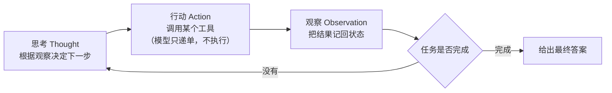

# 第 01 课　Agent 是什么

本章开始学习 Agent（智能体）。本课先讲清楚它与前面学过的链（Chain）的区别，再写一个最小的 Agent 骨架：全程不调用 API，本机即可运行。

---

## 一、从固定流程到 Agent

前面几章你写的程序基本都是固定流程：第一步做什么、第二步做什么，由代码预先写定。第 4 章的链（Chain）就是这种形态：`提示词 | 模型 | 解析器`，输入确定，执行路径就确定。

固定流程的好处是可控，局限也在这里：任务没有预先写好的步骤时，它无法处理。比如"帮我规划一次三天的杭州旅行"，要查天气、订酒店、排行程，先做哪一步、结果不满意怎么办，都没有人事先写好。

Agent 是另一种思路：给它目标和工具，步骤由它自己决定。先查天气，发现下雨就调整户外行程，再看预算，逐步把任务完成。这更像一个接到任务后自己安排步骤的实习生：你交代目标和可用资源，不必教他每一步怎么走。

链的步骤由人预先写定，Agent 的步骤在执行中自行决定。

---

## 二、核心循环：思考 → 行动 → 观察

Agent 靠一个循环来决定步骤，几乎所有 Agent 框架都是这个循环的变体：



这个循环有个专门的名字：**ReAct**（Reasoning + Acting，推理加行动）。走一遍：

> 任务：北京今天穿什么合适？
>
> 思考：先要知道北京今天的天气，调用天气工具。
> 行动：查天气("北京")
> 观察：晴，25°C
> 思考：25 度不算冷，但"穿什么"还需要穿衣建议，调用建议工具。
> 行动：穿衣建议(25)
> 观察：短袖就行
> 思考：信息齐了。最终答案：晴，25°C，短袖就行。

"思考"这一步的作用是把上一步的观察消化掉，再决定下一步。普通链没有这个环节，所以无法根据中间结果调整后续动作。

---

## 三、动手：60 行写一个最简 Agent

配套脚本 `agent_intro.py`（纯标准库，离线可跑），分三部分。

第 1 部分是工具箱。Agent 能执行的动作来自若干函数，关键做法是用字典把工具名和函数绑定在一起：

```python
TOOLS = {"get_weather": get_weather, "get_clothes_advice": get_clothes_advice}
```

为什么要多这一层间接：负责决策的"大脑"只报工具名（`get_weather`），执行端按名字查到函数再调用。解耦之后，增删工具不需要改决策逻辑。第 07 课讲工具系统时，还会用到这个结构。

第 2 部分是大脑。真实 Agent 中，"思考"是把任务、工具清单、历史记录一起发给大模型，让它输出下一步动作。离线版用几条 `if` 规则扮演模型：

```python
def think(memory):
    # 看一眼已有的观察，决定下一步：返回 (动作名, 参数) 或 ('finish', 答案)
```

注意它的输入只有 `memory`，即过去的观察记录。决策只基于已有信息，真实 Agent 也是这样。

第 3 部分是循环本体，对应上面那张图：

```python
for step in range(1, MAX_STEPS + 1):
    action, arg = think(memory)        # 思考
    if action == "finish":
        ...                            # 任务完成，交答案
    observation = TOOLS[action](arg)   # 行动：按名字执行工具
    memory.append((action, observation))  # 观察：记下结果
```

运行 `python agent_intro.py`，可以对比两种形态的行为：普通链的第二步"短袖就行"是写死的，哪怕天气是零下也输出同样内容；Agent 的每一步都依据上一步的结果产生。

---

## 四、一个不能省的细节：安全阀

循环必须防止停不下来：模型可能反复调用同一个工具。所以骨架里有 `MAX_STEPS = 5` 这样的步数上限，达到上限就强制停止。真实框架里这叫**递归上限（recursion_limit）**，第 04 课的 LangGraph 里会再见到它。

到这里可以看出 Agent 和聊天模型的差别：聊天只输出文字，Agent 的每个行动都会真正执行，查数据、写文件、发邮件。

能真正执行，也意味着出错时会真的产生后果。循环里的 `memory=[]` 列表目前只记录观察结果，它是下一课的主角。

---

## 想一想

1. 如果把"思考"这一步从循环里删掉，Agent 会退化成什么？
2. 把 `think()` 换成真实的大模型调用时，需要把哪些信息发给模型？只发任务内容够吗？
3. `MAX_STEPS` 设成 1 会发生什么？设成 1000 又有什么代价？
4. 轻动手：给 `TOOLS` 加一个你自己的工具（比如返回固定笑话的 `tell_joke`），再改 `think()`，让 Agent 在查完天气后先讲个笑话再给答案。

## 小结

- 链的步骤由代码预先写定；Agent 的步骤由"思考-行动-观察"循环在执行中决定。
- 思考消化观察并决定下一步，行动调用工具，观察把结果记回状态；模型只决定调用哪个工具，执行由循环代码完成。
- 工具用字典登记，决策逻辑只引用工具名，增删工具不需要改决策代码。
- 循环必须设置步数上限（递归上限），防止反复调用同一工具停不下来。

下一课讨论 Agent 的记忆：`memory` 这个列表为什么不够用，完整的记忆系统怎么设计。

---

2026 年 10 月
