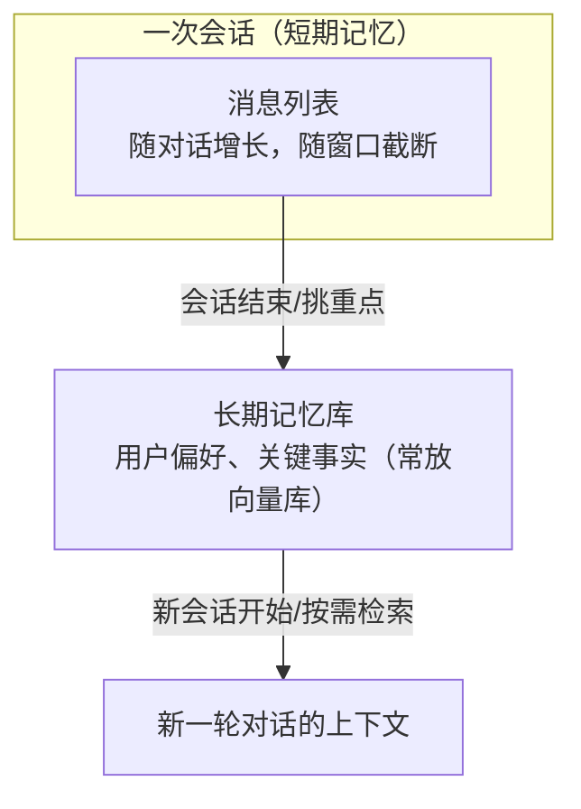

# 第 02 课　Agent 的记忆

上一课的 Agent 用一个列表 `memory` 记录观察结果。换个对话、重启程序，这些内容就全部丢失。本课把记忆问题讲清楚：模型为什么会"忘"，记忆系统要怎么设计。

---

## 一、模型本身没有记忆

先明确一个事实：大模型自身没有记忆。今天和它对话一小时，明天新开一个会话，它对之前的内容一无所知。原因在工作机制：每次调用都是独立的，输入一段文字，生成一段文字，调用结束不保留任何东西。

唯一能让它接上上文的办法，是把相关历史放进本次输入。可以这样理解：模型像一位每天上班都会失忆的员工，能力不减，但昨天的沟通全部清零；要让他接着干，就把一份工作笔记每天递给他看。历史消息就是这本笔记。

Agent 的记忆系统，就是负责记录和维护这本笔记的部分。

---

## 二、短期记忆：把对话存成列表

最简单的记忆是**短期记忆**：把每一轮对话追加到一个列表里，每次调用模型时把完整历史一起发过去：

```python
msgs = []                                # 这就是短期记忆
msgs.append({"role": "user", "content": "我叫小明，在杭州做程序员"})
msgs.append({"role": "assistant", "content": "你好，小明！"})
msgs.append({"role": "user", "content": "我叫什么？"})   # 模型能答上，因为名字在历史里
```

"模型记得我叫小明"这个说法并不准确：历史里有这个名字，它就能答出来；历史里没有，它就答不出来。记忆不在模型内部，而在发过去的上下文里。这意味着记忆完全由程序掌控。

配套脚本 `agent_memory.py` 的实验 4 做了对照：只把最后一条消息发给"模型"，它立刻答不出你的名字。

### 窗口限制

历史不可能无限长：模型一次能处理的文字量有上限（**上下文窗口**），历史越长，调用成本也越高。常见做法是滑动窗口，只带最近 N 条：

```python
sent = msgs[-window:]    # 只发最近 window 条
```

`agent_memory.py` 实验 3 演示了后果：只发最近 2 条时，Agent 同样答不出名字。所以工程上不能只靠窗口截断，还要配合摘要（把旧对话压缩成几句话放进历史）和长期记忆。

---

## 三、长期记忆：跨会话保存信息

短期记忆跟着会话走，会话结束就没有了。真实的助手还需要记住会话之外的信息，例如"这位用户上周说过胃不好，别推荐辣的"。这就是**长期记忆**：把重要信息存到会话之外（数据库、文件、向量库），下次会话再取回来。



图里的"按需检索"和第 5 章 RAG 是同一件事：把用户的话变成向量，到记忆库里搜相似内容。长期记忆本质上就是对"关于这个用户的事实"做 RAG。

### 2026 年的主流写法

旧教程使用 `ConversationBufferMemory` 一类的记忆类，这套已进入维护状态。现在的范式是三件套写法：

```python
agent = create_agent(
    model="deepseek-flash",       # 示例模型名可能更新，以 DeepSeek 官网模型列表为准
    api_key=os.environ.get("DEEPSEEK_API_KEY"),
    base_url="https://api.deepseek.com",
)
agent = create_agent(
    model,
    tools=[...],
    checkpointer=InMemorySaver(), # 记忆保管员：替你存每一步的状态
)
config = {"configurable": {"thread_id": "user-001"}}   # 同一 id = 同一份记忆
agent.invoke({"messages": [...]}, config)
```

三个概念：`checkpointer` 负责在每一步保存会话状态；`thread_id` 是会话标识，同一个编号的对话共享同一份历史，换一个编号就是一份新记忆，互不干扰，这就是跨会话隔离的实现方式。`agent_memory.py` 第 2 部分是这套写法的可运行示例，需要安装库和 DEEPSEEK_API_KEY 才能跑，属于"需 Key，未实跑"段落；离线部分已把原理完整演示。

---

## 四、该记什么，不该记什么

新手常见的问题是不加筛选，什么都往历史里放。历史越长，检索越慢，无关内容还会干扰模型的输出。实用原则：**短期记忆保完整，长期记忆挑重点**。用户主动说明的偏好、重要决定、关键事实值得沉淀；寒暄和过程性内容不存。

另外，记忆里存的是用户隐私：存什么、存多久、用户能否要求删除，既是技术问题也是合规问题。下一课讨论这类风险。

---

## 想一想

1. 用"每天失忆的员工与工作笔记"这个类比，向朋友解释：为什么把历史发给模型，它就"记得"了？
2. `agent_memory.py` 实验 3 里，窗口设成 2 条 Agent 就答不出名字了。你能想到哪两种办法既省 token 又不丢关键信息？
3. 换一个 `thread_id` 为什么就能实现会话隔离？这种机制对"多用户客服系统"意味着什么？
4. 轻动手：把 `chat()` 函数里的 `send_history=True` 改成只发送"包含'我叫'的消息"，观察模型还能不能记住名字，体会"挑重点记忆"的难度。

## 小结

- 模型自身没有记忆，每次调用独立；所谓"记得"，是相关历史存在于本次输入中。
- 短期记忆是消息列表，受上下文窗口和成本约束，超限靠截断或摘要。
- 长期记忆把重点信息存到会话之外，按需检索，机制与 RAG 相同。
- 2026 年范式记住三件套：create_agent、checkpointer、同一 thread_id。
- 记忆挑重点存，不是存得越多越好。

---

2026 年 10 月
