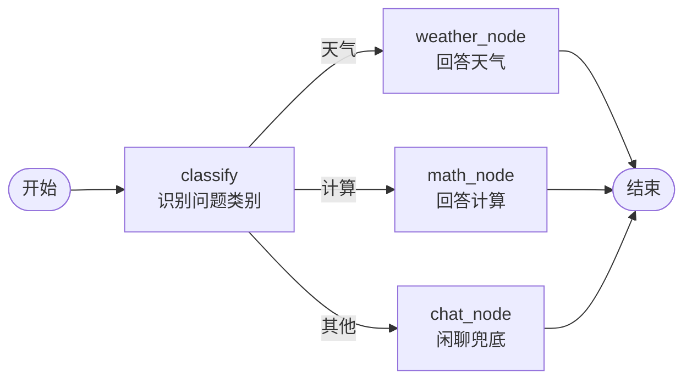

# 第 04 课　LangGraph：给 Agent 画流程图

> 【LangGraph 30 秒补课】三个词建立直觉：**节点**是一个步骤（一个函数做一件事）；**边**是步骤之间的走向（先谁后谁、条件满足走哪条）；**状态**是在节点之间传递的数据包（每个节点读取它、修改它、传给下一个）。LangGraph 就是让你把流程画成图，框架按图执行。

---

## 一、手写循环的局限

第 01 课手写了"思考-行动-观察"循环，并加了 `MAX_STEPS` 安全阀。任务简单时这样够用，业务变复杂后问题随之出现：

- 分支：先判断用户问的是天气还是计算，再分头处理，`if` 开始嵌套；
- 循环：某一步结果不满意就回到重试节点，`while` 里再套 `while`；
- 暂停：停在需要人工审批的节点，明天继续，中间状态要自己保存。

把这些都写进一个函数，维护成本很高。更可靠的做法是公司管理流程的做法：把流程画成图，每个环节只负责自己的事，流转规则明示。报销流程就是这样一张图：节点是提交申请、主管审批、财务打款；箭头决定先后，金额不同走不同分支，被驳回就退回重走。

LangGraph 提供的就是这种"画图"能力：它是 LangChain 家族里专门负责流程编排的库，用节点、边、状态管理可分支、可循环的复杂流程。

---

## 二、把客服流程画成图

本课的例子是一个最小但完整的客服 Agent：先识别用户问题类别，再分流到对应的回答节点。



对照图记三个词：`classify`、`weather_node` 这些方框是节点；从 `classify` 出发的三条箭头是条件边，走哪条由路由函数根据状态决定；从开始流到结束、每个节点都在修改的那个字典是状态。

配套脚本 `langgraph_demo.py` 里，状态就是这样一个字典：

```python
{"query": "北京今天天气怎么样？", "category": "", "answer": ""}
```

每个节点函数的形式一致：接收状态，返回修改后的状态。`classify` 填 `category`，路由函数读取 `category` 决定走向，回答节点填 `answer`。数据包从开始流到结束，任务就完成了。

---

## 三、先手写 MiniGraph，再用真库

`langgraph_demo.py` 分两部分，这个安排有明确目的。

第 1 部分（离线可跑）：用纯标准库手写一个约 20 行的 MiniGraph。它把 LangGraph 的核心机制压缩到最小：`add_node` 登记节点，`add_conditional_edges` 挂路由函数，`invoke` 从入口节点开始走图。节点处理数据包，路由函数指出下一站，走到没有出边的节点就结束。运行后可以看到三个问题各自走出不同的路径。框架的核心就是这套循环的健壮版：换成真正的 StateGraph 时，这部分代码的写法不变。

第 2 部分（需装库）：用真正的 LangGraph 搭建同一张图。写法几乎一一对应：`StateGraph(State)` 建图，`add_node` 加节点，`add_conditional_edges` 挂条件边，`add_edge(name, END)` 接到终点，最后 `compile()` 编译再 `invoke`。未装库时脚本会打印中文提示并优雅跳过；安装命令是 `pip install langgraph`（这一部分不需要 API Key）。

```python
builder = StateGraph(State)
builder.add_node("classify", classify)
builder.add_conditional_edges("classify", route)   # 条件边：看状态决定走向
graph = builder.compile()                          # 画完要"编译"才能跑
result = graph.invoke({"query": "北京今天天气怎么样？", "category": "", "answer": ""})
```

用真库换来的是现成的基础设施：第 02 课的 checkpointer 接上 LangGraph，每走一步状态自动存档，随时可暂停恢复（人工审批节点依赖这一点）；循环防失控的递归上限、失败重试、整张图的可视化输出，都是现成功能。这些自己实现都要处理大量边界情况。

---

## 四、两个注意事项

节点不要过大。一个节点做一件事，分支和重试交给边来表达。把多件事塞进一个节点，图的结构就失去了意义。

安全阀不能省。带环的图必须有递归上限，否则一次死循环会持续消耗 API 调用。第 01 课的 `MAX_STEPS` 在这里继续起作用。防线 4（工具白名单）的要求同样适用：节点里调用工具前，先做权限检查。

---

## 想一想

1. 用"报销流程图"类比向朋友解释：节点、边、状态分别对应公司流程里的什么？
2. 第 01 课手写的循环，和今天 MiniGraph 的 `invoke`，本质差别是什么？真库又比 MiniGraph 多给了什么？
3. "人工审批"节点在图里该怎么表达？（提示：走到这个节点停住，checkpointer 存档，批准后从这里继续。）
4. 轻动手：给 MiniGraph 加一个 `vip_node`，让路由函数对包含"VIP"的提问走这条路，体会条件边的扩展成本有多低。

## 小结

- 手写循环难以支撑复杂流程：分支嵌套、循环重试、中途暂停都会让代码失控。
- LangGraph 用三件套管理流程：节点做一件事，边决定走向，状态作为数据包在节点间传递。
- 先用标准库手写 MiniGraph 理解机制，再用真库获得状态存档、递归上限、可视化等现成能力。
- 节点保持小、带环设上限、调用工具前查权限。

下一课介绍 MCP（模型上下文协议）：一套统一的工具接入协议，工具接入一次，所有 Agent 都能调用。

---

2026 年 10 月
