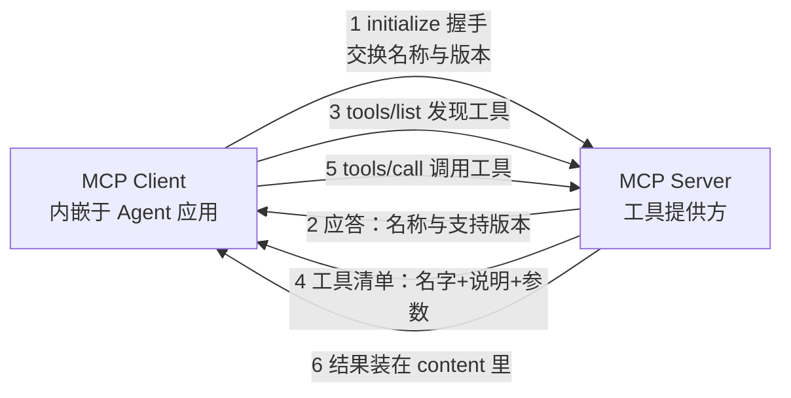

# 第 05 课　MCP：模型上下文协议

> 上一课结尾留了个问题：每接一个工具都要单独写对接代码。这一课的主角 MCP（Model Context Protocol，模型上下文协议）就是回答这个问题的标准：工具与 Agent 应用之间用同一套消息格式对话，工具对接一次，各家 Agent 都能使用。

## 一、为什么需要一套标准

先看没有标准的样子。各家工具的接口写法不同：天气 API 一套写法，数据库一套写法，公司内部系统又是一套。3 个 Agent 配 5 个工具，最坏要写 15 份对接代码；换一家模型供应商，对接代码还得重写。

MCP 的思路是把这件事标准化。工具提供方（天气服务、数据库、内部系统）把能力包装成一个 MCP 服务器（Server）；Agent 应用（各类助手、IDE 插件）内置 MCP 客户端（Client）。两边按同一套协议说话，工具对接一次，所有支持 MCP 的 Agent 都能直接调用。

可以借插座理解这件事：以前每台电器配一种专用插头，每买一件电器就要改一次插座；MCP 相当于把插头统一成同一个制式，插座只留一种。

## 二、协议的三个步骤：握手、发现、调用

MCP 的消息基于 JSON-RPC 2.0。名字听起来复杂，格式其实固定：每条消息都是一个 JSON，核心字段有 `jsonrpc`（协议版本）、`method`（要执行的动作）、`params`（参数）、`id`（请求编号）。

Client 与 Server 的配合分三步：



**握手（initialize）**：Client 报上自己的名称和支持的协议版本，Server 回应自己是谁、支持哪个版本；版本谈拢后，Client 再发一条"初始化完成"，连接才算就绪。**发现（tools/list）**：Client 询问 Server 提供哪些工具，Server 返回清单，每个工具带名字、一句说明、参数格式。说明写得越清楚，Agent 选得越准，这个道理第 07 课展开。**调用（tools/call）**：Client 指名调用某个工具并传入参数，Server 执行后把结果装在 content 里返回；调用了不存在的工具，Server 会返回一条带错误码的 JSON，而不是无响应。

一个细节值得注意：握手完成的最后一条"初始化完成"消息没有 id，也不需要应答，这类消息叫通知（notification）。正经请求都带 id，Server 应答时原样带回，客户端靠它把应答和请求一一配对。Server 同时处理多个请求时，没有 id 就分不清哪条应答对应哪条请求。

## 三、离线跑一遍：看消息的实际形状

配套脚本 `mcp_demo.py` 用纯标准库实现了迷你 Server 和 Client，不需要安装任何库，可直接运行。它把每条请求和应答原样打印，重点看三处：

- 请求的形状：`{"jsonrpc": "2.0", "id": 3, "method": "tools/call", "params": {...}}`；
- 应答如何对应请求：结果装在 `result`，`id` 与请求一致；
- 错误的表达方式：错误装在 `error`，带错误码和一句说明。

运行完可以看到完整一轮：握手、发现、调用天气、做一次加法，最后故意调用一个不存在的工具，看 Server 如何返回错误。

## 四、装上真库：从模拟到真实

真实开发不必自己实现协议。开源的 `mcp` 库（`pip install mcp`）提供 FastMCP，定义一个工具只需要一个装饰器：

```python
from mcp.server.fastmcp import FastMCP

mcp = FastMCP("我的工具箱")

@mcp.tool()
def add(a: int, b: int) -> int:
    """两数相加"""
    return a + b

mcp.run()   # 以 stdio 模式启动，等 MCP 客户端来连
```

`mcp_demo.py` 第二段会尝试导入这个库：装了就演示定义方式，没装就打印一句中文提示跳过（这一段需要安装 mcp 库，讲义未实跑，装好后可自行运行）。补充一个现状：MCP 在 2025 年进入 2.0 阶段，增加了远程服务的 OAuth 登录、流式返回等能力，但握手、发现、调用三步的主结构没有变。学协议先学主结构，版本细节可以按需查阅。

## 五、协议只管连接，安全仍要自己把关

MCP 解决"怎么连上"，不解决"该不该连"。来路不明的 Server 可以在工具描述里写"查天气"，实际执行别的操作。第 03 课的防线在这里继续有效：接入新 Server 先核对工具清单；删除、转账这类不可逆操作，该有的确认一步不能省。

到这里，单个工具已经能通过标准协议即插即用。但真实任务要的常常不是单个工具，而是一整套配合好的动作。把成套能力打包起来、按需加载，就是下一课的主题：Agent Skills（技能系统）。

## 想一想

1. 向朋友解释 MCP：Client、Server 各对应什么？"工具对接一次、处处能用"省掉的是谁的工作量？
2. 应答里的 `id` 用来配对请求与应答。如果 Server 同时处理 3 个请求而没有 id，会发生什么？
3. `tools/list` 返回的"一句说明"为什么重要？提示：Agent 依据这句话决定是否调用这个工具。
4. 轻动手：给 `mcp_demo.py` 的迷你 Server 加一个 `echo(text)` 工具，重跑一遍，观察 `tools/list` 清单和调用结果的变化。

## 小结

没有标准时，N 个 Agent 配 M 个工具最坏要写 N×M 份对接代码。MCP 把连接方式统一成一套协议：initialize 握手、tools/list 发现、tools/call 调用，三步走通。消息是带 id 的 JSON-RPC，通知不带 id，出错返回 error 而不是无响应。真库 FastMCP 把定义工具简化为一个装饰器。协议只管连接，第 03 课的安全防线仍要自己守。

---

2026 年 10 月
