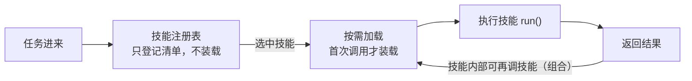

# 第 06 课　Agent Skills：把能力打包成技能

> 上一课用 MCP 把工具接进了 Agent。但"接上"只是第一步，用户要的往往是一整个结果，不是一串零件。这一课讲怎么把成套能力打包成技能（Skill），让 Agent 按需取用。

## 一、工具是零件，技能是成品

让 Agent"整理这周的会议录音，出一份要点纪要"，它实际要做四件事：转写音频、抽取要点、按模板排版、存档。如果只靠单个工具，Agent 每次都要现场把四步的衔接顺序想一遍，少想一步，结果就不完整。

**技能（Skill）**把这组配合好的动作连同流程知识，打包成一个自包含的能力单元，特点是：自包含、可复用、可组合、按需加载。

它和工具的界限：工具是细粒度动作，例如"发一封邮件"；技能是粗粒度能力，例如"处理邮件"，内含分类、起草、归档。工具通常无状态，技能可以自带状态和内部流程。

借手机理解两者的差别：工具像单个螺丝刀，一件只干一个动作；技能像手机里的一个 App，点开记账 App，输入、分类、统计、图表它内部都安排好了，不必每次重新设计流程。

## 二、技能系统的三个关键动作：注册、按需加载、组合

注册：每个技能登记名字和一句说明，进入注册表。Agent 依据说明决定用哪个技能，所以说明要写清"我擅长什么"。按需加载：注册表里登记几十个技能也不占资源，首次调用才真正装载，之后复用已加载的实例。Agent 的上下文窗口是稀缺资源，"要用才装"就是在节省上下文（回忆第 02 课）。组合：技能内部可以调用别的技能，小技能拼成大能力，例如"早间简报"由报时、天气、排版组合而成。

## 三、离线跑一遍 skills_demo.py

纯标准库、零依赖、直接运行。脚本里有一个 `SkillRegistry` 和四个技能：报时、查天气（离线演示表）、四则运算，外加一个组合技能"早间简报"。重点看三处：

1. 列菜单时打印了一排技能名，但没有一个被真正装载，菜单只是登记；
2. 首次调用"报时"时打印 `[按需加载]`，再调一次就不打印了，装载一次，反复使用；
3. "早间简报"内部连调报时和天气，这就是组合。最后故意调用不存在的技能、给天气技能喂一个表里没有的城市，看两道兜底提示如何接住。

## 四、写技能的三条守则

1. **单一职责**：一个技能只说清一件擅长的事，不做"万能包"。菜单描述越诚实，Agent 选得越准。
2. **说明即菜单**：description 写"什么时候用我、输入输出是什么"，它是 Agent 的选择依据，不是装饰。
3. **状态自己管**：需要记中间结果的技能，把状态收在自己实例里，不散落全局。第 02 课的记忆思路在这里同样适用。

技能是成套的能力，通常放进第 04 课流程图的节点里运行：技能管内容，LangGraph 管顺序，两者配合使用。不过再完整的技能也由一个个工具动作组成，单个工具怎么写描述、怎么调度、出错怎么恢复，这些工程细节值得单独讲一课。下一课：Tool Use，把工具用得可靠。

## 想一想

1. 用"App 与单个功能"给同学讲技能和工具的区别，各举一个例子。
2. "按需加载"省的是什么？提示：上下文窗口和内存都是要花的资源。
3. 组合技能"早间简报"依赖天气技能，如果天气技能坏了，简报该怎么办？说出你的兜底方案。
4. 轻动手：给 `skills_demo.py` 加一个"字数统计技能"，先调 `available()` 看菜单再调用，体会"注册、加载、执行"三步。

## 小结

工具是细粒度动作，技能是打包了成套能力与流程知识的自包含单元。技能系统三个关键动作：注册（名字加说明进清单）、按需加载（首次调用才装载，省上下文）、组合（小技能拼大能力）。写技能守三条：单一职责、说明即菜单、状态自己管。技能管内容，第 04 课的编排管顺序。

---

2026 年 10 月
