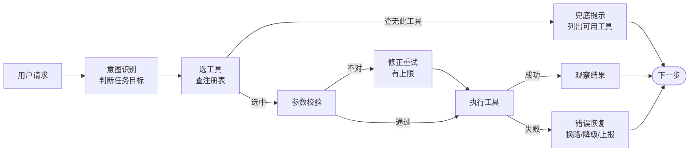

# 第 07 课　Tool Use：把工具用得可靠

> 上一课把成套能力打包成了技能。拆开任何一个技能，里面干活的仍是一个个工具。工具是 Agent 的执行端：工具不可靠，整体结果就不可靠。这一课讲工程细节：怎么设计工具、怎么写描述、怎么调度、出错怎么恢复。

## 一、好工具是设计出来的

先看设计。给 Agent 配工具，像给新员工分派岗位：一个岗位一件事。把"查天气、发邮件、写文件"塞进一个叫 `do_task` 的万能工具，模型每次都要猜当前要做什么，猜错率自然高；拆成三个单一职责的工具，选择就变成明确的三选一。

第二条设计原则：能撤销的动作要留后路，不能撤销的要设闸门。查询类工具可以随便调用，出错也没有损失；删除、转账这类动作，设计时就要确定"调错了怎么补救"，没有补救办法的挡在权限后面。第 03 课的防线，落实到工具上就是这一步。

## 二、描述是写给模型看的"岗位说明书"

工具描述不是写给人的注释，而是模型选工具的唯一依据。回忆第 03 章的 Function Calling：模型看不到工具的实现代码，只看得到 name、description、parameters 这三样。说明书含糊，选错工具、传错参数就是必然结果。

```json
{
  "name": "get_weather",
  "description": "查询指定城市当前天气。输入城市名，返回温度区间与天气状况。",
  "parameters": {"city": "字符串，如'北京'"}
}
```

写描述有个检验法：把说明书给同事看，只凭文字回答"什么场景该用它、要传什么"，答不上来就重写。"查数据"算不上描述，"查询指定城市的当前温度与天气状况，城市需用中文全名"才是一份能用的说明书。

## 三、调度：从一句话到工具执行

先明确分工：模型不执行工具。模型只负责输出一份"单据"，写明调用哪个工具、传什么参数；接收单据、执行函数、回收结果、处理异常，全部由你的代码完成。这个分工是工具调用的基础，也是第 08 课手写循环的前提。

一次完整的调度流程：



调度代码里有两个值得固定的写法。第一，选工具用 `dict.get` 而不是先 `if name in tools` 再取：`TOOL_REGISTRY.get(name)` 查不到时返回 `None`，直接走兜底分支，一行代码接住"菜单上没有"。第二，模型返回的参数是一段 JSON 文本，解析必须放进 try：`json.loads` 遇到残缺或非法 JSON 会抛异常，捕获后把错误信息发回给模型重新递单，程序不会崩溃。

循环调度还有一条硬约束：每一轮都把最新的工具清单（tools）随请求带给模型，否则模型可能调用上一轮已经不存在的工具。同时轮数必须设上限（如 `MAX_STEPS = 5`）：没有上限的循环，会在模型反复试错时持续消耗 token 和费用。第 01 课的安全阀，在这里继续生效。

## 四、错误恢复：把失败当正常输入

工具会坏、参数会错、网络会断，设计时把失败当正常输入处理。失败后先分类，再选恢复策略：

- **参数错**（比如少传了城市）：修正参数重试一次；
- **工具内部出错**（除零、查无此城市）：不重试，换路：换一个工具、用离线数据兜底，或告知用户"查不到"；
- **权限不足**：停下上报用户，不绕过。

配套的 `tool_use_demo.py` 把这三类各演了一遍：先调一个不存在的工具看 `get` 兜底怎么列出可用工具；再给计算器喂一个除零，看"不重试、换策略"；最后看缺参数时"修正一次再试、最多两回"。错误恢复的每一步，都发生在第 01 课循环的"观察"环节。

## 五、离线跑 tool_use_demo.py

纯标准库、零依赖。注册表里三个工具（计算器、离线天气、字符串统计），脚本按"尝试、失败原因、恢复动作、结果"打印每一次调度。看完这份日志，再看任何 Agent 框架的源码，核心都是这几步。

工具的活儿干细之后，还剩最后一个上限：单个 Agent 承担不了所有任务。把多个 Agent 组队分工、互相交接，是下一课的主题，也是全章最后一课：Multi-Agent 协作。

## 想一想

1. 用"岗位说明书"给同学解释：工具描述里哪一句最影响模型选对工具？为什么？
2. `dict.get` 的兜底和"先判断再取值"效果相同，你更倾向哪种写法？说说理由。
3. 除零错误为什么不该"修正参数再重试"，而该换策略？什么错误才值得重试？
4. 轻动手：给 `tool_use_demo.py` 的注册表加一个"字符串长度"工具，然后故意少传参数，观察"修正重试"环节如何接住它。

## 小结

工具设计守两条：一个工具一件事，危险动作设闸门。描述是写给模型的岗位说明书，含糊必被选错。调度的分工是模型递单、代码执行；查注册表用 `get` 兜底，解析参数捕获 JSON 异常，循环每轮带最新 tools 并设轮数上限。错误恢复先分类再出手：参数错可修正重试，工具坏了换路或降级，权限不足上报用户。

---

2026 年 10 月
