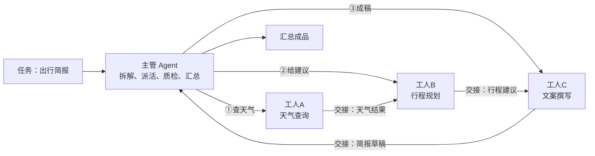

# 第 08 课　Multi-Agent：多个智能体协作

> 上一课把工具的工程细节讲完了。单个 Agent 承担的任务仍有上限，这一课讲怎么让 Agent 组队分工，也是全章最后一课：学完协作模式，再手写一遍核心循环，把整章收束。

## 一、单 Agent 的上限

单个 Agent 处理复杂任务会遇到三重限制：上下文窗口容量有限，任务步骤一多就装不下；一个 Agent 承担所有职能，每项能力都难以做深；任务只能按顺序执行，无法并行。一个环节出错，后续全部返工。

解法是把任务拆开、组成团队。这就是 Multi-Agent（多智能体）系统：把复杂任务分给各有专长的 Agent，再把结果汇拢。

## 二、主管-工人模式：最常用的编队

Multi-Agent 有多种队形，最常用也最好懂的是主管-工人（Supervisor-Worker）模式，对应软件公司的项目组：主管不亲自执行具体任务，负责拆解、派活、盯进度、质检、汇总；工人各守一门专长，完成后交"成品 + 一句交接说明"。



两个关键词值得单独记。分工：按专长切分任务，工人 A 只负责天气，不负责文案。交接（handoff）：上一个 Agent 把成品和注意事项递给下一个 Agent，下一棒依据说明接续工作。配套脚本 `multi_agent_demo.py` 把这套流程离线演示了一遍：主管拆任务、按专长派活、工人串成一条链；天气员失败时主管换备用数据源重派，两路都失败就如实上报，最后汇总成品。

## 三、框架选型：按需求挑工具

真项目不必全部手写。截至 2026 年，主流框架各有定位：

| 框架 | 一句话定位 | 什么时候用 |
|------|-----------|-------------|
| LangChain v1.x | 组件最全的通用框架，`create_agent` 一行建 Agent | 通用首选，生态资料最多 |
| LangGraph | 画流程图做编排（第 04 课的主角） | 流程复杂、要分支/暂停/恢复 |
| OpenAI Agents SDK | OpenAI 官方轻量框架 | 全家桶用户、快速起步 |
| CrewAI | 角色扮演式团队协作 | 明确要做主管-工人编队 |
| AutoGPT | 目标驱动、高度自主 | 自动化长任务 |
| MetaGPT | 模拟软件公司分工 | 软件开发类任务 |

选型逻辑三句话：流程复杂，先上 LangGraph；要多 Agent 组队，看 CrewAI；不确定就从 LangChain 起步。LangChain 的 Agent 入口在 v1.x 已统一为 `create_agent`，旧代码里的 `AgentExecutor` 已被移入 classic 包，会认即可，新代码不再使用。另有一条 2025 年后的新脉络：框架之外，协议在统一。MCP 管"连工具"，Google 推动的 A2A 协议管"连 Agent"。协议学扎实了，框架更换时迁移成本更低。

框架是你手写循环的现成实现，循环逻辑本身才是要掌握的内容。

## 四、全章收束：再手写一遍核心循环

第 01 课你手写过"思考-行动-观察"。走完这一章，带着新内容再写一遍，循环的每一行都对应本章的一课：

```python
TOOLS = {                      # 第 07 课：工具注册表 + 描述
    "天气": lambda city: f"{city}晴，22℃",
    "加法": lambda a, b: a + b,
}

def run(goal, max_steps=5):
    history = []                                   # 第 02 课：记忆
    for _ in range(max_steps):                     # 第 01 课：安全阀
        move = decide(goal, history)               # 思考：由模型来干
        if move is None:                           # 想完了，收工
            return history
        name, kwargs = move
        try:
            history.append(TOOLS[name](**kwargs))  # 行动+观察
        except (KeyError, TypeError) as e:         # 第 07 课：错误恢复
            history.append(f"出错了：{e}，换条路")
    return history
```

`decide` 是模型工作的位置：真实项目里它对应一次 LLM 调用；离线练习可以手写一个查表函数替代模型。对照第 01 课的 `agent.py`：骨架没变，变的是你清楚每一行的来处。TOOLS 可以来自 MCP（第 05 课）或打包成技能（第 06 课）；循环复杂到难以维护，就画成图（第 04 课）；单个 Agent 忙不过来，就组队分工（本课）。核心循环还是那个核心循环，你已经能把它从 20 行的练习扩展为真实系统的骨架。

这一章到这儿就完整了。Agent 越能干，要记、要查的内容就越多，几十万条知识放在哪里、如何快速取出，是下一个要解决的问题。下一章介绍向量数据库，给 Agent 建一座随取随用的图书馆。

## 想一想

1. 用"项目组"类比向朋友解释主管-工人模式：主管、工人、交接说明各对应什么？
2. 为什么说框架是手写循环的现成实现？哪一课的内容对应框架里的"编排"与"记忆"？
3. 交接（handoff）时"成品 + 一句交接说明"缺了说明会怎样？联想到第 07 课的什么原则？
4. 轻动手：给第 01 课的 `agent.py` 加上本课的两样内容，TOOLS 注册表和 try/except 兜底，重跑一遍，对比改动前后的行为。

## 小结

单 Agent 的上限：上下文装不下、样样不精、串行慢。主管-工人模式让主管专管拆解派活汇总，工人各守一门专长，靠交接传递成品。框架选型先问需求：要编排找 LangGraph，要组队看 CrewAI，通用起步用 LangChain 的 `create_agent`（`AgentExecutor` 已入 classic 包，会认即可）；协议层 MCP 连工具、A2A 连 Agent。最后手写一遍核心循环收束全章：骨架不变，每一行你都知道通向哪里。

---

2026 年 10 月
