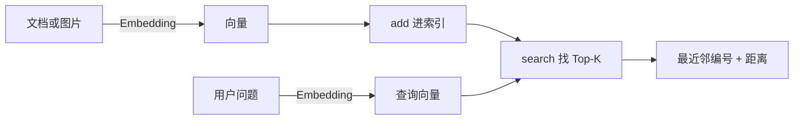

# 第 01 课　向量检索与第一个 FAISS 索引

第 5 章动手做 RAG 时，文档已经变成了向量，检索靠逐条计算距离、取最像的几条。当时库里最多几十上百条，全量算一遍没有压力。第 6 章结尾留下一个问题：Agent 要记的知识多到几十万条时，放在哪里、怎么一秒取出。每来一个问题就把全部向量算一遍，显然行不通。本课处理这个问题：海量向量里如何又快又准地找到最像的几条。

本课使用的工具叫 FAISS，Meta（Facebook）开源的向量相似度搜索库。注意它是一个库，不是数据库服务：装好就能调用，没有服务端，适合先把向量索引的直觉建立起来。

## 暴力搜索的代价

最直接的办法是把所有向量挨个算一遍距离，这叫**暴力搜索**。它永远给出精确答案，但时间与数据量成正比：数据翻倍，查询时间也翻倍。

算一笔账：一条 128 维向量算一次 L2 距离要做 128 次乘加，100 万条向量就是 1.28 亿次乘加，而这只是一次查询的开销。若一天要响应 10 万次查询，这种做法在工程上不可行。

还有一层困难叫维度诅咒：维度升高后，点与点之间的距离差异变小，哪边更近越来越难判断。高维检索不能只靠算得快，得换思路。

## 三种相似度

- L2 距离（欧氏距离）：两点连线的长度，越小越像。计算是每个维度相减、平方、求和、开根号，相当于勾股定理在高维的推广。适合“坐标位置接近才算像”的场景。
- 内积（Inner Product）：对应位置相乘再求和，越大越像。它同时考虑方向和长度：推荐场景里向量长度往往代表偏好强度，内积会把这份强度计入结果。
- 余弦相似度：只看两个向量的夹角，不看长度。两条向量方向相同、长短不同时，余弦认为完全相似，L2 却会给出差距。只关心“像不像”、不关心“强度差多少”时，用余弦。

还有一个关键换算：把向量**归一化**（长度缩放成 1）之后，内积就等于余弦。很多系统因此直接采用“存之前先归一化、查询用内积”的组合，两把尺子合成一把。

## ANN：用准确率换速度

在全城找最相似的人，不必逐一核对几百万人：先按城区筛、再按小区筛，最后小范围精挑。结果未必是全城唯一最相似的，但快了几个数量级，而且足够接近。

这个思路叫**近似最近邻**（ANN，Approximate Nearest Neighbor）：用一点点准确率，换几十上百倍的速度。FAISS 的 Flat 索引是不走近道的精确版；下一课的 IVF、HNSW、PQ，都是不同形式的近似方案。

## 第一个索引：亲手查一次



对应 faiss_intro.py 里的核心三步（完整代码见配套文件）：

```python
import faiss, numpy as np

index = faiss.IndexFlatL2(dim)   # 建 L2 距离的 Flat 索引，参数是维度
index.add(xb)                    # xb：n 行 dim 列的 float32 矩阵，一行一个向量
D, I = index.search(xq, k)       # 每个查询返回 k 个：D 是距离，I 是编号
```

三个易错点提前说明：

1. 向量必须是 **float32**。用 `np.array(data, dtype="float32")` 转好再喂，漏了这一步 FAISS 会直接报类型错误；
2. `search` 返回的 `I` 是**位号**（第几个加进来的），不是你的业务 ID，两者的对应关系下一课专门讲；
3. Flat 是精确搜索，数据量小时先用它；后面所有近似索引，都拿它当标尺衡量准确率。

## 动手跑

```bash
python faiss_intro.py
```

前半段是纯标准库手写的暴力最近邻（不装任何库即可运行）：用“甜度、冰量”两个维度描述几杯饮品，手工计算距离找最近邻。你会看到同一个查询下，L2 与余弦排出的第一名可以不同。后半段使用真实 FAISS 的 Flat 索引；未安装 faiss-cpu 时会打印中文提示并跳过。

## 想一想

1. 10 万条向量、每次查询全量算距离，一天要响应 10 万次查询，暴力搜索撑得住吗？按“每秒能算多少次距离”粗略估算一下。
2. 把所有向量都归一化后，用 L2 排出的 Top-K 和用余弦排出的 Top-K 还会不一样吗？提示：想想“长度”还剩多少话语权。
3. 做推荐系统时，什么情况下你更该用内积而不是 L2？（提示：喜欢程度=方向+强度，你想让“强度”算不算数？）
4. 轻动手：把 faiss_intro.py 零依赖段里的查询向量改一改，让“热可可”变成 L2 最近邻，看看你调出了一杯什么口味。

## 小结

- 暴力搜索永远精确，但时间随数据量线性增长，海量数据撑不住。
- 三种相似度各有分工：L2 看位置，内积看方向加强度，余弦只看方向；归一化后内积等于余弦。
- ANN 的思路：牺牲一点点准确率，换几十上百倍的速度。
- Flat 就是 FAISS 内置的暴力搜索：量小先用它，它还是衡量其他索引准确率的标尺。
- 记住两个易错点：向量转 float32；返回的 I 是位号，不是业务 ID。

Flat 虽然精确，百万级数据的查询代价却太高。下一课介绍三种近似索引：先分堆的 IVF、图上导航的 HNSW、压缩存储的 PQ，逐一看思路与取舍。

2026 年 10 月
