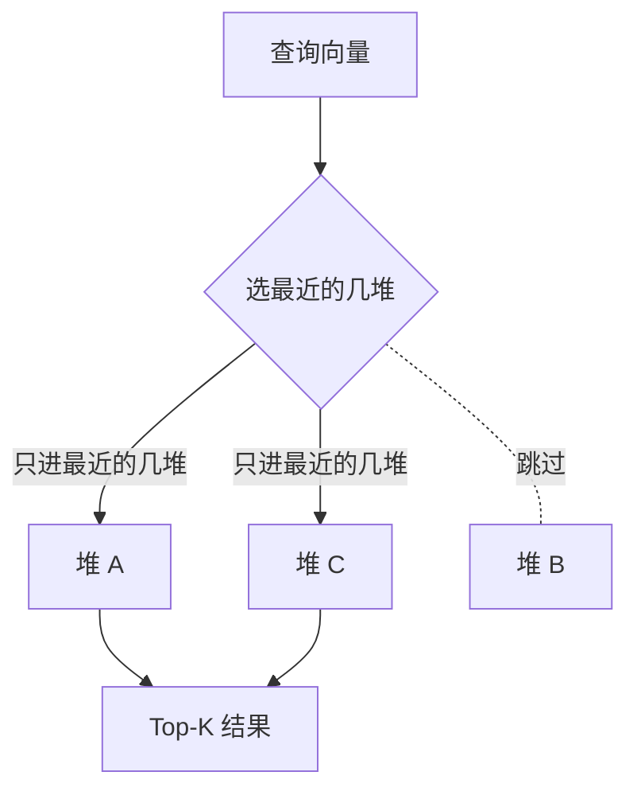

# 第 02 课　FAISS 常用索引怎么选

上一课的 Flat 全存全算，结果精确；但数据到了百万级，每次查询都要全量计算距离，耗时无法接受。本课介绍 FAISS 中三类近似索引。每个思路先讲清楚，正式名称放在小节末尾给出：思路懂了，名字只是代号。

先明确评价标准。三个指标互相制约：速度（查询多快）、内存（装多少数据）、准确率（与精确结果的差距）。没有三项全占的索引，选型就是在具体业务里给这三项排出优先级。

## 思路一：先分堆，只搜最近的几堆

图书馆的书按主题分楼层摆放，找烹饪书直接去烹饪楼层，不必在文学区一本一本翻。向量检索也可以先分堆：把 100 万条向量用聚类分成一千堆，每堆记录一个堆心（这堆向量的中心位置）。查询到来时，先算它与各堆心的距离，然后只进最近的几堆查找，其余堆完全跳过，距离计算量降到原来的十分之一以下。

近似有代价：最像的那条可能刚好在隔壁堆，就被漏掉了。这类索引因此提供一个旋钮：多搜几堆。搜 1 堆最快也最容易漏；搜的堆数越多越准、也越慢，从快而不准到准而慢连续可调。

这个思路的正式名称是 **IVF**（Inverted File，倒排文件）。堆数由 nlist 控制，查询时搜几堆由 nprobe 控制。两者都是旋钮而不是标准答案，最佳值与数据规模有关，要动手调整并观察效果。



## 思路二：图上先粗后细

第二类思路把向量组织成一张多层图：每条向量记录几个邻居，上层稀疏、边长，跳得远；下层稠密、边短，找得细。查询从最顶层出发，每一步都移向更近的邻居，几大步接近目标后，再下到低层精细搜索。先大范围跳转、后小范围细化，大量无关向量被跳过。

这就是 **HNSW**（分层可导航小世界图）。它的旋钮是 efSearch：查询时沿途考察多少候选，调大更准更慢，调小更快更易漏。它还有一个实用优点：不需要聚类、不需要训练，建好就能直接添加向量，查询延迟稳定，常作为默认的起步选择。

## 思路三：压缩存储

前两类思路省的是计算，如果瓶颈是内存装不下，就要压缩数据本身。

向量可以压缩：把 128 维切成 16 段，每一段从 256 个代表向量中挑最像的一个来替代，只记录代表向量的编号。原来 128 个浮点数占 512 字节，压缩后 16 个字节。距离用代表向量估算，会有误差，换来的是几十倍的内存下降：能装的数据更多，查询也更快，因为需要计算的数据变小了。

这个思路的名称是 **PQ**（Product Quantization，乘积量化）。它常与 IVF 组合使用：先用 IVF 分堆缩小范围，再用 PQ 在堆内压缩计算，是海量数据的常见搭配。

## 一张表看取舍

| 索引 | 一句话思路 | 准确率 | 速度 | 内存 | 适合 |
|------|-----------|--------|------|------|------|
| Flat | 全存全算 | 100% 精确 | 慢 | 大 | 小数据 / 当标尺 |
| IVF | 分堆，只搜最近几堆 | 调 nprobe 换 | 快 | 中 | 百万级通用 |
| HNSW | 图上先粗后细 | 调 efSearch 换 | 很快 | 较大 | 要低延迟 |
| PQ | 有损压缩 | 有估计误差 | 快 | 很小 | 内存紧张 |

经验上：数据量小（几千条以内）直接用 Flat；内存装得下又要求快，选 IVF 或 HNSW；内存装不下，选 PQ 系。这些只是起点，每一款都拿 Flat 当标尺测一次召回率，以实测数据为准。

## 本课的边界

分堆、图导航、压缩，这三类思路不是 FAISS 独有，而是整个向量检索领域的通用方法。本课只讲 FAISS 语境下的用法与调参；这些原理如何跨库通用、Milvus 与 Chroma 等数据库各自如何实现与选型，第 8 章专门展开。

## 动手跑

```bash
python faiss_indexes.py
```

零依赖段用纯标准库模拟 IVF（先分堆、只搜最近几堆）与图导航，可以观察到：只搜 1 堆时答案可能漏，搜 2 堆就找回。真实 FAISS 段（未装库会中文提示跳过）把 nprobe 从 1 逐步调大，能看到召回率随之上升。这个调参过程值得亲手做一遍。

## 想一想

1. 把 nprobe 调到等于 nlist（堆总数），IVF 和 Flat 还剩什么区别？这时还有必要用 IVF 吗？
2. 各举一个“宁可漏、不能慢”和一个“宁可慢、不能漏”的业务，各自的旋钮该怎么拧？
3. PQ 压缩后距离是估算的。如果先用它召回 Top-50，再用 Flat 对这 50 条精算排序，这个组合得到了什么、付出了什么？
4. 轻动手：运行 faiss_indexes.py，把模拟 IVF 的“只搜最近 1 堆”改成搜 2 堆，观察被漏掉的答案什么时候回来。

## 小结

- 选索引就是给速度、内存、准确率排序，没有三项全占的方案。
- IVF：先分堆只搜最近几堆；nlist 定堆数，nprobe 定搜几堆。
- HNSW：图上先粗后细；efSearch 定考察宽度，不用训练、延迟稳定。
- PQ：有损压缩省内存，常与 IVF 组合使用。
- 所有近似索引都拿 Flat 当标尺测召回；参数是旋钮，不是答案。

索引选定后，真实业务里数据每天在变：新文档持续进入，旧内容要下架，程序还会重启。下一课处理这些工程问题：增量添加、按 ID 管理、存盘加载。

2026 年 10 月
