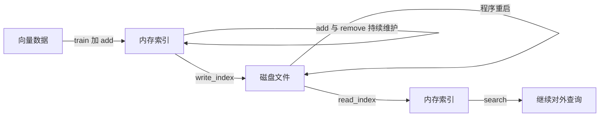

# 第 03 课　工程实践：增改、存盘与性能

前两课把索引建立起来并完成了查询。真实业务随之而来的是维护问题：新数据不断进入、旧数据要下架，程序重启之后数据是否还在，也是必须解决的问题。本课处理这些工程实践：增量添加、按 ID 管理、存盘加载。

## 增量添加：随时上新

向量不是一次性到齐的：文档库今天新增 50 篇、明天下架 3 篇，索引要跟着更新。

`index.add()` 随时可以调用，加完立刻能查。两个细节要注意：

1. **IVF 类索引必须先 train 再 add**。train 让它根据一批数据算出各堆的堆心；堆心没有确定，新向量就没有归属。Flat 与 HNSW 没有这一步，拿来就能加；
2. 攒批添加远快于逐条添加。一次 add 一万条，比一万次各加一条快得多，因为每次调用都有固定开销。

## 按 ID 管理：FAISS 不认识你的业务 ID

默认情况下，FAISS 只给向量编位置编号：第 0 个、第 1 个，search 返回的也是位置编号。而业务里每条向量有自己的文档 ID、商品 ID，两者需要对上。两种办法：

- 自己对账：用一个列表维护“位置编号到业务 ID”的映射，查到编号后翻译一次。做法简单，但删除数据时要自己维护对账表；
- 让 FAISS 记住 ID：用 `IndexIDMap` 把索引包一层，`add_with_ids(vec, [1001])` 直接存业务 ID，search 返回的也是它，还能用 `remove_ids` 按 ID 删除。

打个比方：快递柜的格子号相当于位置编号，快递单号相当于业务 ID。默认的 FAISS 只报格子号，`IndexIDMap` 相当于给柜子装上扫码取件，直接认单号。

## 存盘与加载：关机不丢

内存里的索引，程序一退出就没有了；百万级数据重新 train 加 add 要等很久。FAISS 用两个函数解决：

```python
faiss.write_index(index, "my_index.faiss")   # 存盘
index = faiss.read_index("my_index.faiss")   # 读回，train/add 的成果全在
```

IVF 的堆心、HNSW 的图、PQ 的码本都会随文件保存，读回来直接能查，不需要重新 train。建索引的开销主要在那趟 train，所以训练成果要存盘。



## 数据量大时的几个实用做法

- 分片：单个索引太大，就拆成多个文件、多个索引，查询时分头查再合并结果，可以按数量切，也可以按业务切；
- 先粗筛后精排：用近似索引（IVF、PQ）召回 Top-50，再用 Flat 对这 50 条精算距离排序，快与准各取所长，RAG 中很常见；
- 批量查询：search 一次传一批查询向量，比一问一答省开销；
- 定期测召回：拿 Flat 当标尺测召回率，改了参数、换了索引之后必测，不凭感觉；
- 内存不足时：FAISS 还有把部分数据放磁盘的进阶方案，本书不展开，知道有这条路径即可。

这些数字没有写死：多少条该分片、Top-K 取多大，都取决于内存预算和延迟要求。这里给的是判断依据，具体数值要用自己的数据测。

## 动手跑 🛠️

```bash
python faiss_practice.py
```

零依赖段用纯标准库模拟一个向量仓库：加向量、按 ID 删、搜最近邻，然后存盘到临时文件、读回来验证数据一条不少，本课的核心动作完整走一遍。真实 FAISS 段（未装库会中文提示跳过）用 IndexIDMap 演示 add_with_ids、remove_ids 和 write_index、read_index。

## 想一想

1. 程序重启后 Flat 索引还在内存里吗？让它恢复的最省事办法是什么？
2. 你用自己的对账字典管业务 ID，现在删掉位置编号 5 的向量，后面的编号会往前挪吗？这对对账字典意味着什么？（可运行 faiss_practice.py 验证）
3. 每隔 5 分钟进来 1 万条新向量，逐条 add 还是攒一批？各自的代价在哪里？
4. 轻动手：给 faiss_practice.py 的仓库加一个 update(id, vec) 方法，底层用“先删后加”实现，并想想这对对账表的影响。

## 小结

- 增量添加随时可做，IVF 类要先 train；攒批加远快于逐条加。
- FAISS 默认只有位置编号：业务 ID 要么自己对账，要么用 IndexIDMap 的 add_with_ids。
- write_index / read_index 让训练成果关机不丢，读回即用。
- 大数据量的四个手段：分片、粗筛加精排、批量查询、定期测召回。
- FAISS 是一个库：持久化服务、增删改查、并发访问都要自己搭建。

到这里，FAISS 的使用与维护已经完整。但它终究是一个库：服务化、持久化、多程序并发访问都要自己搭。当你需要一个“起服务就能查”的完整向量数据库时，就进入下一章：第 8 章从库走向数据库服务。

2026 年 10 月
