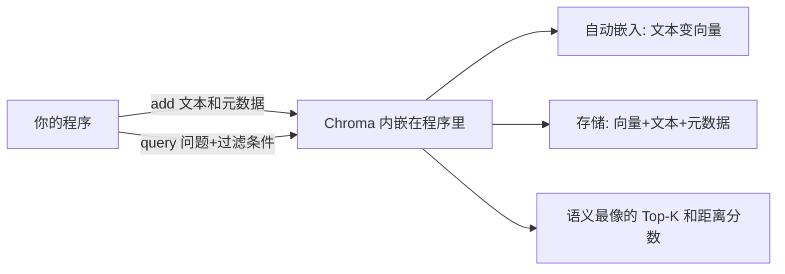

# 第 01 课　Chroma 最友好入门

上一章的 FAISS 是一个库：检索快、算法全，但索引活在程序内存里，程序一关数据就没了，按"分类、来源"筛选还得自己写代码。本章从"库"走向"数据库"。第一个要认识的是 Chroma，它以容易上手著称。

Chroma 是嵌入式向量数据库：不另起服务进程，直接嵌在 Python 程序里运行，pip 装完即可使用。米放进电饭煲、按下按钮就能煮熟饭；Chroma 把建库、嵌入、检索封装成几个方法调用。"最友好"指的就是这个上手成本。

## 三个核心名词

Chroma 的数据结构有三层：

- **集合（Collection）**：一组文档的组织单位，可按主题分开建，如"菜谱"集合、"法律条文"集合。
- **文档（Document）**：一条数据，存一段文本。
- **元数据（Metadata）**：随文档一起存的标签字段，如 {"分类": "美食", "来源": "妈妈的手抄"}，查询时可按它过滤。

Chroma 还提供**自动嵌入**：只给文本，内置的嵌入模型自动把文字变成向量（Embedding 见第 2 章第 05 课），不用先算好再喂。



## 增删改查

真实代码如下（需 pip install chromadb）：

```python
import chromadb
client = chromadb.PersistentClient(path="./chroma_db")   # 指定目录 = 数据落盘
col = client.get_or_create_collection("recipes")          # 拿集合，没有就建
col.add(ids=["1"], documents=["红烧肉要先焯水再炖"], metadatas=[{"category": "美食"}])
res = col.query(query_texts=["怎么炖肉"], n_results=2, where={"category": "美食"})
col.update(ids=["1"], documents=["红烧肉要小火炖九十分钟"])   # 改
col.delete(ids=["1"])                                       # 删
print(col.count())                                          # 数数
```

注意 `where={"category": "美食"}`：先按元数据缩小范围，再在剩下的数据里找语义最近的结果。这正是第 7 章 FAISS 需要自己实现的"元数据过滤"，Chroma 内置提供。

## 持久化：程序关了，数据还在

`PersistentClient(path=...)` 是本课最重要的一行。第 7 章 FAISS 的索引在程序退出后即消失；Chroma 指定一个目录后，数据自动写入硬盘，下次启动继续使用。"库"与"数据库"的分水岭就在这里：数据有没有独立于程序的生命周期。

## 动手跑

```bash
python chroma_demo.py
```

前半段是纯标准库：亲手实现一个"迷你 Chroma"，包含集合、增删改查、元数据过滤、JSON 落盘重启读回，可以看到数据库的核心骨架并不复杂。后半段是真实 Chroma（没装库会打印中文提示并跳过；为了离线可跑，演示直接传向量，不联网下载默认嵌入模型）。

## 本课的边界

Chroma 适用于单机、嵌入式场景：一个人使用、几万条数据时足够称手。当数据涨到千万级、需要多人同时读写、要求机器故障后数据不丢失时，就需要真正为大规模设计的数据库。下一课介绍 Milvus。

## 想一想

1. FAISS 和 Chroma 都能做相似检索，"关机后数据还在"这个能力差在哪一步？
2. 给"图书馆管理系统"设计元数据字段，你会存哪几个标签？它们分别怎么帮你过滤？
3. 迷你版查询时"先过滤、再算相似度"，如果过滤后只剩 3 条，直接算是不是反而更快？什么情况下先过滤反而亏？
4. 轻动手：把 chroma_demo.py 的 where 条件改成只看"编程"类，结果和不过滤相比有什么不同？

## 小结

- Chroma 是嵌入式向量数据库：不另起服务，pip 装完就用。
- 集合、文档、元数据分别对应组织单位、数据本身、标签字段；查询支持 where 过滤。
- 自动嵌入：只给文本，向量由内置模型计算。
- PersistentClient 让数据落盘重启不丢，这是"数据库"的入场券。

## 下一课预告

Chroma 适合单机场景；当数据涨到十亿条、几百人同时读写时怎么办？下一课介绍为大规模而生的 Milvus。

2026 年 10 月
