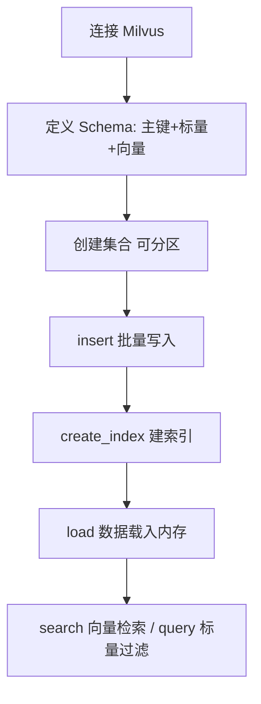

# 第 02 课　Milvus 为大规模而生

Chroma 是单机嵌入式数据库，适合一个人使用。当向量到千万、十亿级，需要几百人同时查询、机器故障后数据不能丢失时，就需要独立部署的数据库服务。Milvus 专为这个规模设计。

先记住它的三种形态：

- **Milvus Lite**：pip 安装后直接使用，数据存本地文件，与 Chroma 同为嵌入式，适合学习与原型。
- **Standalone**：一台服务器运行完整数据库，Docker 一行命令启动服务，适合中小规模生产。
- **Distributed**：多台机器组成的集群，分片加副本，支撑十亿级向量。

三者的 Python 代码几乎一样，差别只在连接地址：本地文件、服务器 IP 或云端 URL。学一次，三种规模都会用。

## 和 Chroma 最大的不同：先定义 Schema，再放数据

Chroma 写入时比较随意，add 时想存什么就存什么。Milvus 要求建集合前先定义 Schema：每一列叫什么、什么类型、向量多少维，事先全部定好。就像仓库收货前要先登记品类和规格，登记清楚了，海量数据才不会乱。

字段通常三类：主键（唯一标识一条数据）、标量字段（文本、数字、标签，负责过滤）、向量字段（负责语义检索）。



## 分区：查询前先缩小范围

百万条数据里只想搜"美食类"，逐条扫全库太浪费。Milvus 支持按规则把集合分成多个**分区（Partition）**，查询时直接指定分区，不扫全库。写入时按类别分仓，查询时按需进仓，两边都省力。

## 服务化的代价与回报

Milvus 是独立的服务：程序通过网络连接它，它负责存储、索引、并发、备份。代价是要安装、要运维；回报是多人同时读写、宕机有副本、数据量可以持续增长。上一课说的"库"与"数据库"的分水岭，在这里是完整的数据库服务。

还有一个规矩：插入的新数据要等 `load()` 载入内存后才能搜索。"入库"和"上架"在服务化数据库里是两个步骤。

## 动手跑

```bash
python milvus_demo.py
```

纯标准库段：给迷你库加上三样 Milvus 特质，先定 Schema 再写入（字段不齐拒收）、按类别分区检索、不 load 就不能搜，体会服务化数据库的规矩。真实段用 Milvus Lite（需 pip install pymilvus，本地文件即服务，无需部署），走 MilvusClient 新范式：一个 client 对象完成建集合、插入与检索；演示直接传现成向量，不联网下载嵌入模型。没装库会打印中文提示并跳过，不影响主线。

## 本课的边界

如果不想引入新数据库，公司现成的 PostgreSQL 也能查向量，做法在下一课 PGVector，顺带补一个五分钟的 SQL 生存包。

## 想一想

1. Schema 先行 vs 随手 add：小项目你可能喜欢哪个？数据到一亿条时呢？
2. 分区和上一章 IVF 的"分堆"有什么本质不同？（提示：一个是存的时候就分开，一个是查的时候才分组）
3. Milvus Lite 和 Distributed 代码几乎一样，这个设计对你的学习路径有什么好处？
4. 轻动手：把 milvus_demo.py 的数据按两个分区存，比较"指定分区查"和"全库查"的搜索范围差多少。

## 小结

- Milvus 三形态：Lite 嵌入式、Standalone 单机服务、Distributed 集群。
- Schema 先行：主键、标量、向量三类字段，先定义结构后放数据。
- 分区按规则分仓，查询指定分区少扫数据；新数据要 load 后才能搜。
- 它是服务不是库：要部署运维，换来并发、副本与水平扩展。

## 下一课预告

不装新数据库，让 PostgreSQL 自己学会查向量。下一课 PGVector，外加五分钟 SQL 生存包。

2026 年 10 月
