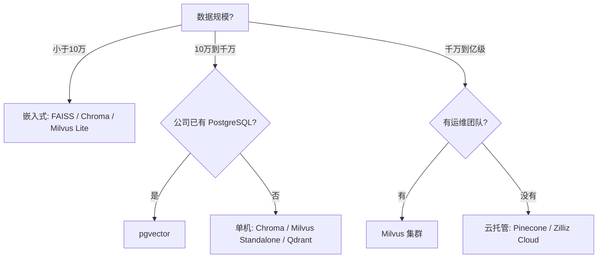

# 第 05 课　向量数据库选型

五课下来，我们已经用过 FAISS、Chroma、Milvus、PGVector，也认识了 IVF、HNSW、PQ 这些索引算法。真到接项目那天，问题通常不是"哪个最强"，而是"哪个和当前处境匹配"。本课给一套"提问-打分"的选型方法：像租车前先想清楚拉货还是载客、跑山路还是高速、有没有驾照，再谈车型。

## 五个问题，问完就有答案

1. **数据规模**：千条级各家都行；十万级嵌入式够用；千万级要单机服务；亿级以上才真正需要分布式集群。
2. **运维能力**：没有 DBA 就不要自建集群，嵌入式或托管服务优先。这一条经常直接排除一批候选。
3. **已有设施**：公司 PostgreSQL 已经用了十年，pgvector 一步到位，数据不用搬家。
4. **功能需求**：元数据过滤、混合查询、事务、多租户，各家支持程度不同。
5. **预算**：开源免费但要承担机器和人力成本；托管服务省心但按量付费。

## 一张决策地图

主流产品按形态分四类：嵌入式（FAISS、Chroma、Milvus Lite，随应用走）、单机服务（Milvus Standalone、Qdrant）、分布式集群（Milvus 集群）、云托管（Pinecone、Zilliz Cloud）。规模升一档，形态换一类：自由度递减、省心度递增，成本结构也跟着变。



这张地图是起点不是终点：同一格里的候选，再按运维、设施、功能、预算四问逐一筛选，剩下的就是答案。落到常见处境，就是三句：个人或小团队，用 Milvus Lite 这类嵌入式起步；公司已有 PostgreSQL，用 pgvector；亿级数据又缺运维，选云托管。

## 动手跑

```bash
python vector_db_selection.py
```

纯标准库决策器：把五个问题变成打分项，内置六位候选（FAISS / Chroma / pgvector / Milvus Lite / Milvus 集群 / 云托管），跑三个场景（个人 RAG、已有 PG 的中型知识库、亿级推荐系统），看推荐结果和理由如何随条件变化。修改场景参数，让它为你的项目出主意。

## 本课的边界

选型不是终点。真实项目里，向量库里装什么、向量从哪来，往往比"用哪个库"更影响效果：回头看你第 5 章 mini_rag 切的 chunk、选的 embedding，再联系第 9 章的数据清洗，原料的干净程度决定检索的上限，数据库只是存储与检索的那一环。学完本章，可以把当时那个小项目升级成"真数据库版"，实际验证一遍今天的选型逻辑。

## 想一想

1. 五个问题里，哪两个在你当前的处境下最优先？为什么？
2. "开源免费但要自己运维"和"托管付钱但省心"，团队 3 个人和 30 个人时答案会怎么变？
3. 已有 PostgreSQL 的团队选 pgvector，除了省一套数据库，还有什么额外收益？（提示：业务数据和向量在同一个库里，join 起来方便）
4. 轻动手：给 vector_db_selection.py 加第四个场景——"初创团队、50 万条数据、无人运维"，看决策器推荐谁、为什么。

## 小结

- 选型问五件事：规模、运维、设施、功能、预算；规模先行，运维能力可直接排除候选。
- 四类形态：嵌入式、单机、集群、托管，规模升档形态跟着换。
- 常见三句：个人用 Milvus Lite 这类嵌入式；已有 PostgreSQL 用 pgvector；亿级缺运维选云托管。
- 算法各家通用，实际选的是"自由度与省心度"的配比；数据质量决定检索上限。

## 学完本章之后

本章到此收束。回头把第 5 章的 mini_rag 换上真数据库，是检验本章学习成果的最好练习；向量从哪来、原料怎么洗净，第 9 章数据处理会接着讲。

2026 年 10 月
