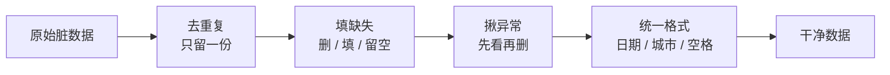

# 第 01 课　数据清洗与预处理

拿到手的原始数据，很少能直接使用。它可能带着多余空格、错字、重复记录，也可能混着离谱的数字。直接拿这种数据训练模型，结果不可信。这节课讲数据处理的第一道工序：**数据清洗**。它类似做饭前的洗菜切菜：琐碎、耗时，但决定后面成品的下限。

## 一、垃圾进，垃圾出

AI 领域有一句流传很广的话：Garbage in, garbage out，垃圾进，垃圾出。模型本身不分辨数据对错，它照着喂进去的数据总结规律。1000 条评论里混着 200 条重复的差评，模型统计出的差评比例就会偏高。

> 数据圈还有一个流传很广的说法：做数据的人，八成时间花在清洗上，两成才花在建模上。数字不必较真，但清洗占大头，这个方向是对的。

清洗的目标很朴素：让每一条数据都靠谱、唯一、格式统一。这类工作也叫"预处理"，指建模之前的全部准备工序。

## 二、四类最常见的"脏"

以配套 `cleaning_demo.py` 里那份故意弄脏的用户登记表为例，脏数据主要有四类：

**缺失值**：该填的格子空着，比如年龄空、城市空。处理思路有三条：缺得不多就整行删掉；删不得就填，数字列用平均数，类别列填"未知"；也可以留着空，让模型知道这格是空的。

**重复值**：同一条记录出现了两次。张三的信息一模一样存了两份，统计活跃用户时他会被数成两个人。处理办法最简单：只留一份。

**异常值**：明显不对劲的数。有人 28 岁，有人填了 999 岁，大概率是笔误。但极端值偶尔真实存在（比如确实有月消费十万的大客户），所以查出来之后要先看再删，不能一律删除。

**格式不统一**：同一个东西有几种写法。北京被写成"北京"、"beijing"、"BJ "；日期有"2026-01-05"、"2026/01/06"、"05-01-2026"三种写法。处理办法是定一个标准格式，全部归一。

四类问题的处理顺序，一张图看清：

顺序不是死的，但去重放在前面，后面要处理的行数会少一些，一般划算。

## 三、动手：把小表洗一遍

配套的 `cleaning_demo.py` 用纯 Python 标准库（不用装任何东西）把上面四步各写了一遍，每一步都先打印"洗之前"、再打印"洗之后"。运行时重点看三处：

1. 去重用的是"整行内容做指纹"的思路：把一行的所有字段拼成一个元组作为唯一标识，第二次见到相同内容就丢弃；
2. 填缺失用的平均数，只用没缺、又不离谱的行算出来：缺失的行不能参与计算，999 这种笔误混进去，平均数会被从 28 拉到 270；
3. 异常值用的是最朴素的"常识区间"判断：年龄超出 0～120 就算异常。真项目里常用更讲究的统计方法（比如 IQR 四分位距），道理相同：先划一个合理范围，再逐条确认。

文件后半段还有一段 pandas 的对照写法（`pip install pandas` 装好后才能跑；缺库时程序给出中文提示并跳过）：同样这四件事，pandas 用 `drop_duplicates()`、`fillna()` 一行顶十行。思路是通用的，工具只是更快。

## 四、清洗的三条行规

这几条从第一行代码就照做，以后少走弯路：

- 先备份原始数据。清洗动作全部落在副本上，原始数据不动。某一步洗坏了，随时退回来重来。
- 每一步都留痕。删了几行、填了几个空、查到几个异常，都打印或记录下来。出了问题时，这是唯一的排查依据。
- 别追求一次洗到位。先粗洗（明显的重复、空值、格式），看一眼数据长什么样，再决定要不要细洗。边洗边看，比一次写一个大而全的脚本可靠。

## 想一想

1. 一列年龄有 5% 的格子是空的：整行删除和用平均数填，各适合什么情况？（提示：想想这列对结果有多重要、删除会不会把别的有用信息也丢掉）
2. 异常值一定是错的吗？举一个"你舍不得删"的异常值场景。
3. 为什么"先备份原始数据"是铁律？想象你把一整列出生日期误填成了平均数、又没有备份，接下来会发生什么？
4. 轻动手：往 `cleaning_demo.py` 的脏表里加一行 `{"name": "周八", "age": -5, "city": "北京", "signup": "2026-01-09"}`，再跑一遍，看异常值那一步能不能把它查出来。

## 小结

- 垃圾进，垃圾出：数据质量决定模型效果的上限，清洗是最花时间也躲不开的一环。
- 四类最常见的脏：缺失、重复、异常、格式不统一，各有处理套路。
- 异常值先看再删，不一刀切；缺失值要填的话，填充值必须只用没缺失的数据算出来。
- 先备份、留痕迹、边洗边看，是清洗的三条行规。
- 清洗完的数据只是能用的原料，下一课把它加工成模型能使用的特征。

---

2026 年 10 月
