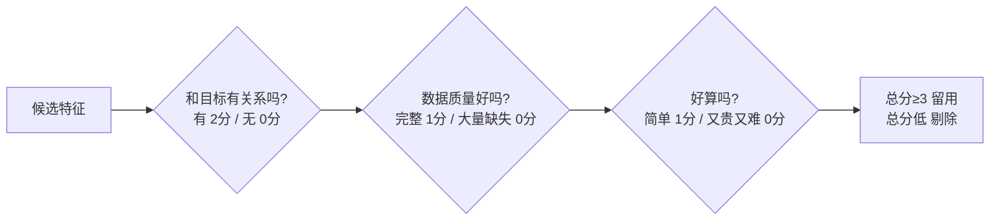

# 第 02 课　特征提取与选择

上一课把数据洗成了干净的原料。但原料还不能直接交给模型，模型需要的是一种叫"特征"的东西。这节课讲两件事：把原始信息变成特征，叫**特征提取**；从众多特征里挑出真正有用的，叫**特征选择**。

## 一、什么是特征：模型眼里的"体检指标"

去医院体检，医生不会直接看你这个人，而是看一张化验单：身高、体重、血压、血糖。每一项都是把人"压缩"成的一个数字。模型也如此：它看不懂一个具体的用户，只看得懂一串数字，**每一个数字就叫一个特征（Feature）**。

所以特征提取要回答的是：要描述这个东西，该量它哪几个指标？量错了指标，模型再强也会误判。

> 顺带说明：到了大语言模型时代，Embedding 接过了"把原始东西变成一串数字"的工作（第 2 章第 05 课讲过 Token 与 Embedding 的直觉）。但这一课的方法没有过时：它教的是"该量哪些指标"的判断力，这件事 LLM 替不了你。

## 二、提取：从原始信息里造指标

举例最直观。一行原始数据是 `"2026-01-08 14:32, 用户在上海下单了3单"`，模型没法直接用。把它提取成几个数字：

- 注册年数：`1`（2026 减 2025）
- 订单数：`3`
- 收货城市：`上海` → 拆成 `city_上海=1, city_北京=0`（类别变数值，行话叫"编码"）

原本一段没法使用的文本，变成了 `[1, 3, 1, 0]` 四个干净的数字。这就是特征提取：从原始信息里造出对预测目标有帮助的指标。

选指标的诀窍只有一个：先想清楚要预测什么。预测"会不会流失"，下单频率、最近一次登录天数就是好指标；预测"会不会买母婴产品"，家里有没有小孩这种指标就重要。指标跟着目标走，不是越多越好。

## 三、选择：指标太多也是病

有人认为特征越多越好，多量几百个指标总有用得上的。恰恰相反。特征太多，训练更慢，而且大量无关特征会把模型带偏，这也是**过拟合**的一种来源：模型记住了无关特征的巧合，而不是真规律。

所以要做特征选择：把没用甚至添乱的特征剔出去。最朴素的一招是**手工打分**，给每个特征问三个问题，逐个打分：

三个问题对应三件事：相关性（它和目标有关吗）、可用性（数据本身靠谱吗）、成本（拿到它划不划算）。配套 `feature_demo.py` 就是这么做的：给每个特征打分，把"用户ID、手机尾号"这类与流失毫无关系的列剔出去。真项目里还有自动的统计方法（行话叫过滤法/包装法/嵌入法，可靠程度不同），但第一步应该是先人工筛一遍：很多没用的特征，看一眼名字就能判断。

## 四、动手与两条提醒

`feature_demo.py` 用纯标准库（零安装）演示了完整流程：一份"用户流失"小表 → 手工打分 → 剔除无关列 → 打印留下哪些特征；后面还有一段 pandas 对照（`pip install pandas` 才能跑，缺库时程序给出中文提示并跳过）。

两条容易踩的坑，提前说明：

- 打分标准要在看数据之前定好。如果先看了结果再定标准，打分会不自觉地向结论倾斜。
- 别急着删"暂时没用"的特征。有些特征单独看没有相关性，和别的特征组合起来才有用（比如"性别"单独没用，"性别×最近购买品类"可能有用）。拿不准就先留着，等模型表现说话。

## 想一想

1. 预测"这单外卖会不会超时"，你会量哪些指标？至少想 4 个，并说明每个和"超时"的关系。
2. "用户手机号"为什么几乎总是要剔除的特征？（提示：想想它和任何目标都无关，还几乎每行都不同）
3. 某特征 80% 的格子是空的，但剩下的 20% 和目标强相关，留还是删？你的依据是什么？
4. 轻动手：给 `feature_demo.py` 的候选特征表加一行"注册渠道"，按打分三问给它打分，看它值不值得留。

## 小结

- 特征就是把现实事物压缩成模型能使用的指标；提取是造指标，选择是挑指标。
- 提取的诀窍：指标跟着预测目标走，先想目标再定指标。
- 特征不是越多越好，无关特征会把模型带向过拟合。
- 手工打分三问（相关吗/数据好吗/好算吗）是第一道也是最便宜的筛子。
- 有了干净又挑好的数据，数量还是不够怎么办？下一课讲"合理地变出更多数据"。

---

2026 年 10 月
