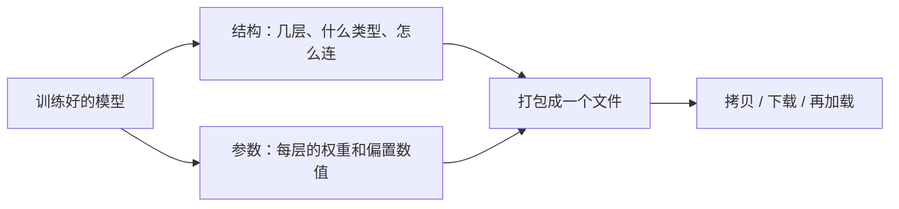
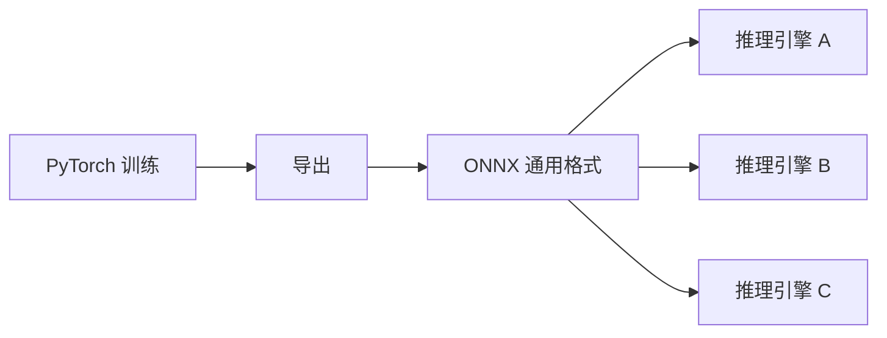

# 第 01 课　模型导出与格式转换

模型训练完成只是第一步，要投入使用还差一个环节：把它搬到真正运行它的机器上。这一课不训练任何东西，专门讲模型的"搬运"：模型文件里装了什么、直接发训练脚本为什么不行、部署时常见的几种格式各是什么。

---

## 一、拆开模型文件看看，里面装的是什么

先建立直觉。一个训练好的模型，拆开看只有两样东西。

第一样是**结构**：这个网络有几层、每层是什么类型、数据从哪层流向哪层。第二样是**参数**：每个部件的具体数值。前几章反复打交道的权重和偏置，就是几百万到上千亿个普通的数字，训练做的事，就是把它们一点点调到合适的值。

PyTorch 里有个词叫 **state_dict**，内容是一份部件名到数值的对照表：一行一个部件名字，后面跟着这个部件的全部数值。保存模型，本质是把这份清单写进硬盘；加载模型，是照着清单把数字原样填回去。配套的 `model_export_demo.py` 第 1 段就用纯标准库模拟了这件事：把一个"模拟权重矩阵"存成 json 再读回，读回的数字和原来一模一样，前向计算的结果也一模一样。这就是所有模型文件格式的共同骨架。

## 二、为什么不直接把训练代码发过去

直接把训练脚本发给对方，基本跑不起来，问题出在环境和依赖上：对方要装一模一样的框架和版本、维持相同的目录结构，硬件也得对得上，这些条件在部署现场很难凑齐。这就像请朋友尝你做的菜，却把整个厨房连同灶台搬过去，太重。正确做法是把菜做熟打包：只交付"结构 + 参数"这个结果，对方只需要一个能加热的微波炉（推理环境）。

还有一层原因：部署现场常常不是 Python。手机 App、网页浏览器、嵌入式设备、C++ 后端服务里都没有 Python 运行时，训练框架自带的保存格式是给训练流程用的，这些环境读起来并不方便。

## 三、导出与转换：一套各家都认的通用格式

于是就有了"导出"和"格式转换"这一步。最有代表性的通用格式叫 **ONNX**（Open Neural Network Exchange，开放神经网络交换格式）：把模型的结构和参数翻译成一套各家都认的通用写法，任何支持它的推理引擎都能加载运行。

为什么要多这一道手续？因为换来的是实际收益：

- 部署灵活：一份通用格式，服务器、边缘设备、不同框架都能接；
- 速度提升：专用推理引擎（下一课介绍）会针对通用格式做深度优化，往往比直接用训练框架跑快不少；
- 成本下降：跑得快、占用少，同一台机器就能服务更多请求。

当然，交换不是白来的：转换要花一次功夫，个别特殊算子可能转换失败要绕路，个别转换路径还可能带来微小的精度差异。这条主线将贯穿整章：每一次优化，都是在速度、显存、精度、成本四样东西之间做交换。

顺手认识三个常见格式（名字不同，骨架一样）：

- `.pt` / `.pth`：PyTorch 自带的参数清单格式，训练圈最常见；
- `.safetensors`：只存参数、加载更安全省事的新格式，很多开源模型用它发布；
- `.onnx`：上面说的通用交换格式，跨框架部署常用。

## 四、配套演示怎么跑

`model_export_demo.py` 分三段，建议按顺序跑：

1. 纯标准库段：把模拟权重存成 json 再读回，并做前向计算验证"文件里的数字能原样复活"。零依赖，直接 `python model_export_demo.py` 就能跑。
2. torch 段：真用 PyTorch 保存和加载 state_dict。需要 `pip install torch`；没装也没关系，程序会打印一句中文提示并跳过。
3. onnx 段：把一个小模型导出成 ONNX 并读回检查。需要 `pip install torch onnx`，同样缺库优雅跳过。

重点看第 1 段的输出：导出的文件多大、里面有什么字段、读回后输出是否一致。torch 的 .pt 和 ONNX 的 .onnx，是这套骨架的工业级版本。

## 想一想

1. 模型文件里如果只有参数、没有结构，加载时会发生什么？反过来只有结构、没有参数呢？
2. state_dict 这个名字里的 "state"（状态），你觉得指的是模型的哪样东西？训练到一半和训练完的模型，state 有什么不同？
3. 假设你要把模型交给手机 App 团队，ONNX 这类通用格式帮上了什么忙？如果不转换、直接发 .pt 文件，会有什么麻烦？
4. 轻动手：运行 `model_export_demo.py`，打开导出的 json（或打印前几行），找到结构部分和参数部分各在哪个字段，数一数一共有多少个参数。

## 小结

- 模型文件由结构加参数组成：训练是把参数调好，部署是把这两部分完整交付。
- 直接发训练代码等于把整个厨房搬过去，环境与依赖很难满足。
- 导出与格式转换（如 ONNX）给模型换来通用格式支持，部署灵活，也为后续加速留出空间。
- 每一步优化都是交换：本课用一次转换成本，换部署灵活性与加速的起点。
- 文件交付之后体积仍然偏大，下一课讲用量化把它压缩。

2026 年 10 月
