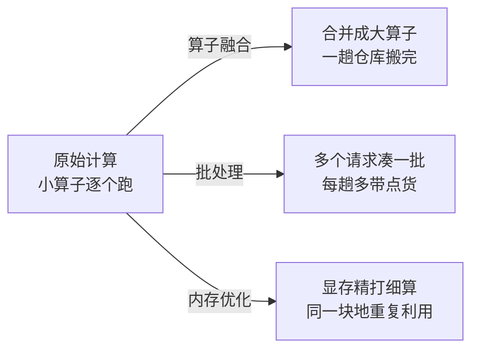

# 第 03 课　推理引擎与优化

前两课完成了模型的交付（导出与格式转换）和压缩（量化）。部署提速还有第三个方向：同样的模型，换一套更合理的执行方式，速度可以相差数倍。这套执行方式就是推理引擎的核心工作。本课讲它最典型的三招：**算子融合**、**内存优化**、**批处理**，每招都遵循同一条主线：用什么代价，换什么收益。

---

## 一、为什么"会算"和"算得快"是两回事

先建立一个关键直觉：神经网络计算时，真正花时间的往往不是乘加运算本身，而是数据搬运。

把 GPU 想象成一家餐厅：厨师（计算单元）手速很快，但每做一道菜，服务员都要先去仓库（显存）取食材、再送回后厨，来回搬运的时间往往超过炒菜本身。计算在术语里叫"计算密集"，搬运叫"访存"，大多数深度学习计算的时间都耗在取送数据的路上。

推理引擎的优化几乎都围绕一件事：减少搬运次数，提高每次搬运的利用率。

## 二、算子融合：合并连续的小操作

模型里到处是这样的结构：先做矩阵乘法，紧跟着加偏置，再来一个激活函数。看起来是三步，很多引擎会把"乘 + 加"融合成一次操作（这正是第 01 课 json 演示里线性层写法的由来），甚至把激活也一并合入。

为什么要融合？不融合时，每一步小操作都要从显存读数据、计算、写回显存，下一步又要重新读取。融合后，数据读出一次就在片上连续完成几步，最后才写回，显存往返次数从 3 次降到 1 次。

代价是灵活度下降：融合后的大算子是为特定组合定制的，换一种结构可能没有现成的融合算子，只能回退到逐个执行。这是用灵活度换速度。

## 三、内存优化：显存的复用与按需分配

显存是部署中最紧缺的资源，内存优化有两条常见思路：

- 复用：一个算子的输出被消费完，它占的显存立刻可以分配给其他算子。引擎会提前分析各算子的生命周期，规划出一张复用时间表。
- 按需分配：与其按最长可能的输入预留一大块，不如按实际需要分配，避免大片显存长期闲置。

这些事手工做极易出错（误用还没算完的数据会导致结果错误），所以交由推理引擎自动完成：你得到结果，引擎负责细节。

## 四、批处理：多个请求合并计算

单个请求喂给模型时，GPU 有大量算力在等待数据而不是计算数据。批处理把多个请求凑成一批同时计算，一次数据读取供整批请求共同使用，减少了重复搬运。

对单个请求来说，响应稍慢了，因为要等同批请求一起计算；对整体来说，单位时间完成的请求数成倍上升。这就是批处理换来的收益，代价是单请求延迟略增。

批越大吞吐越高，但延迟和显存占用也越高。批次大小是部署时最常见的调节参数之一，没有标准答案，按业务对响应速度和成本的偏好来定。下一课会看到大模型场景下它还有一个更精细的进化版本。

## 五、配套演示怎么跑

`inference_engine_demo.py` 全程纯标准库，直接跑：

1. 算子融合段：把"乘 + 加 + 激活"分别按"逐算子"和"融合"两种方式模拟，逐条打印两种做法的显存读写次数，数一数融合省了多少趟；
2. 内存复用段：模拟一张算子时间表，展示同一块显存如何在算子之间接力复用；
3. 批处理段：对比"逐个请求"与"拼批"的总操作步数，并试着调大批次看吞吐变化。

重点看每段末尾的"优化前后步数对比"：整章的交换逻辑都浓缩在这几行数字里。

## 想一想

1. 算子融合省时间的关键，是省了"计算"还是省了"数据搬运"？用餐厅的比喻说一遍。
2. 批次从 8 调到 64，哪三个数字会变？分别往哪个方向变？如果你在做聊天机器人（用户在乎响应快）和做夜间批量文档摘要（在乎总成本），分别往哪个方向拧？
3. 内存"重复利用"和量化（上一课）都在省显存，它们的省法有什么本质不同？能不能同时用？
4. 轻动手：运行 `inference_engine_demo.py`，把批处理段的批大小参数改成 2、4、16，记录三种情况下"总操作步数"和"最晚完成请求的等待轮数"，画出你观察到的交换关系。

## 小结

- 深度学习计算的时间大头常在显存搬运而非乘加本身，推理引擎的优化围绕减少搬运次数、提高每次搬运的利用率。
- 算子融合把连续小操作合并为一次显存往返，用灵活度换速度。
- 内存优化靠复用与按需分配，让同一块显存服务更多算子。
- 批处理把多个请求合并计算，吞吐量成倍上升，代价是单请求延迟略增、显存占用更高。
- 三招都指向同一条主线：速度、显存、精度、成本之间的交换。下一课看大模型场景下这套思路如何进一步演化。

2026 年 10 月
