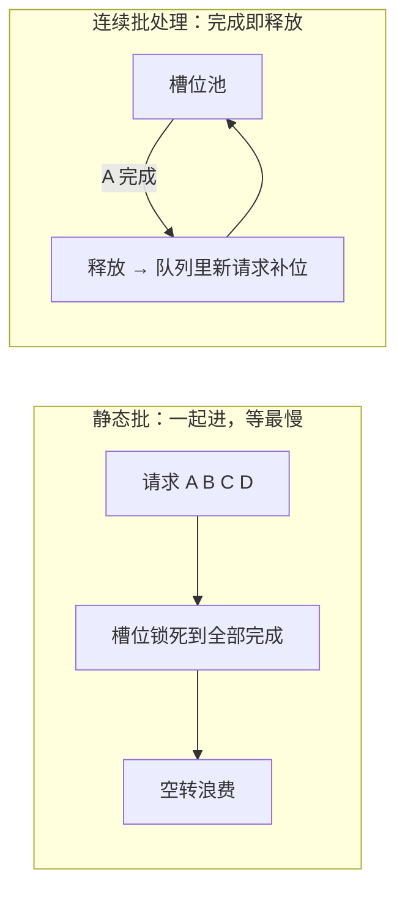

# 第 04 课　LLM 推理框架

上一课的优化（融合、复用、批处理）是通用推理引擎的基本功。大语言模型上场后，情况有了新变化：它一个 token 一个 token 地生成，还要为每个请求维护一份不断增长的中间结果缓存。常规做法直接照搬会浪费大量资源，于是专门为大模型定制的推理框架出现了。本课讲它们解决了什么，以及今天就能在本机上手的那一个。

---

## 一、LLM 推理特殊在哪

回顾第 2 章讲过的推理过程，三个特点决定了它需要专门优化：

- **自回归生成**：一次只生成一个 token，生成后接回输入再生成下一个。写 500 字就是 500 次小计算，不是一次大计算。
- **KV Cache**：为避免每生成一个 token 都重算全部历史，模型把每层的中间结果缓存下来。对话越长缓存越大，而且每个请求都有自己的一份。
- **长度不定**：有人问"今天几号"，有人要写万字报告。请求之间长度差异极大，资源很难提前规划。

KV Cache 是显存大户。粗略地说，长对话下它占用的显存可以超过模型参数本身。缓存管理得越高效，同样显存能同时服务的请求就越多，这是本课两项主技术的共同出发点。

## 二、连续批处理：完成即释放，新请求补位

上一课的批处理有一个缺陷：一批请求同时进入，必须等最长的那个完成才能整体结束。期间已完成的请求占着槽位空转，新请求排队等待，GPU 利用率被拖低。



连续批处理（continuous batching）把槽位池化管理：每生成一轮，谁完成谁释放槽位，排队的新请求立刻补位。可以把槽位想成餐厅的座位：翻台不再等整桌客人走完，空出一个坐一位。GPU 每一轮都接近满负荷。代价是调度逻辑更复杂，每一轮都要决定哪些请求进入、哪些退出，这道调度题正是配套演示里亲手模拟的内容。

## 三、PagedAttention：KV Cache 按块管理

第二个问题：KV Cache 的长度无法预知。传统做法按可能的最大长度预留显存，实际生成的长度往往短得多，多余部分全部闲置，还限制了能同时服务的请求总数。

vLLM 框架提出的 **PagedAttention**（分页注意力）借用了操作系统管理内存的思路：把 KV Cache 切成固定大小的块（block），请求来了按需一块一块申请，写完一块再领下一块，释放时块立刻归还池子。显存碎片没有了，同一块显存能容纳的并发数大幅上升，吞吐随之上升。

这一招不增加计算，纯靠管理方式就省下大量显存，是 2026 年主流框架的标配思路（各家实现名称可能不同，原理相通）。

## 四、框架格局：一张地图

不写死版本号，按定位记四家（截至 2026 年的主流格局）：

| 框架 | 定位 | 一句话 |
|------|------|--------|
| vLLM | 高吞吐服务端 | PagedAttention 出身地，功能全 |
| TGI | 生产级服务器 | HuggingFace 系，工程化成熟 |
| TensorRT-LLM | 极致性能 | NVIDIA 官方，深度绑定其硬件 |
| Ollama | 本机最易用 | 一条命令跑开源模型，人人可试 |

交换主线依旧在场：框架越极致，配置越复杂、硬件绑定越深；Ollama 最容易上手，性能调优空间也最小。按"服务多少人、什么硬件、谁来运维"来选，没有全能冠军。

## 五、Ollama 本机实操锚点：今天就能动手的部分

这是本章人人可动手的落点：在自己的电脑上装好 Ollama，就能在本地运行开源模型。以下命令在 Windows / macOS / Linux 通用（**本节为命令指引，撰写本讲义的环境未实跑**；装好即用，不依赖任何付费 API Key）：

```bash
# 1. 安装：官网 https://ollama.com 下载安装包，Windows 一路下一步即可
#    （Linux 可用一行脚本：curl -fsSL https://ollama.com/install.sh | sh）

# 2. 拉一个模型到本地（第一次会下载几 GB，耐心等）
ollama pull qwen3          # 示例名；模型名按官网模型库当前列表替换

# 3. 对话（装好即聊，退出输入 /bye）
ollama run qwen3

# 4. 顺手看看本地有哪些模型
ollama list
```

三件事请亲手做：装好、拉一个不太大的模型、跟它对话几句。在本机运行开源模型没有额外门槛，命令行走一遍就能体会。配套的 `inference_framework_demo.py` 不替你运行 Ollama，但会模拟它的两条核心调度机制；vLLM/TGI 等 Python 框架段会检测缺库并用中文提示跳过。

## 想一想

1. 四个请求长度是 2、5、3、4 个 token，静态批一轮一轮跑，有多少"槽位轮"被浪费？连续批处理呢？动手算算再跑演示对答案。
2. PagedAttention 和第 03 课的"显存复用"像不像？它们的区别是：一个管普通算子的中间结果，一个专管什么？
3. 你自己的电脑（或公司服务器）内存/显存多大？对照 Ollama 官网模型库，你觉得能拉多大的模型？这决定了你本机体验的边界。
4. 轻动手：跑通 `inference_framework_demo.py`，把请求数量或长度改一改，观察连续批处理相对静态批的节省比例怎么变——请求越参差不齐，节省越明显吗？

## 小结

- LLM 推理三个特殊性：逐 token 生成、KV Cache 占显存、请求长度参差，专门框架由此而生。
- 连续批处理把槽位池化管理：完成即释放、新请求补位，消除空转等待。
- PagedAttention 把 KV Cache 分块按需管理，不增加计算，靠管理方式省下大量显存。
- 框架按定位选：vLLM/TGI/TensorRT-LLM 各有战场，Ollama 是本机动手的首选入口。
- 模型能跑了，但它还只是个程序，下一课把它包成真正的服务。

2026 年 10 月
