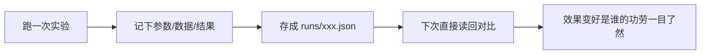

# 第 01 课　实验管理与追踪

上一章把模型部署了出去。本课往前追溯一步：这个模型是怎么来的，用了什么数据、什么参数，当时的效果是多少。这些问题没有记录，团队协作时会反复付出代价。

先看一个常见的场景。同事问上周效果很好的那次实验是谁跑的、参数是什么，没有人记得完整答案，只好重跑一遍；重跑的结果和原来不同，因为当时的参数和数据没有被完整记下来。本课解决的就是这个"谁来说得清"的问题。

## 一、没有实验记录，项目大会出什么乱子

几个真实会发生的场景：

- 改动混在一起，效果无法归因。改了学习率，效果变好了一点，但同一轮还顺手改了数据切分和随机种子，到底是哪个改动带来的提升说不清，后续调优只能继续试。
- 三个月后无法复现。客户问上季度演示用的模型准确率是多少，查聊天记录和旧代码，发现数据集已经被覆盖，那个数字说不清了。
- 同事重复踩坑。小张试过某个思路，效果不好，放弃时没留记录；半年后小王把同样的路又走了一遍，多花一整周。

实验记录可以用做菜配方来理解：同一道菜随手做一次很好吃，如果不记下盐几克、火多大、炖多久，下次复刻就只能凭感觉。**实验追踪（Experiment Tracking）**做的事，就是把"结果"和"它是怎么来的"绑在一起存档。

## 二、一条实验记录该长什么样

核心要素四样，缺一个，可复现性就断一环：

| 要素 | 记什么 | 例子 |
|------|--------|------|
| 参数 | 你定了哪些设置 | 学习率、切块大小、模型名 |
| 数据 | 用的是哪份哪版数据 | 数据文件指纹、条数 |
| 结果 | 跑出来效果如何 | 准确率、延迟、花费 |
| 时间与身份 | 什么时候、谁跑的、哪份代码 | 时间戳、备注 |

参数要记全。效果差异的来源常常是那个被认为不重要、所以没记的设置。拿不准该不该记，就记。

## 三、最小可用方案：一个 json 文件就够了

先不装工具。用纯 Python 标准库把一条实验记录写进 json 文件，这已经是能用的实验追踪：



配套的 `experiment_tracking_demo.py` 做的就是这件事：模拟训练两次、各存一条记录、再读回来并排比较。它是纯标准库写的，本机直接 `python experiment_tracking_demo.py` 就能运行。

实验多到几十上百条后，json 文件的短板出现：想按指标排序、画趋势图就很费力，这时换专业工具。

## 四、专业工具：MLflow 这一类

主流工具有 MLflow、Weights & Biases、TensorBoard 等，思路相近：调用几个函数，工具把参数、指标、产物（模型文件、图表）集中存好，并提供网页界面浏览比较：

```python
# 需先安装：pip install mlflow
import mlflow

with mlflow.start_run():
    mlflow.log_param("chunk_size", 200)      # 参数
    mlflow.log_metric("accuracy", 0.87)      # 结果
    mlflow.log_artifact("model.pkl")         # 产物文件
```

然后在命令行执行 `mlflow ui`，浏览器打开就能看到每条实验的参数与结果，哪次效果最好可以直接比较。

> 没装 mlflow 也可以继续学。本课配套脚本的核心逻辑（参数+数据+结果+时间戳存 json）就是这类工具的内核思想，工具只是把存储、搜索、可视化做得更完善。本章约定：真实工具段都标注"缺库可跳过"，最小示例始终能真跑。

补充一个 2026 年的常见口径：LLM 时代也用这类工具追踪"调用效果"（每次调模型的花费、延迟），W&B 和 LangSmith 类平台把这做成了独立方向，后者在第 04 课展开。

## 五、把纪律变成习惯

工具之外，三条纪律现在就能用：

1. 改任何设置前先想：这条改动待会儿记不记。不记就先补记录方式。
2. 一次只改一个变量。否则结果变好变坏都无法归因。
3. 数据也要版本化。同一份数据改过之后，实验结果就不再可比，至少给数据文件记个改动时间或指纹。

这几条纪律是第 12 章实战项目和真实公司里 MLOps 团队的日常操作。工具（MLflow 这类）的作用就是把纪律固化下来，不依赖自觉。

## 想一想

1. 你以前做过什么"没记录导致返工"的事？（不限于编程）当时的损失是什么？
2. 如果参数记了、数据没记，实验还能复现吗？为什么？
3. （动手）给 experiment_tracking_demo.py 再加一个参数（比如 temperature），看看记录文件里多出来的字段。
4. 两个实验各自记录了结果，A 的准确率高、B 的延迟低，你会怎么权衡？这类取舍该记在哪？

## 小结

实验追踪就是把每次实验的参数、数据、结果、时间绑在一起存档，核心诉求是可复现。一个 json 文件是最小可用方案，专业工具（MLflow 类）在此基础上提供搜索、比较和可视化。比工具更重要的是纪律：一次只改一个变量，改动必留痕。

到第 12 章第 04 课做监控 Dashboard 时，这条 json 记录会变成 Dashboard 上的一个数据点，这里先留一个衔接。

模型有了实验记录，接下来要走上生产：谁负责上线、出问题怎么退回上一版，下一课讲模型版本管理。

2026 年 10 月
