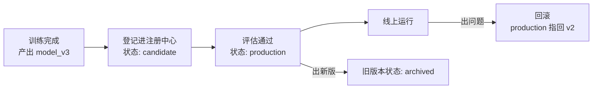

# 第 02 课　模型版本管理

上一课把实验记录好了，也选出了效果最好的模型。新的问题跟着出现：模型文件交给谁、放在哪，线上跑的到底是哪个版本。靠文件名来区分（比如 `final_final_真的最终版.pkl`）很快会失控。

本课讲模型文件和它的配置怎么像软件代码一样管理，上线、出问题、回退，每一步都有据可查。

## 一、没有版本管理，上线现场什么样

几个迟早会遇到的场面：

- 说不出线上是什么。被问到"现在线上做推荐的是哪个模型"，运维说是 3 号文件，算法说是上周那个版本，谁也没有依据拍板。
- 出事退不回去。新版本上线十分钟就出了问题，想退回旧版，旧文件早被新文件覆盖，硬盘里找不出来。
- 模型和配置对不上。模型是新的，阈值配置还是旧的，两个组合跑出奇怪的结果，排查一晚上才发现是版本错配。

模型版本管理可以用药店的批号来理解：药品出了问题，凭批号能精确召回那一批，其余批次照常销售；没有批号，就只能全架下架。模型也一样，版本号就是定位和召回的依据。

本课的两个核心动作：**给模型打版本号**，以及**建一个"注册中心"记着哪个版本处于什么状态**。

## 二、三个概念：版本、注册中心、上线与回滚

模型版本管理不只是"把文件复制一份多起个名字"，它至少要管三样东西：

- 模型本体：那个几百 MB 的权重文件。它没法像代码一样逐行看差异，所以按"整文件快照"管理，一个版本一份。
- 配套配置：预处理参数、阈值、模型名、训练时的实验记录链接。模型离开配置跑不对，两者必须捆在一起登记。
- 版本状态：这个版本处于哪个阶段，`candidate`（候选）→ `production`（线上）→ `archived`（已退役）。谁在线上，就看哪条记录的状态是 production。

流程画出来是这样：



回滚是这套体系的价值所在：把 production 标记从坏版本挪回好版本，坏版本降级留档。不是重新训练，也不是从回收站找文件，而是改一个指针。

## 三、最小可用方案：目录 + 清单 json

专业工具有 MLflow Model Registry、DVC、Hugging Face Hub 等，但它们的核心动作，用纯标准库也能演出来：

1. 建一个 `registry/` 目录，每个版本一个子目录（模型文件 + 配置一起放）；
2. 一份 `registry.json` 清单，记录每个版本的状态和登记时间；
3. "上线" = 把 production 标记写到某个版本上；"回滚" = 把标记挪回去。

配套的 `model_version_demo.py` 是这套流程的完整演示：注册两个版本 → 上线 v2 → 发现问题 → 一条命令回滚到 v1。全程临时目录操作，跑完自动清理，直接 `python model_version_demo.py` 就能看到全过程。

## 四、专业工具怎么做的

```python
# 需先安装：pip install mlflow
import mlflow

# 训练后把模型登记进注册中心，起个正式名字
mlflow.register_model("runs:/<run_id>/model", "qa_ranker")

# 评估通过后，把某个版本推上生产（就叫"上线"）
client = mlflow.tracking.MlflowClient()
client.transition_model_version_stage("qa_ranker", "3", "production")

# 出事回滚：把 production 指回旧版本，一行
client.transition_model_version_stage("qa_ranker", "2", "production")
```

动作和最小示例一致：登记 → 改状态 → 需要时改回去。工具额外管理了大文件的存储和多人协作的审批，思路相同。

> 没装 mlflow 照样能学：本课配套脚本就是注册中心的简化实现，理解它之后再使用工具，操作是同样的三步。

## 五、和上一课接起来

第 01 课的实验记录回答"模型从哪来"。版本登记时，应当把实验记录的链接写进配置。两条记录配合着用：实验记录说明一个版本是怎么来的，注册中心说明线上跑的是哪个。出了问题，两条记录对照，很快能查清来龙去脉。

这套上线与回滚的机制，在第 12 章第 04 课做监控 Dashboard 时会用到：Dashboard 要显示"当前生产版本"，数据就来自这样的注册中心。

## 想一想

1. 只用网盘"复制文件多起名字"管理模型，会漏掉上面讲的哪一样东西？
2. （动手）给 model_version_demo.py 加一个 v3，注册后把 production 指给它，看看清单文件怎么变。
3. 回滚之后，那个出问题的版本应该删除吗？为什么留档更好？
4. 模型文件和配置文件，为什么强调"捆在一起"登记？分开管会出什么事？

## 小结

模型版本管理 = 模型文件 + 配置 + 状态一起按版本登记；注册中心是一本账，记着每个版本处于候选、生产还是退役。上线是改状态，回滚是把指针挪回去，不是重新训练。MLflow Model Registry 这类工具只是把这套账本做得更好用。

线上跑起来之后，它运行得好不好、有没有出问题，需要有人持续盯着。下一课讲监控与评估。

2026 年 10 月
