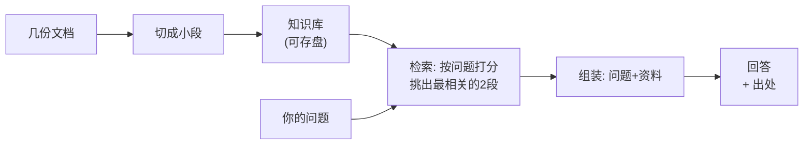

# 第 01 课　本地知识库 RAG

从这节课开始进入实战。第一个项目不追求复杂，而是把已经学过的组件，文档切分、检索、组装提示词，组装成一个能日常使用的系统：把几份文档喂进去，之后有问题直接提问，它基于文档回答，并注明答案出自哪份材料哪一段。

---

## 一、先把这个项目说清楚

一个常见场景：公司的请假制度、报销规则散落在几份 PDF 和网页里，每次想确认年假天数，都要翻找半天。本地知识库解决的就是这个问题：文档入库，之后直接提问。

第 5 章写的 mini_rag 已经能一问一答，但它只有十几行，属于原理演示。真实项目要再往前走三步：

- 能入库：文档一份份存进来，不是每次运行都重新切分、用完即弃
- 能检索：提问时先找出最相关的几段，而不是把所有文档都传给模型
- 能交代出处：每个答案注明"出自哪份文档第几段"，方便核实

第三步最要紧。大模型会编造答案，出处就是核对依据：它说的每句话都能翻回原文对照。这就像一个可靠的图书管理员：不但告诉你答案，还把书递给你，指给你看是第几页。

---

## 二、整个系统长什么样



左边是入库，只做一次；右边是问答，每次提问都走一遍。这个结构就是所有 RAG 系统的骨架：再复杂的 RAG 产品，拆开看仍是这两条线。

---

## 三、配套代码怎么读

打开本课目录的 `local_kb_rag.py`（不到两百行，纯标准库，不需要安装任何东西），代码按上图分成五块：

1. `DOCS`：内置三份示例文档（员工手册、报销制度、IT 账号指南），代替"你的 txt 文件"。真实使用时换成读自己的文件即可。
2. `build_kb()`：按段落把文档切成片段，每段登记来自哪份文档、第几段。出处信息就是在入库时挂上去的。
3. `search()`：检索打分。问题里出现过的字词，在某段里出现得越多，这段就越相关。这是最朴素的做法，但思路与向量检索一致：都是找出与问题最相近的几段，只是相似度算得粗一些。够用，而且零依赖。
4. `extract_answer()` / `ask_real_llm()`：拿到相关段落之后，如何变成一句回答。`ask_real_llm()` 就是接真实大模型的位置：把资料和问题交给模型组织语言。这个函数需要 `DEEPSEEK_API_KEY`（openai SDK 连 DeepSeek，模型默认 deepseek-flash）才能运行，本课未实跑；配好环境变量后，可以用它替换兜底方案。没配 Key 也不影响学习：程序会自动退回到抽取式回答，直接给出最相关段落的原文。
5. `demo()` / `main()`：命令行入口。

## 四、跑起来

直接运行，看内置演示（入库 → 检索 → 回答全流程）：

```
python local_kb_rag.py
```

也可以单独提问：

```
python local_kb_rag.py ask "年假有几天"
```

运行后程序先报告入库了几个片段，然后对每个问题列出命中的段落和相关度，最后给出带出处的回答，形如"根据《员工手册》第 2 段：年假：入职满一年每年 5 天……"。这种能对回原文的答案，就是本课的交付物。

代码里还有一个细节值得看：知识库会以 JSON 形式存到系统临时目录，下次运行时如果存在就加载，这就是入库的持久化。真实项目里会换成向量数据库（第 7、8 章学的 FAISS、Chroma 就用在这里）。

---

## 五、真实项目里还差什么

这个精简版离生产还有距离，差距恰好是前面学过的内容：

- 检索精度：字词重合度打分，问"休假"就搜不到写着"年假"的段落。第 5 章的 Embedding 检索按语义相近匹配，生产系统都用它。
- 回答质量：抽取式兜底只会引用原文，通顺的表达要靠模型组织，这就是 `ask_real_llm()` 的位置。
- 规模：几十份文档没问题，几千份就要上向量数据库和更讲究的切分策略（第 5 章讲过 chunk 大小的取舍）。

先把骨架跑通，再逐块换上更好的实现，这是做项目的合理顺序，不要一开始就追求完美。

---

## 写个 README

从这一课开始养成习惯：每个项目配一个 README，回答三个问题：这是干什么的、怎么装、怎么跑。本课目录里的 `README.md` 就是一个现成的示范，可以照着它给后面每课的项目各写一份。能把项目讲清楚，才算真正理解了它；将来面试，README 也是作品集的第一份材料。

---

## 学完第 14 章回来加的扩展环节

现在它是一个命令行工具。学完第 14 章的 Streamlit 后，回到这里加一个网页问答界面：左边选文档，右边输入框提问，答案下方挂出处。同一套 `build_kb` / `search` 函数直接复用，界面只是给核心逻辑补的一层外壳。

---

## 想一想

1. 如果把整份文档不切分、直接全部传给模型回答，会有什么问题？（提示：想想第 5 章讲的上下文长度限制）
2. 出处信息是在哪一步挂到答案上的？如果把 `build_kb()` 里的"第几段"删掉，系统还能正常回答吗？代价是什么？
3. 用字词重合度打分，构造一个具体例子：什么样的问题会检索失败？怎么改问法就能搜到？
4. （动手）给 `DOCS` 里加一份你自己写的文档（比如"考勤制度"），重新运行，然后问一个只有这份新文档能答的问题，看看检索和出处对不对。

---

## 小结

- RAG 系统的骨架就两条线：入库（切分、登记出处、存盘）和问答（检索、组装、带出处回答）。
- 出处是答案的核对依据，能对回原文的答案才可信，这是 RAG 对抗幻觉的关键设计。
- 精简版用字词重合度做检索、抽取原文做兜底回答；换上 Embedding 检索和真实模型，就接近生产形态，两个升级挂点都已在代码里留好。注意：DeepSeek 不提供 embedding 接口，检索升级需另配 BGE/通义/智谱等嵌入模型；生成段则直接接 DeepSeek。
- 每个项目配一份 README：干什么、怎么装、怎么跑。

下节课给这个系统换一个更进一步的用法：不止被动等待提问，还能自己拆解任务、调用工具、逐步办完事，那就是 Agent。

---

2026 年 10 月
