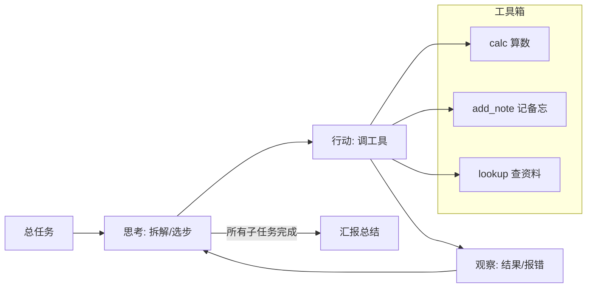

# 第 02 课　Agent 任务执行系统

上一课的知识库只在被提问时工作。这一课把它升级成能自主执行任务的系统：给它一个目标，它自己规划分几步、每步用哪个工具，逐步办完，中途还会根据执行结果调整计划。

---

## 一、从"回答问题"到"办完事情"

回顾第 6 章写过的最简 Agent 骨架，它的核心只有一个循环：思考 → 行动 → 观察。

- 思考：根据当前目标和已知信息，决定下一步做什么
- 行动：调用一个工具（算一笔账、查一次资料、记一条备忘）
- 观察：消化工具返回的结果，再进入下一轮思考

普通程序照清单办事：所有步骤都是预先写死的。Agent 按情况办事：步骤由它根据观察临时决定。用装修打比方：照全包合同推进的项目经理像普通程序，每做完一步都查看现场、发现问题就改方案的工头更像 Agent。

本课的实战目标：写一个命令行 Agent，给它一个总任务，它自己拆解成子任务、选工具执行、逐步办完，最后向你汇报。

---

## 二、系统的骨架



三个环节里，行动依赖工具箱，观察依赖工具返回值，思考由决策逻辑完成。真实项目里决策由 LLM 承担；本课的零依赖版用规则模拟决策，按固定策略挑下一步。循环本身与真实 Agent 相同，接入 LLM 时只需把思考这一步换成模型调用，其他代码不用改。

---

## 三、配套代码怎么读

打开 `agent_runner.py`（约 160 行，纯标准库）：

1. `TOOLBOX`：三个工具，每个都是一个普通函数，注册表结构是 `{"工具名": (函数, 一句话说明)}`。给工具写清楚说明很重要：真实 Agent 靠这段描述决定用哪个工具（第 6 章 07 课讲过的 Tool Use 要点）。
2. `plan()`：把总任务拆成子任务清单。这里按任务文本中出现的关键词拆；真实 Agent 里这一步由 LLM 一次性输出 JSON 计划（第 3 章 Structured Output 做的就是这件事）。
3. `choose_tool()` / `extract_arg()`：一个思考-行动-观察节拍：先按规则给子任务挑工具，再从子任务文本里取出要传给工具的参数。
4. `run()`：主循环：逐个子任务完成思考-行动-观察，观察结果记入 history（Agent 的短期记忆），全部完成后生成汇报。
5. `demo()` / `main()`：命令行入口。

## 四、跑起来

```
python agent_runner.py
```

运行后能看到 Agent 的工作记录：它接到"查一下差旅住宿标准，算一下 400*3 是多少，把合计 1200 记入备忘"后，先拆成查资料、算数、记备忘三步，每步打印一行思考、一行行动、一行观察，最后交出一份总结。再运行 `python agent_runner.py "查一下VPN申请流程"`，可以看到它换了一条执行路径：同一套循环，路径随任务而变，这就是 Agent 和普通脚本的区别。

代码里值得留意：每一步的观察结果都保留在 `history` 里，后面的思考能引用前面的成果。这个滚动上下文就是 Agent 的短期记忆（第 6 章 02 课的 Memory 组件在生产版里负责这件事）。

---

## 五、离"真 Agent"还差哪几块

对照第 6 章的框架盘点，这个精简版有三处要升级：

- 决策：规则拆解换成 LLM 输出计划 JSON，并支持失败重试和改道
- 工具：三个内置函数换成真实 API、数据库、第 12.5 课那样的 MCP 平台
- 记忆：内存里的 history 换成可持久化的记忆库，任务跨天也能续

第 12 章后面的课会把工具箱交给 MCP 平台，把协作交给 Multi-Agent；本课的循环是它们共同的基础。

---

## 学完第 14 章回来加的扩展环节

旧版教程在这里写了 FastAPI 加 WebSocket 的实时任务页面，那是第 14 章的技能，现在不写。学完 14 章回来：用 FastAPI 把 `run()` 包成接口，前端提交总任务，页面实时刷新 Agent 每一步的思考-行动-观察。核心逻辑今天已经就位，到时候补的只是界面。

---

## 想一想

1. 本课 Agent 的"思考"是规则模拟的。找一段你自己的任务流程，说说规则版会在哪一步出问题（想不出分支或选错工具），换成 LLM 后为什么能解决？
2. `history` 越滚越长会怎样？如果任务要执行 100 步，全部历史都放进上下文合理吗？想到什么办法控制它？（提示：回忆第 6 章记忆系统的分层）
3. 工具描述写得含糊，Agent 会发生什么？故意改错 `TOOLBOX` 里某个工具的说明，跑一遍看它还会不会选对工具。
4. （动手）给工具箱加一个新工具 `ask_kb`：直接调用第 01 课 `local_kb_rag.py` 里的 `search()` 函数查知识库，让 Agent 能"办完事顺便引用制度原文"。

---

## 小结

- Agent 的核心是"思考-行动-观察"循环：根据情况决定下一步，而不是照人写死的清单走。
- 工具 = 普通函数 + 一句清楚的说明；注册表让 Agent 能挑工具，说明写得好坏直接影响它选得对不对。
- 滚动的 history 就是 Agent 的短期记忆，前面的观察会成为后面思考的依据。
- 精简版用规则模拟决策、零依赖可运行；换上 LLM、真工具、持久记忆，就是生产级 Agent 的三块升级。

下一课把这个循环用到最常见的场景：客服。同一套"理解-查资料-回复"流程，如何组织成口吻稳定、有问必答的客服机器人，是下一课的内容。

---

2026 年 10 月
