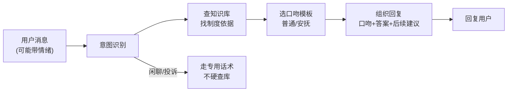

# 第 03 课　智能客服机器人

前两课完成了能答出处的知识库和能自主执行任务的 Agent。这一课把它们组合成最常见的 AI 落地形态：智能客服。用户发来一句话（可能带有情绪），系统识别意图、查到制度依据、按固定口吻礼貌回复。

---

## 一、客服机器人和聊天机器人差在哪

很多人以为客服机器人就是一个会聊天的模型，其实差别很大。直接把用户问题交给大模型，会出三类问题：

- 编造答案：模型不知道公司的制度，按常识给出"年假 15 天"这样的错误数字
- 口吻漂移：一会儿像客服、一会儿像百科全书、一会儿太随意
- 处理不了情绪：用户不满时，它还在平静地讲道理

合格的客服机器人是模型加规矩的组合：先识别用户想干什么（意图），再去知识库查依据（检索），最后按写好的口吻模板组织回复（话术）。大模型只负责最后把话说通顺这一步。就像餐厅服务员：菜由后厨（知识库）决定，端菜的方式（口吻）受过统一培训，服务员自己不发明菜。

---

## 二、一次客服会话的完整流水线



注意图中那条岔路：不是每句话都需要查库。用户只是打招呼，或者已经不满要投诉时，直接回答制度反而会激化情绪，意图识别会先把这类消息分流到专用话术。该查才查，是客服机器人设计的重要一环。

---

## 三、配套代码怎么读

打开 `customer_service.py`（约 160 行，纯标准库）：

1. `KB`：复用第 01 课的思路，内置几条客服最常被问的制度。
2. `detect_intent()`：意图识别。按关键词把消息分成四类：问候、投诉（安抚优先）、咨询（查库）、其他。
3. `TONE`：口吻模板字典。每种意图配了固定的开场白和收尾话术，这是口吻稳定的原因：无论模型输出如何变化，骨架话术是预先确定的。
4. `answer()`：主线。咨询类先查库，查到就按模板拼回复；查无依据或超出范围就转人工，不编造答案。
5. `chat()` / `main()`：命令行对话循环，输入 `q` 退出。

## 四、跑起来

```
python customer_service.py
```

试试这三种消息，观察流水线的分流：

- `在吗` → 走问候话术，不查库
- `差旅住宿标准是多少` → 查库 + 制度答案 + 出处
- `你们这系统也太烂了吧` → 先安抚再引导，最后才谈解决方案

也可以一次演示：`python customer_service.py demo`，程序自动轮播这三类对话。留意查不到的情况：问一个库里没有的问题，它会承认查不到并提议转人工。诚实地说不知道，比自信地编造更可取，这是客服产品的基本要求，也是第 01 课出处核对思路的延续。

---

## 五、接真实模型的挂点

代码里 `polish_with_llm()` 是升级挂点：把检索到的制度和口吻模板一起交给模型，让它把答案表述得更自然。模板定结构，模型只做润色。这个函数需要 API Key，本课未实跑；没有 Key 时程序用纯模板回复，一样可用。上线前还应补充：敏感词过滤、话术合规审核、人工抽检。口吻可以靠模板保证，责任必须由人承担。

---

## 学完第 14 章回来加的扩展环节

现在是命令行对话。学完第 14 章回来：用 Streamlit 加一个聊天窗口界面，用户消息靠左、机器人回复靠右，再加一个转人工按钮。核心逻辑已就位，界面的工作量很小。

---

## 想一想

1. 为什么"查知识库"这一步必须在大模型回答之前，而不是让模型先自由回答再检查？结合第 01 课的出处核对说说你的理解。
2. `detect_intent()` 用关键词分流，构造一句会被分错类的用户消息（比如带着反话的咨询），想想真实产品为什么要用模型做意图识别。
3. 用户问"我可以把年假折成钱吗"，知识库里只有年假天数没有折算规则。合格的回复应该长什么样？动手改 `KB` 或模板，让它这样回答。
4. （动手）给 `TONE` 加一种"售后工单"意图：识别"维修/报修/故障"等词，回复固定话术"已为您创建工单"——体会"加一个意图要动哪几处"。

---

## 小结

- 客服机器人 = 意图识别 + 知识库检索 + 口吻模板，模型只负责把答案说通顺，不负责发明答案。
- 不是每句话都查库：问候、投诉走专用话术，该查才查同时影响体验和成本。
- 查不到就承认查不到并转人工，诚实的兜底优于自信的编造。
- 口吻稳定依靠模板：结构由人确定，模型只做润色。

下一课换个视角：不盯着单次对话，而是盯着系统的整体状况，延迟、token、成功率如何采集、如何汇总成一份能快速查看的报告。

---

2026 年 10 月
