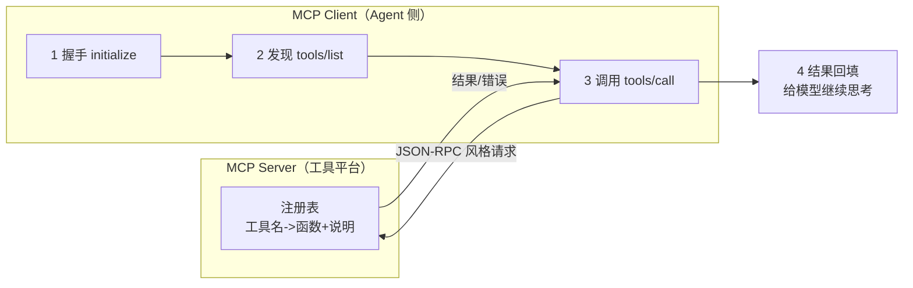

# 第 05 课　MCP 智能工具集成平台

上一课结束时留下一个问题：Agent 的工具越接越多，每个工具一套接口、一套参数，接十种工具就要写十遍胶水代码。这一课的解法是行业标准做法：把它们统一到一个协议后面，也就是 MCP（Model Context Protocol，模型上下文协议）。

---

## 一、先讲清楚 MCP 解决什么问题

没有标准协议时的情况：要给 Agent 接数据库、接 GitHub、接 Slack，每个服务的调用方式都不一样，参数格式不同、鉴权方式不同、返回结构不同。代码里全是特制适配，接一个写一份，改一个牵动全身。

MCP 做的事类似 USB 接口。USB 出现之前，键盘一个口、鼠标一个口、打印机又一个口，各有各的插法；USB 定下统一的插座和对话方式后，任何设备只要按标准说话就能即插即用。MCP 就是 AI 世界的 USB：工具方把能力包装成 MCP Server（提供工具列表和调用入口），模型方做 MCP Client（发现工具、发起调用）。两边只要遵守协议，互相不需要知道对方内部怎么实现。

于是接十种工具变成接一个协议。第 6 章跑过最小的 MCP server 消息形状，这一课把它放大成一个能管多个工具的小平台。

---

## 二、平台的四个阶段

一次完整的 MCP 交互分四步，我们的平台按这四步组织代码：



- 握手：双方互通名称和版本，确认使用同一套协议
- 发现：Client 询问对方有哪些工具，Server 返回工具清单（名称+说明+参数），Agent 靠这份清单决定用哪个工具
- 调用：Client 发标准格式的请求（工具名+参数），Server 路由到对应函数执行
- 回填：结果按标准格式返回，Agent 把它当作观察，继续下一轮思考

这个流程并不陌生：发现+调用+回填，正是第 02 课 Agent 循环里的"行动-观察"。MCP 没有改变 Agent，它只是把行动这一步标准化了。

---

## 三、配套代码怎么读

打开 `mcp_platform.py`（约 170 行，纯标准库）：

1. 三个模拟工具：数据库查询、GitHub 仓库信息、Slack 发消息。每个就是一个普通函数，注册时统一登记名称+说明+参数表。
2. `MCPServer` 类：平台本体。`register()` 收纳工具；`handle()` 是协议入口，接收 JSON-RPC 风格的请求字典（方法名+参数），按方法名路由到握手/发现/调用三个处理器；每次调用都记录进调用历史。
3. `MCPClient` 类：Agent 侧。它不直接接触工具函数，所有交互都走 `handle()` 发标准请求。这就是协议的意义：哪怕 Server 换成别人写的、跑在别的机器上，Client 代码一行不改。
4. `demo()` / `main()`：演示完整四阶段：握手、打印发现的工具清单、连续调用三个工具、故意调一个不存在的工具看错误处理。

## 四、跑起来

```
python mcp_platform.py
```

输出里重点看三处：握手成功后的协议版本；`tools/list` 返回的工具清单（注意每个工具的说明和参数描述，Agent 选工具全靠它）；一次故意失败的调用返回的标准错误结构（`isError: true` 加中文错误信息），而不是程序崩溃。错误也是协议的一部分：标准格式的错误让调用方可以程序化处理，这在生产中很重要。

---

## 五、和真实 MCP 的对应关系

真实 MCP 是 Client 和 Server 两个独立进程（甚至两台机器）之间走标准传输层通信，消息用 JSON-RPC 2.0 格式。本课的精简版把它们放在同一个进程里、用函数调用模拟消息传递，但消息的形状和流程与协议一致：initialize/tools/list/tools/call 这套方法名、请求与响应的字段，在真实 MCP 里会原样见到。学完本课再去装官方 SDK 跑真 Server（第 6 章第 05 课已经演示过），会发现只是换了一层传输，协议没有变。

---

## 学完第 14 章回来加的扩展环节

学完第 14 章回来：用 FastAPI 把 `MCPServer.handle()` 包成 HTTP 接口，Client 通过网络请求调用。这一个改动就能把同进程模拟升级成跨进程真协议，正好练手接口层。工具平台的管理页面（注册/禁用工具、看调用历史）也一并补上。

---

## 想一想

1. 如果不给工具写说明和参数描述，只留函数名，`tools/list` 返回的清单对 Agent 意味着什么？这能否说明"好工具文档"的价值？
2. Client 代码为什么能做到"Server 换了实现也不用改"？在我们的代码里，这个保证靠哪一层实现？（提示：Client 是否 import 过任何工具函数）
3. 调用不存在工具时，平台返回标准错误而不是抛异常。如果改成直接抛异常，Client 和 Server 各会出什么问题？
4. （动手）往平台里注册一个你自己的工具（比如查天气的假函数），跑 `tools/list` 看新工具怎么出现在清单里——体会"即插即用"。

---

## 小结

- MCP 统一了 AI 工具的接入方式：工具方做 Server，模型方做 Client，互相只认协议不认实现。
- 一次完整交互四步：握手 → 发现（tools/list）→ 调用（tools/call）→ 结果回填；发现清单是 Agent 选工具的唯一依据。
- 错误也是协议的一部分：标准格式的错误让调用方能程序化兜底，而不是崩溃。
- 精简版同进程模拟，消息形状与真实 MCP 一致；跨进程只差一层传输，接口实现是第 14 章的挂点。

最后一课把前面所有零件组合到最大规模：不是一个 Agent，而是一支分工明确的 Agent 团队（Multi-Agent），并落到一个完整的企业助手形态。

---

2026 年 10 月
