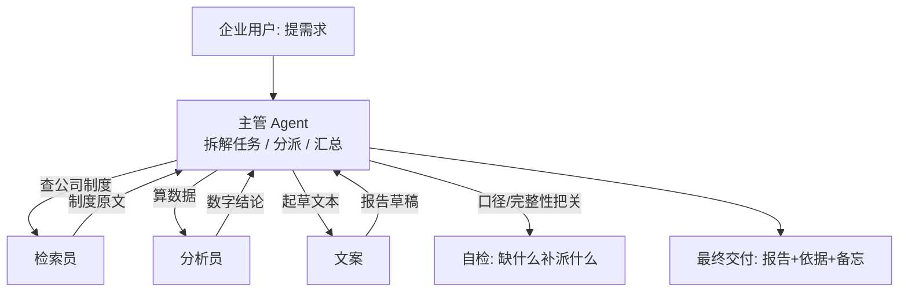

# 第 06 课　Multi-Agent 协作与企业助手

最后一课，把这一章的零件组合到最大规模。前五课做的都是单个系统：一个知识库、一个执行者、一个客服、一个工具平台。真实企业里的问题往往更大：一份市场分析要查资料、算数据、写报告、审口径，一个 Agent 处理不过来，需要多个 Agent 分工协作。

---

## 一、为什么需要一支"Agent 团队"

让一个 Agent 承担全部工作，有两个问题：

- 上下文过长：所有中间结果都堆在它的上下文里，任务一长就开始遗漏、混淆
- 杂而不精：提示词里既要求懂检索、又要求会算账、还要会写作，每样都做不精

Multi-Agent 的思路很朴素：与其培养一个全才，不如组一支分工明确的团队：每位 Agent 只负责一摊事，有一位主管负责分派和把关。就像一家小公司：老板不用什么都自己干，把工作分给财务、文案、调研员，收上来拼成最终交付。每个角色上下文干净、提示词聚焦，质量容易保证。

分工还有一个好处：出问题容易定位。报告数据错了，多半是分析员；口吻不对，是文案的问题。这比在一个万能 Agent 的漫长上下文里排查容易得多。

---

## 二、主管-工人怎么协作



看这条主循环：主管把需求拆成子任务，派给对应工人；工人各自完成并交回结果；主管汇总并自检，发现缺料（比如分析员缺一个前提数据）就再派一轮。这就是 Multi-Agent 系统的骨架：分派 → 干活 → 收结果 → 补派 → 汇总。

工人之间不直接对话，一切经主管中转，这是最简单也最稳的协作拓扑。工人互相直接通信的多边协作看着灵活，但消息一乱就难以排查，生产系统大多从星型拓扑起步。

---

## 三、配套代码怎么读

打开 `multi_agent_app.py`（约 170 行，纯标准库）：

1. 工人角色：`worker_research`（查内置制度库）、`worker_analyst`（算数）、`worker_writer`（按模板起草文本）。每个工人就是一个函数：输入子任务描述，输出一段结果；真实系统里工人各自是一个带专属提示词的 LLM 调用。
2. `AGENTS` 注册表：`角色名 -> (函数, 一句话职责)`。主管选工人靠这份名单，逻辑与第 02 课选工具完全同构：对主管来说，工人就是它的工具。
3. `supervisor()`：主管主循环。第一步拆任务（规则版按分句+关键词；真实版让 LLM 输出 JSON 计划）；第二步按子任务选工人执行；第三步自检补派（发现"需要的数据缺失"就追加子任务）；最后汇总成企业报告。
4. `assemble()`：汇总收尾，把各工人产出去重后拼成一份带依据的完整交付物。
5. `demo()` / `main()`：默认演示"季度营收简报"；也可 `python multi_agent_app.py "写一份新员工入职指引"` 换个需求再跑。

## 四、跑起来

```
python multi_agent_app.py
```

输出是一份企业助手工作台账：主管先列出拆解出的子任务清单，然后每个子任务一行"派给谁 → 干了什么 → 交回什么"，最后是拼装好的完整报告。换第二个场景再跑，同一支团队完成完全不同的任务：团队没变，变的是主管的拆解，这正是 Multi-Agent 的弹性所在。

代码里值得留意自检补派那一段：主管发现分析员引用的前提数据缺失时，会自动追加一个"检索员先查数据"的子任务。真实 Multi-Agent 系统里，这类"发现缺料、回头补齐"的闭环是可靠性的关键，也是单 Agent 长上下文最容易出错的地方。

---

## 五、这就是"企业助手"的底座

合并旧教程的两课（Multi-Agent 系统 + 企业 AI 助手）可以看出："企业助手"不是第六种新系统，而是前五课所有零件的组装形态：

- 知识库检索（第 01 课）→ 检索员的手艺
- 工具调用与注册表（第 02、05 课）→ 主管选人的名单
- 口吻与话术（第 03 课）→ 文案模板
- 监控埋点（第 04 课）→ 给每次派工记台账（生产必上）

本章到此收束：从能答出处的知识库到分工协作的智能体团队，六个项目构成一条完整的 AI 应用生产线。接下来该做的：把每个项目的 README 补成自己的话，挑一两个项目改出自己的版本——作品集里放自己改过的项目，收获最大。

---

## 学完第 14 章回来加的扩展环节

学完第 14 章回来：给这支团队补两层外壳：FastAPI 接口让外部系统提交任务，Streamlit 页面实时展示主管派工过程和工人状态。旧教程的企业助手界面（登录、会话管理、报表导出）届时都是顺手的扩展。

---

## 想一想

1. 对照第 02 课：主管选工人和 Agent 选工具，代码结构几乎一样。那 Multi-Agent 相比"一个 Agent + 一堆工具"到底多了什么能力？什么情况下其实不需要 Multi-Agent？
2. 工人之间为什么不直接对话、一切经主管中转？设想一个检索员和分析员直接通信可能出现混乱的具体场景。
3. `supervisor()` 的自检补派只查了"数据缺失"一种情况。再想两种该触发补派的情况（比如文案产出为空），动手在代码里加一条检查。
4. （动手）给团队加一个新工人 `worker_reviewer`（审核员）：主管在汇总前把报告草稿派给它"挑毛病"，有毛病就打回文案重写，体验一次最小闭环的质量工序。

---

## 小结

- Multi-Agent 用"专科分工 + 主管协调"替代"一个全才"：上下文干净、提示词聚焦、问题好定位。
- 最稳的协作拓扑是星型：工人不私聊，一切经主管中转；主循环是分派 → 干活 → 收结果 → 补派 → 汇总。
- 对主管而言，工人就是它的工具：选工人的注册表与选工具同构，这是本章知识的汇合点。
- 企业助手不是新系统，而是本章六个项目能力的组装形态。

第六课结束，本章收官。作品集里现在应该有六个亲手跑通的项目。下一站是第 13 章：站在架构师的视角回看这些系统该如何设计和演进。

---

2026 年 10 月
