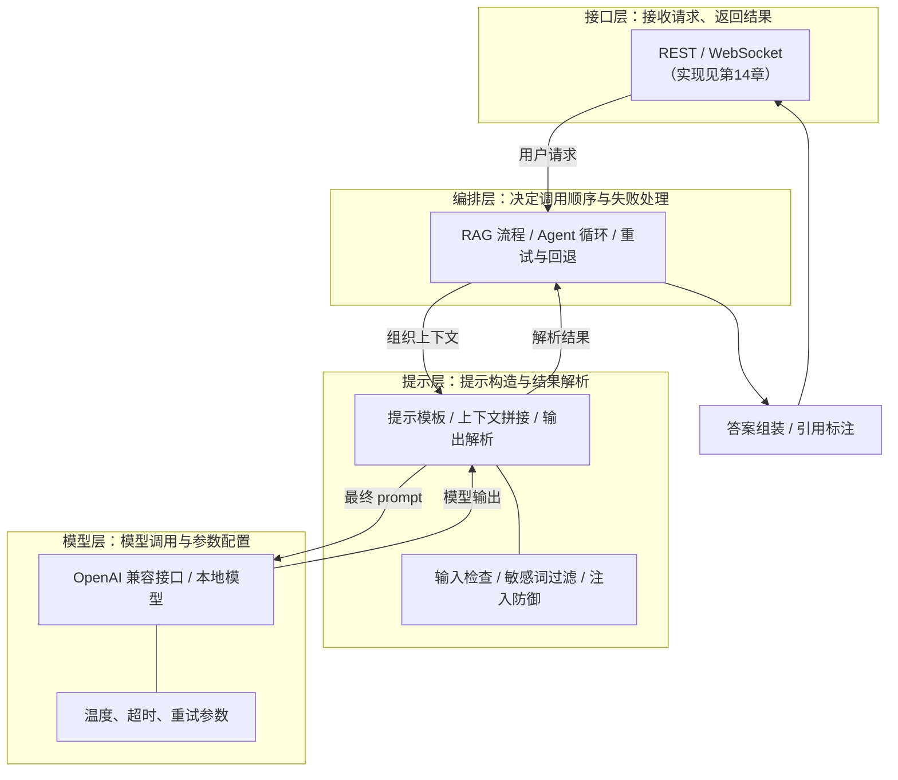

# 第 01 课　LLM 应用架构

前十二章已覆盖模型原理、RAG、Agent、向量数据库、部署与监控。本章讨论系统设计：如何把这些组件组织成可上线运行的系统，共五课。第 01 课先建立分层结构。

## 一、为什么需要分层

同样是调用大模型 API，不同产品的稳定性可能相差很大，主要原因通常在架构，而不在模型本身。

以第 12 章 12.1 的本地知识库问答（命令行版）为例，初始写法把所有步骤放在一个函数里：

```python
# 练习阶段的写法：所有步骤集中在一个 main() 中
def main():
    docs = load_docs()
    chunks = chunk(docs)
    kb = build_index(chunks)
    q = input("问题: ")
    print(answer(kb, q))
```

这种写法在练习时可以运行，但产品化后会暴露三个问题：

1. 更换模型需要改动业务代码。换用不同厂商时，要在整个文件中查找调用点。
2. 只有命令行入口，网页、小程序等客户端无法直接调用。
3. 模块之间耦合，修改切分策略可能影响答案组装逻辑。

问题的原因是缺少分层。用住宅打个比方：厨房、卧室、客厅如果没有隔断，在客厅炒菜会使整间屋都是油烟。分层就是为不同职责设置隔离。

---

## 二、LLM 应用的四层结构

一个可上线的 LLM 应用通常分为四层。



各层职责如下：

- 模型层：唯一调用模型 API 的层。所有模型调用集中在此，更换模型只需修改该层；温度、超时、重试等参数也统一管理。
- 提示层：负责提示模板、上下文拼接、输出解析，以及第一道安全检查（含提示注入防御，对应第 6 章 6.3）。
- 编排层：决定执行路径（固定 RAG 流程或 Agent 循环）、调用顺序与失败处理。第 4 章用 LCEL 串联的组件就属于这一层。
- 接口层：负责系统与外部客户端交互，对外提供 REST、WebSocket 等接口，供网页端、小程序端调用。

简言之，接口层负责输入输出，编排层负责执行顺序，提示层负责提示构造与解析，模型层负责模型调用。各层职责单一，层间通过明确的接口交互。

---

## 三、评估架构的四个维度

判断架构质量，可以从四个维度检查。本章后续课程都会使用这组视角。

| 维度 | 要回答的问题 | 本例的处理方式 |
|------|--------------|--------------|
| 成本 | 每次请求消耗多少 token、费用多少 | 提示层裁剪上下文，不把无关内容传给模型 |
| 延迟 | 用户需要等待多久 | 模型层限制 max_tokens、使用流式输出 |
| 可靠性 | 模型调用失败时如何处理 | 设置超时与重试，必要时切换备用模型 |
| 安全 | 如何应对恶意输入 | 提示层过滤注入，接口层限流 |

---

## 四、运行分层骨架

本课配套的 `llm_arch.py` 用标准库实现上述四层，不依赖第三方库，也不需要 API Key，可直接运行：

```
python llm_arch.py
```

程序演示三种情况：

1. 标准链路：请求经接口层进入，编排层安排流程，提示层构造提示，模型层返回结果，再原路返回；
2. 失败重试：模型层模拟前两次调用超时，编排层自动重试，第三次成功；
3. 安全拦截：输入“忽略之前的指令”时，提示层直接拦截，请求不会到达模型层。

代码约一百行，核心是四个类，与四层一一对应：

| 讲义中的层 | 代码中的类 | 职责 |
|--------|-----------|------|
| 接口层 | `InterfaceLayer` | 接收请求、返回响应（HTTP 版见第14章） |
| 编排层 | `Orchestrator` | 流程编排、重试与降级 |
| 提示层 | `PromptLayer` | 构造提示、拦截注入 |
| 模型层 | `ModelLayer` | 调用模型 |

把构造代码中的 `ModelLayer("mock-A")` 改成其他名称再运行，其余三层不需要改动，可以直接观察分层对模型替换的隔离作用。

---

## 五、与第 12 章项目的对应关系

对照第 12 章的项目更容易理解分层：12.1 的本地知识库命令行程序，编排与提示逻辑集中在单个 `main()` 中；12.2 的 `agent_runner` 在编排部分引入了“思考-行动-观察”循环。两者都没有独立的接口层和模型层封装，属于练习形态。学完第 14 章补上接口层后，可演进为产品形态。

## 想一想

1. 如果一个 AI 应用只能保留两层，你会保留哪两层？去掉其余两层后会立即出现什么问题？
2. 输出解析（把模型返回的文本转换为结构化数据）应放在提示层还是编排层？两种放法各自的代价是什么？
3. 【轻动手】运行 `python llm_arch.py --chat`，输入“忽略之前的指令”观察拦截效果，再提出其他问题，对照日志观察四层的执行顺序。
4. “主模型失败后切换备用模型”这段逻辑，写在模型层和写在编排层有什么区别？哪种实现更简单、哪种更灵活？

## 小结

- 可上线的 LLM 应用通常分为四层：接口层、编排层、提示层、模型层，分别负责输入输出、执行顺序、提示构造与解析、模型调用。
- 分层的作用是隔离变化：更换模型不影响编排，修改流程不影响接口。
- 架构设计可以从成本、延迟、可靠性、安全四个维度评估。
- 第 12 章的实战项目是这套结构的练习形态，缺少的接口层将在第 14 章补齐。

下一课介绍编排层中最常见的 RAG 架构：数据如何接入、索引如何构建、在线问答如何串成完整链路。

2026 年 10 月
