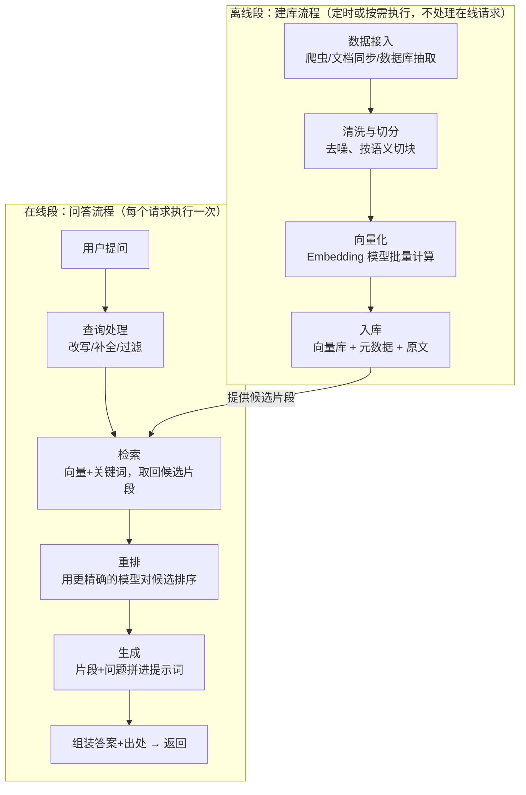

# 第 02 课　RAG 系统架构

上节课建立了四层结构，本课进入编排层中最常用的流程：RAG。第5章做过迷你 RAG，第12章 12.1 把它扩展成了知识库项目，本课从架构视角看整条链路如何组织。

---

## 一、离线建库与在线问答

首先要区分两条流程：建库和问答不是同一段流程，而是两个独立的部分。建库在后台定时或按需执行，问答在线响应每个请求。用图书馆类比：采购、编目、上架在后场完成，读者查目录、取书在前厅进行，两边靠"书架"这个中间产物交接。



看图注意三个要点：

- 两段靠"库"交接：离线段产出库，在线段只读库，在线延迟因此不受离线跑批影响，这是分两段的主要好处。
- 离线段的质量决定上限：切块不合理、原文本身有错误，在线段无法弥补。输入质量决定输出质量。
- 在线段每一步都消耗用户的等待时间：检索、重排、生成各占几十到几百毫秒，合计构成用户感知的响应速度。

各模块职责：数据接入负责获取原始数据，清洗与切分负责把原始内容整理成可用的块，向量化负责把文字转换为向量，入库负责存储备查；查询处理负责把用户问题整理成可检索的问句，检索负责从库中取回候选片段，重排负责对候选排序，生成负责组织最终答案。

---

## 二、四个取舍视角在 RAG 中的体现

| 视角 | 典型矛盾 | 业界常见解法 |
|------|----------|--------------|
| 成本 | 片段越多答案越准，但 token 费越贵 | 控制 top_k；高频问题缓存答案 |
| 延迟 | 重排能提准，但多一次模型调用 | 小问题跳过重排；重排只对 top 20 做 |
| 可靠 | 知识库更新后，旧答案还在缓存里 | 增量更新索引；缓存按库版本失效 |
| 安全 | 知识库混进敏感文档 | 入库时打权限标签，检索时按用户身份过滤 |

切分策略同时影响四个视角：块大则检索次数少（省延迟）但单块 token 消耗多（成本高）；块小则命中准确但候选噪声多。没有全局最优解，只能按具体语料反复调整，第5章 5.1 讲的 Chunk 策略在这里成为架构参数。

---

## 三、与 12.1 项目的对照

第12章 12.1 的 `local_kb_rag.py`（CLI 版）是这条架构的精简骨架：入库、检索、回答三步对应图中离线段的"切分/入库"和在线段的"检索/生成"。它省去了查询改写、重排、缓存，这三项正是生产系统优先补充的模块。学完本课后可以给 12.1 规划升级路径：在哪个环节补充哪个模块。

本课配套 `rag_arch.py` 用纯标准库实现两条流程：离线段对几份"文档"切分并建倒排索引，在线段执行查询处理、检索、重排、生成，全程零依赖：

```
python rag_arch.py
```

运行后可以看到离线建库的逐块日志和在线问答的每步耗时，检索片段带出处编号，与 12.1 的输出形态一致，模块边界更清晰。

---

## 想一想

1. 用户抱怨"答案总是过时的"，你先查在线段还是离线段？分别说出一种可能的原因。
2. 如果预算只够在"更好的 Embedding 模型"和"加重排模型"里二选一，你选哪个？用成本/延迟/可靠四个视角里的至少两个说理由。
3. 【轻动手】打开 `rag_arch.py`，把 CHUNK_SIZE 调大一半再跑，对比检索命中和耗时有什么变化。
4. 两个部门的知识要放同一个库，A 部门文档不能让 B 部门搜到。这个需求该在哪个模块实现？画出数据流上需要多加的那一步。

## 小结

- RAG 由两条独立流程组成：离线建库决定质量上限，在线问答决定体验下限。
- 两段靠"库"交接，离线定时跑、在线秒级答，互不影响。
- 切分大小、top_k、重排与否，每一项都是成本/延迟/可靠/安全的综合取舍，没有全局最优。
- 12.1 的项目是本架构的精简版，生产化优先补充：查询改写、重排、缓存、权限过滤。

RAG 的流程固定、步骤可数，每一步都预先设计好。当任务无法拆成固定步骤、需要根据中间结果调整路径时，就要换用 Agent。下一课介绍 Agent 系统架构：运行时、状态、工具、记忆如何组织。

2026 年 10 月
