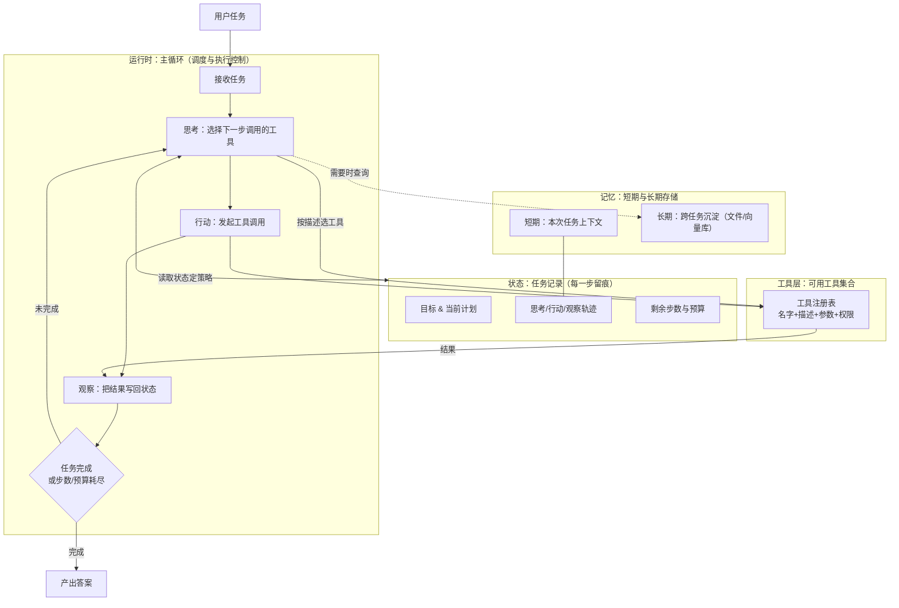

# 第 03 课　Agent 系统架构

上节课的 RAG 流程固定：步骤预先确定，按序执行。有些任务无法预先画出完整流程，例如"把这个季度的销售数据查出来，和去年对比，写份总结"，要查几次、先查什么，取决于中间结果。这类需要边执行边调整的任务由 Agent 承担。

第6章写过"思考-行动-观察"循环，第12章 12.2 把它做成了任务执行系统。本课从架构视角看一个可投入生产的 Agent 系统如何组织运行时、状态、工具、记忆四个部分。

---

## 一、整体结构：四个部分如何衔接

用一个类比说明各部分的关系：Agent 系统类似一名新入职的员工。运行时对应工作制度（什么阶段做什么的规则），状态对应工作笔记，工具对应公司配发的设备与权限，记忆对应积累的经验与归档的资料。



四个部分的职责：

- 运行时：负责调度，推动思考、行动、观察循环执行，本身不执行具体任务。它同时负责上限控制：步数上限、预算上限、敏感操作要求人工确认。
- 状态：记录每一步。模型每次调用都不保留之前的上下文，上一轮查到了什么，依赖状态拼进下一轮的提示词，状态设计直接影响 Agent 的表现。
- 工具层：核心是注册表，每个工具带名字、描述、参数说明、权限等级。模型依靠描述选择工具，描述不完整会直接影响工具的选用效果，第6章 6.7 的工程细节在这里属于架构的一部分。
- 记忆：短期记忆是状态中的轨迹；长期记忆跨任务保留，落到文件或向量库，第5章的检索技术在这里复用。

---

## 二、四个视角在 Agent 上的体现

| 视角 | 风险点 | 常见解法 |
|------|--------|----------|
| 成本 | 循环失控，一任务几十次模型调用 | 状态里记步数/预算，超限强制收尾 |
| 延迟 | 串行循环一步接一步，慢 | 无依赖的工具调用并行发；简单任务降级为固定流程 |
| 可靠 | 工具报错，循环停滞或行为失控 | 工具层统一 try/except，错误作为"观察"输入回模型，由模型调整策略 |
| 安全 | 模型选中了危险工具（删库、转账） | 工具分级：只读可直接调用，写操作要确认，高危直接禁用 |

与 RAG 对比：RAG 的控制流由代码预先写定（先检索后生成），Agent 的控制流由模型在执行中决定。灵活度换来了能力，也带来上表四项风险，因此生产级 Agent 必须带上限控制。

---

## 三、与 12.2 项目的对照

第12章 12.2 的 `agent_runner.py` 是本图的精简版：运行时循环和状态已有，但工具是写死的两三个、没有长期记忆、没有预算上限。生产化补充的优先级即本课的架构清单：先加预算上限（防止失控），再上工具注册表（便于扩展），最后挂长期记忆（形成积累）。

配套 `agent_arch.py` 用纯标准库实现四个部分：运行时循环、状态字典、三个模拟工具、json 落盘的长期记忆，以及步数上限：

```
python agent_arch.py
```

运行后可以看到每次"思考-行动-观察"的轨迹打印，任务完成后状态整包存进临时文件。当工具不止本系统内的三个，而是全公司上百个、还要给其他系统共用时，就需要统一的管理方式，这是下一课的内容。

---

## 想一想

1. "最大步数 20"这个上限写在哪一层最合适？运行时还是状态里？为什么另一个不合适？
2. 工具调用报错了，把报错信息当"观察"喂回给模型，和直接终止任务，各适合什么场景？
3. 【轻动手】打开 `agent_arch.py`，把 MAX_STEPS 改成 2 再跑，观察上限触发时 Agent 是正常收尾还是中途终止，想想收尾提示为什么重要。
4. 如果两个 Agent 协作（一个查数据、一个写报告），状态该各自持有还是共享一份？说出你方案的隐患。

## 小结

- Agent 系统四个部分：运行时管调度与上限控制，状态管每步留痕，工具层管能力清单，记忆管经验沉淀。
- 模型每次调用不保留上下文，状态的职责是把上下文喂回下一轮提示词，状态设计直接决定 Agent 的表现。
- Agent 用"模型在执行中决定控制流"换取能力，代价是成本/延迟/可靠/安全四项都要额外设防。
- 12.2 是精简版，生产化三步：预算上限 → 工具注册表 → 长期记忆。

工具多了、系统多了，各自注册会难以管理。下一课介绍 MCP 工具架构：一个标准协议，让全公司的工具统一注册、统一发现、统一调用。

2026 年 10 月
