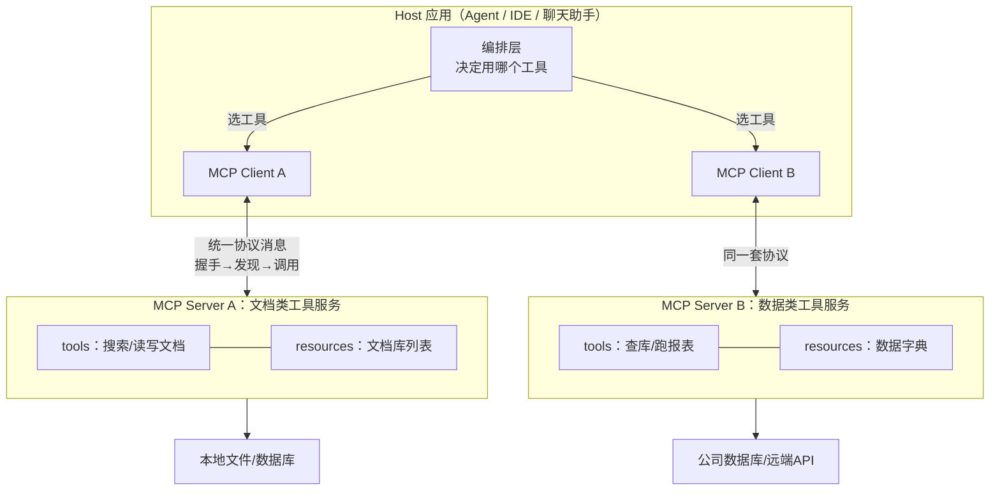

# 第 04 课　MCP 工具架构

上节课结尾提出的问题：Agent 的工具多了、系统多了，各自连接会导致什么结果。设想每种电器配一种专属插头，吹风机两脚、电脑三脚、汽车充电桩又是另一套，每买一件新电器都要改一次线路。没有统一协议的工具接入就是这样：每接一个工具都要单独开发对接代码。

MCP（Model Context Protocol，模型上下文协议）是为 AI 工具接入制定的统一标准：工具方实现一次 Server，接入方实现一次 Client，之后任意组合。第6章 6.5 跑过最小 MCP server，第12章 12.5 搭过模拟平台，本课看它在系统架构中的位置与设计要点。

---

## 一、整体结构：三个角色的分工

MCP 涉及三个角色。Host 是运行 Agent 的应用（IDE、聊天助手等），MCP Client 是 Host 内与 Server 通信的组件，MCP Server 是把一类资源包装成标准接口的服务。



三个角色的职责边界：

- Host：包含编排层，决定用哪个工具，本身不直接连接工具，通过 Client 通信。
- Client：只负责按协议收发消息，一个 Client 对接一个 Server，不参与业务逻辑。
- Server：能力的包装方，把本地文件、数据库、远端 API 包装成统一的三样东西：tools（可执行的动作）、resources（可读的数据）、prompts（预置的提示模板）。

一次完整的协作分三步，对应协议的三类核心消息：

1. 握手（initialize）：Client 发送自身身份与支持的协议版本，Server 回应能力清单。版本不一致则终止连接，不进入后续步骤。
2. 发现（tools/list）：Client 请求工具清单，Server 返回每个工具的名字、描述、参数格式（JSON Schema）。模型选择工具依据的就是这份描述，Server 描述的质量直接影响工具的选用效果。
3. 调用（tools/call）：Client 发送工具名与参数，Server 执行并回传结果；出错时也按协议格式返回错误，Client 可统一处理。

---

## 二、统一协议在四个视角上的收益

| 视角 | 没有统一协议 | 用 MCP 之后 |
|------|--------------|-------------|
| 成本 | 每接一个工具写一套对接代码，重复建设 | 工具方实现一次 Server，全行业复用 |
| 延迟 | 工具描述塞满上下文，模型选择变慢 | 按需发现：先列清单，用时才取 Schema |
| 可靠 | 某个工具改版，接入方全面故障 | 协议层版本协商；单 Server 故障只影响它对接的部分 |
| 安全 | 工具权限散落各处无法审计 | Server 白名单接入；按工具粒度授权；调用全程留痕 |

安全上需要特别注意：工具描述本身也是输入。恶意 Server 可以在描述里夹带诱导模型的内容，这类风险称为工具投毒。生产系统要做 Server 白名单，把不可信的 Server 排除在外。

---

## 三、与 12.5 项目的对照

第12章 12.5 的 `mcp_platform.py` 模拟了多工具注册、握手、调度。本课的 `mcp_arch.py` 把视角换成协议双方：Client 和 Server 是两个独立对象，消息是标准形状的字典（jsonrpc 风格），运行后可观察完整的三步：

```
python mcp_arch.py
```

运行后可以看到：两个 Server 各自注册工具，Client 逐个握手、发现、路由调用。工具分散在两个 Server，Host 侧只有一份统一清单，大量工具统一管理的实现方式即：注册表下沉到各 Server，发现与路由上收到 Client。

---

## 想一想

1. 你的 Agent 要接 50 个工具，全部描述塞进系统提示词会怎样？用 MCP 的"发现"机制怎么缓解？
2. 一个 Server 半天没响应，Client 该干等吗？设计一个超时+降级的策略，说说降级后 Agent 该提示用户什么。
3. 【轻动手】给 `mcp_arch.py` 的 DATA_SERVER 加一个新工具（照着现有工具的样子写），只重启 Server 不改 Client，看发现清单会怎么变。
4. 工具描述里出现"请务必优先调用本工具"这种话，你该警惕什么？这个风险该在哪一层设防？

## 小结

- MCP 三个角色：Host 含编排层、Client 负责协议消息收发、Server 负责包装能力（tools/resources/prompts 三件套）。
- 协议三步：握手协商版本、发现获取清单、调用交换结果；工具描述的质量决定被选中的概率。
- 统一协议的收益：成本省在复用、延迟省在按需发现、可靠性来自版本协商与故障隔离、安全靠白名单与授权。
- 12.5 是平台视角的精简模拟，本课补充了协议双方的实现形态。

工具体系稳定后，最后的问题是：这套能力如何成为可收费、可服务大量租户的服务。下一课介绍 AI SaaS 架构：多租户、配额计费、模型网关、高可用。

2026 年 10 月
