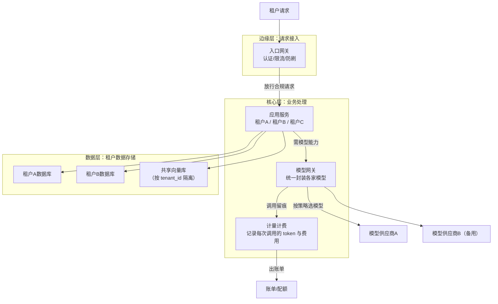

# 第 05 课　AI SaaS 架构

前四课覆盖了四层结构、RAG 的两条流程、Agent 的四个部分、MCP 协议。最后一课讨论更实际的问题：这套系统如何面向大量客户运营。成百上千家公司在同一个系统上使用，谁多用谁多付费，租户之间互不影响，模型供应商出现故障时服务仍可用。这就是 AI SaaS（Software as a Service，软件即服务）架构。

---

## 一、整体结构：从可用到可运营

用商用写字楼类比整个系统：租户（客户公司）各租各的楼层（数据隔离），前台统一发门禁卡（认证），物业按用电量收费（计量计费），备用发电机保证停电时正常运营（高可用）。



各模块职责与数据流：

- 入口网关：所有请求的必经入口，负责认证（确认请求方身份）、限流（限制请求频率）、路由（转发到对应服务），拦截大部分恶意流量。
- 模型网关：全系统唯一调用模型的位置，对上提供统一 API，对下管理多家供应商，主用 A 家超时自动切换 B 家，是第01课模型层的产品级实现。
- 计量计费：网关每次调用留痕（调用方、所用模型、token 数），按量出账。没有它，成本无法核算。
- 数据隔离：三种方案对应不同成本。独立数据库成本最高、隔离最强；独立 Schema 居中；共享表加 tenant_id 字段成本最低，依靠代码规范保证不串。多数团队从共享加字段隔离起步，出问题再升级。

---

## 二、配额与计费

模型调用是 AI SaaS 最大的变动成本，配额（quota，允许的用量上限）因此不只是收费手段，也是产品生命线：

| 视角 | 配额扮演的角色 |
|------|----------------|
| 成本 | 按租户设 token/次数上限，成本封顶可预算 |
| 延迟 | 付费大户走独立模型通道，防止互相挤占 |
| 可靠 | 配额超限返回明确提示而不是耗尽全部额度 |
| 安全 | 异常配额消耗曲线可作为被盗刷的预警信号 |

计费常见三档：按量（按 token 或次数，简单透明）、套餐（固定月费含额度，用户便于预算）、混合（套餐加超额按量，业界主流）。选择依据用户画像：用量稳定的 B 端倾向套餐，波动大的 C 端倾向按量。

---

## 三、高可用设计

SaaS 的承诺是随时可用，但模型供应商可能出现故障。生产系统用三层冗余保障：

1. 多供应商：模型网关配置主备两路，主路超时或报错自动切换备路，用户无感知。
2. 结果缓存：相同问题直接返回缓存答案，同时降低延迟与成本。
3. 优雅降级：所有模型都不可用时，返回"服务繁忙，请稍后重试"，不直接抛出 500 错误。

配套 `saas_arch.py` 用纯标准库把这四块都实现了：三个租户、字段隔离的"数据库"、按租户限流的网关、token 计量出账、主备模型切换：

```
python saas_arch.py
```

运行后可以看到按租户汇总的账单，以及一个租户超限后被拒绝的过程。

---

## 四、全章回顾

回顾全章：第01课的四层是骨架，第02课的 RAG 和第03课的 Agent 是核心业务能力，第04课的 MCP 是能力接入标准，本课是商业化的外壳。再看第12章，每个实战项目都能在这张图上找到对应的位置。第13章到这里，可以从零画出一张可上线的 AI 系统架构图了。

下一章开始动手写真正的界面：用 FastAPI 把模型调用变成可访问的 API，第01课提到的接口层将在第14章实现。

---

## 想一想

1. 三种数据隔离流派（独立库/独立Schema/共享表加字段），一家 50 人初创公司该选哪个？说出两年内它的升级路径。
2. 一个租户凌晨三点调用量暴涨 100 倍，列出你的系统里最先报警的三个指标，以及各自的处置动作。
3. 【轻动手】打开 `saas_arch.py`，把租户 B 的配额改成和 A 一样大，观察账单变化，思考"配额即产品"这句话对不对。
4. 模型网关切到备用供应商后，提示词模板要跟着改吗？从这个问题出发，说说模型网关为什么要做"提示词适配层"。

## 小结

- AI SaaS 四个部分：入口网关管接入与限流、模型网关管多供应商与切换、计量计费管成本回收、数据隔离管租户互不干扰。
- 配额不只是收费手段，它是成本/延迟/可靠/安全四个视角的共同抓手。
- 高可用三层保障：多供应商主备、结果缓存、优雅降级。
- 全章收束：四层骨架加 RAG/Agent 能力加 MCP 标准加 SaaS 商业外壳，第12章每个项目都对应这张图上的一部分。

2026 年 10 月
