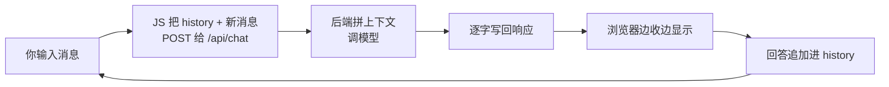

# 第 02 课　AI 聊天应用

上一课的情绪分析是一问一答，问完就结束。真实的 AI 聊天要记住前面聊过的内容，还要让回答逐字显示。这一课解决两个问题：**连续对话**与**流式输出**。

## 连续对话：把历史带上

先澄清一个常见误解：大模型本身没有记忆。它"记得"上次聊的内容，是因为每次请求都把聊天记录重新发给它。连续对话没有别的秘密，就是每次都携带完整历史。

看 `chat_app.py` 的前端部分：`history` 数组在浏览器里持续累积，每聊一轮追加两条（用户一句、AI 一句），发消息时整个数组随请求发给后端。后端拿到 history 就知道对话进行到哪了。



## 流式输出：不等全部生成完再返回

普通响应要等整个回答生成完毕才一次性返回，用户等待时间长。流式输出是一边生成一边发送，第一个字很快到达。

HTTP 层面怎么做到？关键在 `chat_app.py` 的 `do_POST`：响应头里**不写 Content-Length**，响应头发完就开始逐字 `write + flush`；浏览器的 JS 用 `for await (const chunk of r.body)` 边收边显示。这种"不声明总长度、分段写出"的传输方式就是 HTTP chunked 流式，本课最小聊天页用的正是它。代码里的 `time.sleep(0.03)` 模拟模型生成的耗时。

DeepSeek 兼容 OpenAI SDK，同样有流式能力（示意，需 DEEPSEEK_API_KEY，未实跑；client 构造同上一课，base_url 用 https://api.deepseek.com）：

```python
with client.responses.stream(
    model="deepseek-flash",         # 示例模型名可能更新，以 DeepSeek 官网模型列表为准
    input=[{"role": "user", "content": "讲个冷笑话"}],
) as stream:
    for text in stream.text_stream:
        print(text, end="", flush=True)
```

把这段 print 换成"向 HTTP 响应里写一个字"，就是真实产品的流式聊天。FastAPI 版对照在 `chat_app.py` 末尾：`StreamingResponse(gen(), ...)`，生成器每产出一段文本，浏览器就多显示一段。

## 动手跑

```
python chat_app.py
```

浏览器打开 `http://127.0.0.1:8766`，聊三句以上，注意两件事：字是逐个显示的；每次回复末尾会说"这是你的第 N 条消息"，说明历史真的被带上了。`python chat_app.py --selftest` 会自动启动服务、发消息、验证流式分块、再关闭服务。控制台中文乱码时用 `PYTHONIOENCODING=utf-8 python chat_app.py`。

## 真实产品的聊天还差什么

最小版足以理解骨架，离上线还有几步，各有去处：多用户同时聊，要把 history 按会话分开存（数据结构问题）；历史太长要裁剪或摘要（第 6 章记忆系统专门讲）；需要"双方随时都能发消息"的产品化场景可换 WebSocket 通道（FastAPI 的 `@app.websocket` 支持，本课的 HTTP 流式已够演示原理）；回复前的内容安全检查在第 6 章安全课。

## 想一想

1. 为什么聊天历史要存在前端或会话里，而不是指望模型自己记住？
2. 流式输出给用户省了什么？给你（开发者）添了什么麻烦？至少各说一条。
3. 如果两个用户同时用这个最小版聊天，共用一个 history 会出什么问题？该怎么改？
4. 轻动手：给 `fake_reply` 加一条规则：消息里带"笑话"两个字就回一个笑话。重启服务，用浏览器验证它。

## 小结

大模型无状态，连续对话靠每次把历史带上。流式输出在 HTTP 层就是"不报总长度、逐字写出、浏览器边收边显示"。前端攒历史、后端调模型、接口传话，上一课的主线在这里同样成立，只是把"算情绪"换成了"接着聊"。流式的价值在于缩短用户看到第一个字的等待时间。

这个网页的 HTML 和 JS 是逐行手写的。下一课介绍几乎不写前端也能搭出 AI 界面的两个工具：Streamlit 和 Gradio。

2026 年 10 月
