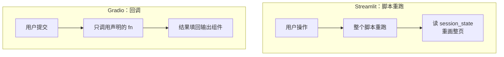

# 第 03 课　Streamlit 与 Gradio

上一课为一个聊天页手写了几十行 HTML、CSS 和 JS。本章的主战场是 AI 逻辑，不是前端。这一课介绍两种几乎不写前端就能搭出界面的工具，它们的设计思路不同。

## Streamlit：整个脚本重跑一遍

Streamlit 的模型是：你的 .py 文件就是界面本身。每点一次按钮、每改一次输入框，Streamlit 把**整个脚本从头到尾重新执行一遍**，界面整体重画。

这个设计省心，代价是重复执行。跨交互的记忆靠 `st.session_state`：每次重跑前，Streamlit 把上一次交互保存的数据恢复出来。用 `@st.cache_data` / `@st.cache_resource` 装饰的代码在重跑时直接读缓存，模型加载这类耗时操作只执行一次。

## Gradio：声明"函数 + 输入 + 输出"

Gradio 的模型是：写好一个函数，声明输入用什么组件、输出用什么组件，页面由它自动生成。你只提供函数与组件声明，布局和页面渲染交给 Gradio。



## ui_demo.py：先看数据流，再跑真界面

先跑零依赖版，把两种执行方式打印出来观察（控制台中文乱码时改用 `PYTHONIOENCODING=utf-8 python ui_demo.py`）：

```
python ui_demo.py
```

注意输出里的细节：Streamlit 式模拟里，"打字"那次没有触发模型、点击才触发，而且第二次提问时第一次的问答还在，这就是"重跑但状态不丢"。Gradio 式模拟里则是一次提交对应一次回调。

装好 Streamlit 之后（缺库时脚本会打印中文提示并跳过真实界面段），**同一个文件**可以直接跑出真实界面：

```
pip install streamlit
streamlit run ui_demo.py
```

界面代码已经用 Streamlit 写在这个文件里，`streamlit run` 时自动切换到界面模式，输入框、按钮、聊天记录都会出现，而背后的 `model()` 函数没有变。

Gradio 版十几行，`ui_demo.py` 里也备好了（装好后运行 `python ui_demo.py --gradio`，或取消注释 `launch_gradio()`）：

```python
import gradio as gr   # pip install gradio

demo = gr.Interface(
    fn=你的函数,
    inputs=[gr.Textbox(label="问题"), gr.Slider(0, 1, 0.7, label="温度")],
    outputs=gr.Textbox(label="回答"),
    title="迷你问答机器人")
demo.launch()
```

## 两者怎么选

| | Streamlit | Gradio |
|---|---|---|
| 心智模型 | 脚本重跑 + session_state | 函数 + 组件声明 |
| 擅长 | 多步骤应用、Dashboard、带状态的小工具 | 模型演示页：拖张图、传段音频就能测 |
| 上手门槛 | 要理解"重跑"这套逻辑 | Interface 三件套几乎零概念 |

共同点：适合原型和演示。需要产品化（多用户、登录、精细权限）时，回到第 01/02 课的 FastAPI 加前端路线。判断标准：给同事演示效果，用这两个；给用户天天使用，用 FastAPI。

## 想一想

1. Streamlit 里如果不用 `st.session_state`，用户点一次按钮后，上一次的聊天记录会怎样？为什么？
2. `@st.cache_resource` 为什么必须存在：模型加载要十秒，而脚本每次交互都重跑，不做缓存会发生什么？
3. 你刚训好一个图像分类模型，想让标注同事拖图进来快速试用，选 Streamlit 还是 Gradio？说出理由。
4. 轻动手：在 `ui_demo.py` 的 `model()` 里加一条你自己的问答，重跑零依赖模拟，再判断它会不会自动出现在 Streamlit 界面里。

## 小结

Streamlit 把脚本当界面，交互一次重跑一次，状态靠 session_state 和缓存保持。Gradio 声明函数和组件，页面自动生成，适合模型演示页。两者都能跳过前端开发，把精力放在 AI 逻辑上；原型阶段用它们，产品化回到 FastAPI。

功能越加越多时，主文件会膨胀、职责混杂。下一课用插件系统解决这个问题：让功能模块可以插拔。

2026 年 10 月
