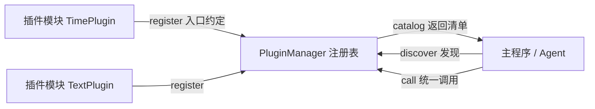

# 第 04 课　AI 插件系统

前三课的功能都集中在一个文件里，尚可维护。当应用要接入十几个功能（查时间、算字数、判断情绪、连数据库、调搜索），全部塞进主程序会出现两个问题：改一个小函数可能影响其他功能；其他人想加功能，需要读懂全部代码。

插件的做法是提供 **USB 接口**式的统一约定：设备各不相同，但插口统一，任何设备即插即用，主设备不需要为某个设备做改造。插件系统就是给 AI 应用提供一组统一的插口。

## 三件套：注册、发现、调用

核心是**入口约定**：主程序不 import 具体插件、不关心插件写在哪个文件，只要求每个插件模块提供 `register(manager)` 这一个入口。运行 `python plugin_demo.py`，对照代码看输出：

- **注册**：`@manager.register("名字", description="...")` 装饰器一行登记；`TimePlugin` 登记一个，`TextPlugin` 登记两个
- **发现**：`manager.discover([TimePlugin, TextPlugin])`，按入口约定批量登记；接入新模块只需往列表里加一个名字
- **调用**：`manager.call("word_count", "文本")` 统一入口，内部查表、查开关、执行；出错时打印中文提示而不裸抛（一个插件出错不能拖垮主程序）
- 清单：`manager.catalog()` 返回插件清单，上层靠它知道当前可用哪些工具
- 开关：`disable("sentiment")` 之后调用被直接拦下，`enable` 恢复，这就是热插拔

自检：`python plugin_demo.py --selftest` 自动验证注册、发现、调用、开关、容错全链路。控制台中文乱码时用 `PYTHONIOENCODING=utf-8 python plugin_demo.py`。

## 与 MCP 的关系

第 6 章讲过 MCP（模型上下文协议），它已是 AI 工具接入的行业标准。两者思想同源：统一入口、自我描述、动态发现。区别在规模：MCP 把这套约定升级为跨进程、跨语言的协议，工具可以运行在其他机器上、用其他语言编写；本课手写的 `PluginManager` 是它的最小原型。亲手实现过一次最小版，协议的内部结构就容易理解了。

## 收束：回第 12 章给项目加界面

第 12 章实战项目当时交付的都是命令行版，因为界面技能安排在第 14 章。现在四课齐了，可以回去补上界面：

| 第 12 章项目 | 现在能加的界面 | 用哪课 |
|---|---|---|
| 12.1 本地知识库 RAG | Streamlit 页：输入问题→显示答案和出处 | 第 03 课 |
| 12.2 Agent 任务执行系统 | FastAPI 接口 + 执行日志流式推送 | 第 01/02 课 |
| 12.3 智能客服机器人 | 聊天网页：连续对话、逐字回复 | 第 02 课 |
| 12.4 监控 Dashboard | Streamlit 面板读报告 JSON，指标变图 | 第 03 课 |
| 12.7 企业 AI 助手 | 完整聊天应用 + 工具插件化 | 第 02/04 课 |

手法相同：把项目里的核心函数接到第 01 课 `fake_model` 所在的位置，业务逻辑一行不改。第 12 章的核心逻辑与带界面的完整形态之间，差的只是这一步接入。

## 想一想

1. `call()` 里为什么要用 try/except 包住插件执行？不包的话，一个插件出 bug 会连累谁？
2. `catalog()` 返回的清单，在 Agent 系统里对应什么？LLM 是靠它决定"用哪个工具"的吗？
3. 想给现有系统加一个"翻译插件"，需要改动主程序代码吗？你的插件文件需要满足什么约定？
4. 轻动手：照 `TextPlugin` 的样子写一个 `NumberPlugin`（插件名 `double`，输入数字字符串，返回翻倍结果），注册进 manager 并调用验证。

## 小结

插件系统三件套：注册、发现、调用，靠一个入口约定把"加功能"变成"插上去"。统一的 call 入口让主程序与插件互相隔离，单个插件出错不影响全局。这套思想与 MCP 同源，是 Agent 工具体系的原型。到这里，全书主线收束：模型（第 2 章）、调用（第 3 章）、编排（第 4 章）、RAG（第 5 章）、Agent（第 6 章）、工程化（第 10~13 章）、界面与扩展（本章）。你已经能独立做出一个可演示、可扩展的 AI 应用。回第 12 章，给你喜欢的项目加上界面，形成完整作品。

2026 年 10 月
